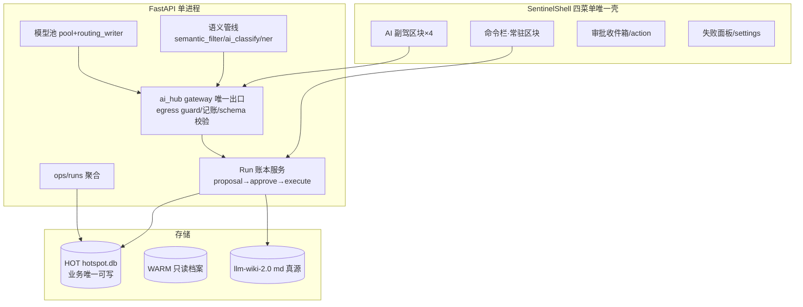
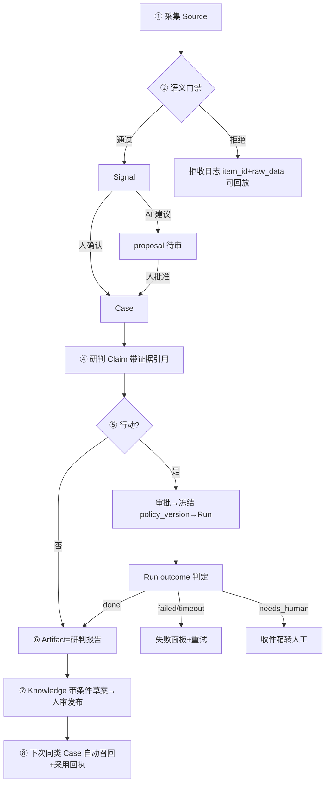

# Hotspot v0.8.6 改造 PRD — AI Native 证据工作台

> **版本**: 0.8.6 (改造版)
> **日期**: 2026-10-02
> **状态**: **已定稿（2026-10-02，owner 指令"回写主 PRD"即定稿）**——路线已回写 `docs/HOTSPOT_SECURITY_AI_WORKBENCH_PRD.md`（变更记录 v0.8.6-A 条目；2026-09-15 九章版 §8 路线被本版取代，其第 1–7 章产品语义保留为长期方向）；留痕 `docs/audit/PRD_ALIGNMENT_AUDIT_2026-10-02.md`。本文件为 0.8.6 版本族详细文档
> **基线**: `18dd6f3` (v0.8.5 + NAV4 + P3 + DEV-0239~0248)
> **输入**: `docs/audit/FIRST_PRINCIPLES_REDESIGN_2026-10-02.md`（六根因/19 证据/S1-S3）+ 其复审意见（E7/E8 修正、E19 提级、manifest 降级）+ 既有权威 PRD
> **裁决记录**: owner 已裁决 AI Native = 四轴全选（Agent 优先工作循环 / 模型驱动管线 / 全界面 AI 副驾 / 对话式驱动，均为主轴设计）。继承审计 §7.2 待裁决项的建议裁决：**D1=(a) 安全从业者工作台，主干优先**（本 PRD 立场）；**D2=(b) 主干做到执行+产物（含 pi 执行体）**（用例 A/C 依据）；D3=保守冻结（不激进的删除）；D4=维持中文硬编码；D5=先修竞态不引状态库；D6=长期单用户；D7 见 P0-3（全入口覆盖，回环单机默认免 token 但入口不豁免）。D1/D2/D7 为 PRD 立场，定稿时 owner 可改。

---

## 第1章 · 产品概述与目标

### 1.1 背景与痛点（≤3 句）

v0.8.5 之前的 24 天里，系统以 405 次提交建成了 485 端点/58 job/153 服务的完整能力面，但真实工作主干（资讯→Case→执行→产物）流量为零：31,907 条 hotspots 只转化为 13 条 signals、0 条 runs、0 个 artifacts。第一性原理审计（2026-10-02）将根因收敛为六条：主干是旁路（R1）、失败即沉默（R2）、控制面是散文（R3）、三套本体（R4）、无删除纪律（R5）、边界可选且写入不原子（R6）。0.8.6 的使命不是再加能力，而是**换主干**：让已有能力围绕"可验证的安全判断"重新产生流量。

### 1.2 产品定位

**面向安全从业者的单机 AI Native 证据工作台**：Agent 产出提案、人负责审批、Run 账本记录一切、每个结论带证据引用、每次失败显式可归因。

### 1.3 核心目标（基线 → 目标，30 天窗口）

| # | 目标 | 基线 (2026-10-02) | 目标 |
|---|------|------------------|------|
| G1 | 主干流量跑通 | v1_runs=0 / v1_artifacts=0 | **≥10 条真实 Run、≥5 个可验证 Artifact**（全程 run record） |
| G2 | 失败可见性 | 静默失败 3 类（gate-detect fail-open 1,006 次/写库失败 439 次/55 job 静默 misfire） | **该 3 类失败 100% 落显式 outcome**，失败面板可见 |
| G3 | AI Native 采纳 | 四轴均为 0 | **四轴各自产出 ≥1 个可验证 Artifact**（含对话式通道） |

### 1.4 成功指标

- 主干转化率：hotspots→signals ≥ 0.5%（现 0.041%，绝对值 ≥120 条/30 天）
- 信号→Case→Run→Artifact 全链在 UI 内可追溯（任一 Artifact 能回溯到原始 Source）
- 静默失败数（生产日志中"失败但无 outcome 记录"的消息类）：降为 0 类
- `/api/ops/runs` 任一 job 失败 24h 内可在 UI 查到原因

### 1.5 竞品与差异化

[假设] 本产品为单人内部工具，以下竞品为设计参照而非直接对位（owner 未指定竞品）：

| 竞品 | 类型 | 核心功能与设计要点 | 可借鉴 | 差异化点 |
|------|------|------------------|--------|---------|
| Microsoft Security Copilot | 商业 | 自然语言安全问答 + Agent 工作流（微调查/脚本分析），权限与审计内建 | 对话式入口即审计对象：每轮交互落 session 记录 | 我们以本地 SQLite 账本替代云端 session，单机可审计 |
| Google Gemini for Security | 商业 | 模型按任务分层（Gemini Flash/Pro 分档），能力以 Assisted workflows 嵌入既有界面 | 分档路由 + 界面内嵌辅助（对应 M2/M3 两轴） | 我们模型池开放国产 9 平台自选，不被单一厂商锁定 |
| OpenBAS (Filigran) | 开源 | 攻防仿真平台：Action→Injector→Result 全程原子化执行记录 | Run 账本设计（outcome 枚举、防"成功但无产物"） | 我们面向单人研判工作流而非团队仿真 |
| DefectDojo | 开源 | 漏洞管理：Finding 带证据引用 + 复测/覆盖生命周期 | 证据回执（evidence receipt）一等公民 | 我们从资讯侧切入，覆盖采集→研判全链 |

### 1.6 名词解释

| 术语 | 定义 |
|------|------|
| **Run 账本** | 贯穿 Case→Claim→执行→产物的执行记录表；outcome ∈ {done, failed, cancelled, timeout, needs_human}，禁止"成功但无产物" |
| **提案 (proposal)** | Agent/模型产出的候选动作或结论；未经人审批前不得成为事实（人主律） |
| **证据回执 (evidence receipt)** | 结论到原始 Source 的最小引用单元（含哈希/抓取时间），v1_evidence_receipts 表 |
| **主干/支路** | 主干 = 资讯→Signal→Case→Claim→Run→Artifact→Knowledge 的用户工作流；支路 = 系统自维持（索引/门禁日志/自检） |
| **空转** | job 周期性运行但 candidates=0 且无状态变化（审计实测 kl 管线 7,643 次） |
| **静默失败** | 失败被降级吞掉且无 outcome 留痕（fail-open、WARNING 后继续、misfire 丢弃） |
| **模型池** | 内置国产 9 平台 + 密钥保险箱 + /models 探测（DEV-0244 已落）；与 llm.yaml 路由（DEV-0245）分权 |
| **档位路由** | task_overrides 三档锚点：t1_score=STANDARD / t3_summary=HEAVY / t3_chunk_summary=FLASH |
| **AI Native 四轴** | ①Agent 优先工作循环 ②模型驱动管线 ③全界面 AI 副驾 ④对话式驱动（owner 全选为主轴） |
| **壳纪律** | v0.8.5 SentinelShell 四菜单唯一壳；新能力只能以区块进入，禁止新一级入口 |

---

## 第2章 · 用户画像与场景

### 2.1 主要用户画像

单用户（owner）：安全研究者/从业者，技术能力强，能容忍 CLI 与半成品，但要求**结论可辩护**（每个判断能拿出证据链）。同时是本系统唯一运维者——"失败可见"对其等于"系统能被信任"。

### 2.2 核心使用场景（用户故事）

1. **每日情报研判**：作为安全研究者，我希望打开 `/` 资讯流时 AI 已按我的关注域完成语义筛选与初步研判建议，以便我把 30 分钟花在 20 条高价值候选上而非 1,400 条原始资讯上。
2. **信号成案**：作为研究者，我希望对一条高置信 Signal 一键确认成 Case，AI 同步起草研判（带证据引用）供我修订，以便一条资讯当天变成一份站得住的判断。
3. **执行与产物**：作为研究者，我希望 Case 里的 Action 经我审批后由 Agent（pi）执行并登记可验证 Artifact（含哈希），以便"完成"是可证明的而非宣称的。
4. **复盘与复利**：作为研究者，我希望 Case 关闭时 AI 自动生成带适用条件的知识草案供我发布，以便下一个同类 Case 自动召回它并记录采用回执。
5. **对话式调查**：作为研究者，我希望在命令栏输入"过去两周勒索软件相关的高置信信号"，得到可追溯的查询结果与建案建议，以便不点穿多层菜单。
6. **运维可见**：作为运维者，我希望失败面板默认展示"过去 24h 什么失败了/降级了/静默了"，以便系统失诚实 时我知道。

### 2.3 使用频率与时长

每日 30–60 分钟（研判 + 审批）；事件驱动（告警→成案）若干次/周；每周一次复盘与失败面板巡检。自动化（采集/门禁/聚合）7×24 后台。

---

## 第3章 · 功能模块与范围

### 3.1 范围边界

| 本次 (0.8.6) 做 | 明确不做 | 留待后续迭代 |
|----------------|---------|-------------|
| F0 止血 12 项（E1/S1/S2/E19/E4/E9/E10/DEFAULT_SCORE/降噪/DB 路径/权限位/sync 事务） | 声明式 manifest 大一统（降级为 E11 廉价修法：CORE_ROUTERS 完整性断言） | manifest 控制面（主干立住后评估） |
| Run 账本 + 提案审批循环（M1） | 多用户/鉴权体系升级（维持单用户，D6 裁决为长期单用户） | 三本体合一（hotspots/v1_materials/wiki 共享 ID） |
| AI Native 四轴（M2/M3/M4） | i18n 补齐（D4 裁决：维持现状中文硬编码，移除半吊子 i18n 层另议） | OpenAPI→前端类型生成 |
| 失败面板 + run record 统一（M5） | Skill* 9 包大删除（D3 裁决：保守——冻结不加，不做激进删除） | schema 快照/迁移连续性校验 |
| 拒绝可回放（item_id + raw_data） | 移动端/局域网多端 | 前端统一 server-state 层（D5 裁决：先修竞态，TanStack 另议） |
| warm 索引/原子写/misfire 声明 | 新采集源、新门禁、新 skill | 日志 293MB→归档策略细化 |

#### 0.8.7 候选表（审计遗留项登记，来源：v0.8.6 PRD 覆盖核对 2026-10-02）

> 以下 9 项来自 `FIRST_PRINCIPLES_REDESIGN_2026-10-02.md` 审计但**未纳入 0.8.6 范围**，在此显式登记为 0.8.7 候选——消除"既不在做也不在不做"的无删除纪律灰区。排序按严重度；0.8.7 立项时逐项复核优先级（届时基线可能已变）。

| # | 候选项 | 审计出处 | 严重度 | 备注 |
|---|--------|---------|--------|------|
| C1 | except 分级治理（1,019 处宽泛 `except Exception`，133 处完全静默） | F4-4 / R2 | 高 | R2 根因的另一半；0.8.6 的 G2 只治 3 类代表；建议 0.8.7 首位 |
| C2 | `_bulk_syncing` 无 try/finally（异常后事件桥永久静默死亡） | E6 / R2 | 中 | 改造量小，可与 C1 同批 |
| C3 | 密钥分离：vault key ≠ sync bundle key + 轮换后旧包可解 | F4-5 / R6 | 中 | |
| C4 | 供应链收紧：`npm ci`、action SHA 固定、`permissions:` 块、dev/optional 依赖入 pip-audit | F4-7 / R6 | 中 | |
| C5 | WebDAV 备份远端推送明文（除密钥外全部明文） | R6-MEDIUM | 中 | 与 C3 同域 |
| C6 | 备份恢复演练进 CI（`restore_from_backup` 无测试） | F4-3 / R6 | 中 | 0.8.6 §9.2 仅做最小版（启动失败提示） |
| C7 | 双门禁系统合一（feature_gates.toml × config.feature_*） | R4 | 中 | 需先积累 manifest 廉价修法（P0-8）的运行经验 |
| C8 | secnews 组件域收敛（26 组件/测试覆盖 19%，与 sentinel 重叠） | R5 | 低 | 与 Skill* 裁决（D3 保守）联动，待 D3 解冻 |
| C9 | 重复 helper 收敛（`_now_iso` ×22 等 AST 体重复） | F3-5 / R5 | 低 | 机械工作，可穿插 |

### 3.2 模块总览

```mermaid
graph TD
    subgraph M0[F0 止血与可见]
        M0A[E1 档位 model 真生效] --> M2
        M0B[S1 鉴权全入口] 
        M0C[S2 迁移器幂等]
        M0D[E19 warm 索引]
        M0E[run record 统一] --> M5
    end
    subgraph M1[Run 账本与审批循环·轴①]
        M1A[proposal 提案表] --> M1B[审批收件箱]
        M1B --> M1C[执行体 pi/ai_hub]
        M1C --> M1D[Artifact 登记]
    end
    subgraph M2[模型驱动管线·轴②]
        M2A[模型池+档位路由] --> M2B[语义门禁主流量]
        M2B --> M2C[T4 真发布门]
    end
    subgraph M3[全界面 AI 副驾·轴③]
        M3A[情报流研判建议] 
        M3B[知识自动摘要]
        M3C[案件证据召回]
        M3D[SK-04 复盘草案接线]
    end
    subgraph M4[对话式命令栏·轴④]
        M4A[NL 意图路由] --> M4B[动作执行]
        M4B --> M1C
    end
    subgraph M5[失败面板]
        M5A[/api/ops/runs] --> M5B[失败优先视图]
    end
    M2B --> M1A
    M3C --> M1A
    M4B --> M1D
```

### 3.3 模块清单与优先级

| 模块 | 功能点 | 优先级 | 依赖 |
|------|--------|--------|------|
| M0 止血 | F0-12 项（见 §10 P0 表） | **P0** | 无 |
| M1 Run 账本 | v1_runs 扩列（plan_json/policy_version/outcome/reason）；proposal CRUD；审批收件箱；pi 执行体；Artifact 登记 | **P0** | M0(run record) |
| M2 模型管线 | E1 修复后档位 model 真路由；semantic_filter/ai_classify/pipeline_ner 为主流量；**T1 评分修复先行** + T4 真门（前置见 P1-2，防死锁） | **P0** | M0-E1 |
| M3 界面副驾 | 四菜单区块：研判建议卡/摘要卡/召回卡/复盘草案卡（全部走提案通道，人审后生效） | P0 设计轴 / P1 交付（分波，见 §10） | M1 |
| M4 命令栏 | Shell 常驻命令输入；固定四类意图模板（查询/建案/出报告/执行，不做通用 NLU）；全部动作产生 run record | P0 设计轴 / P1 交付 | M1 |
| M5 失败面板 | /api/ops/runs + /settings 运维区失败优先视图 | **P0** | M0-run record |

注：owner 裁决四轴均为 P0 主轴**设计**；交付顺序按依赖分波（§10 P1 内排序），M3/M4 不与 M1 并行开工。

### 3.4 P0 功能用例式详述

#### 用例 A：审批循环（M1，轴①核心）

- **前置条件**：一条 Signal 已被人工确认成 Case；模型池至少一平台可用。
- **主流程**：Case 页点"AI 起草研判" → ai_hub（HEAVY 档）生成草案 → 以 proposal 落库（status=draft，含 evidence_receipts 引用与 prompt 版本）→ 审批收件箱出现待审项 → 人修订并批准 → 触发 Run（actor=human+agent 双签）→ Run 落 outcome=done + Artifact（md/JSON 产物，含 sha256）→ Artifact 关联回 Case。
- **异常流程**：LLM 超时/拒绝 → proposal 落 outcome=failed（**不回落默认值、不缓存**），收件箱显示失败原因与重试按钮；执行体 pi 不可用 → Run=needs_human，收件箱转人工；产物哈希校验失败 → Run=failed + 告警事件。
- **涉及数据**：v1_proposals（新）、v1_runs（扩）、v1_artifacts、v1_evidence_receipts、llm_usage_log。
- **验收标准**：①任一 Artifact 可从 UI 一路回溯到 Source 原文；②构造 LLM 超时用例，断言 proposal.outcome=failed 且无默认值污染；③v1_runs 月增 ≥10。
- **实现裁决（2026-10-03 P1-1 切片2，DEV-0264）**：① "evidence_receipts 引用"落为 `evidence_ids_json` = Case 绑定的 v1_materials id 列表（经 v1_case_materials；material.url 即 Source 原文，构成 Artifact→Run→Proposal→Case→Material.url 回溯链）；② HEAVY 档以 `task="report"` 命中 model_router t3_summary（config/llm.yaml: sensenova deepseek-v4-pro），零配置改动；prompt 版本冻结为 `judgment-draft@v1`；③ 批准 judgment_draft 时 Run 先 `running`，md 落盘 `data/run_artifacts/<run_id>.md` 并经 ArtifactService R08 读盘 sha256 比对登记成功后才 `succeeded/done`；落盘/哈希失败 → status=failed+outcome=failed（告警 outbox 留待 G1 批次）；④ 起草端点 `POST /api/proposals/draft-judgment`，模型失败回 HTTP 200 + status=failed（收件箱可重试），无绑定证据 400。failed Run 重试端点未做。
- **实现裁决（2026-10-03 P1-1 切片3，DEV-0265，UI 落地）**：① 收件箱区块 `frontend/src/components/action/ApprovalInbox.tsx` 以页内 `<section>`（PANEL_SHELL 同款令牌）挂入 `/action`（`SentinelActionPage`，位于 ExecOverviewPanel 之前），**不新增路由/一级入口**（NAV4 四菜单纪律）；并行拉 `?status=draft` 与 `?status=failed`，拉取失败显 unavailable 不伪装空态；提案卡字段对齐 §7 = 类型/发起方/证据数/case/prompt 版本/正文预览，judgment_draft 与 knowledge_draft 挂「写操作」橙标。② 批准两步内联确认（按钮文案明示「将生成双签 Run」），修订=受控展开 JSON 原文，非法 JSON 客户端拦截不发请求；驳回原因必填、>200 客户端先挡（后端 400 兜底）。③ failed 卡显示 error_msg；重试=对原 case_id 再调 draft-judgment 生成**新提案**（无专用重试端点；无 case 锚点的失败提案按钮禁用）。④ Case 页按钮 `AI 起草研判` 改接 `/api/proposals/draft-judgment`（无证据前置警告；status=failed 走错误 toast 并指引到收件箱）；旧 `POST /api/v1/judgments/generate`（dsh 绕过审批）前端按钮退役、端点保留，收编另开工单。验收①UI 回溯链的收件箱端到此闭环（Artifact 详情侧回溯入口属既有 Case 页能力，本批未新增）。

#### 用例 B：对话式命令栏（M4，轴④）

- **前置条件**：Shell 已登录（回环单用户）；命令栏常驻四菜单顶部。**范围约束（审查二）**：意图集固定为四类模板（查询/建案/出报告/执行），本地规则优先匹配；**不做通用 NLU、不做自由对话**——识别不中即显式列出可选动作，防止命令栏演化为第二个 Skill* 平台（R5 教训）。
- **主流程**：输入自然语言 → 意图路由（本地规则优先：查询类直接 SQL/FTS；行动类生成 proposal 进审批流）→ 返回带引用的结果卡 → 每次执行写 run record（含原始输入、意图判定、动作、outcome）。
- **异常流程**：意图不可识别 → 显式回复"未理解，可选动作：…"（不猜）；行动类未获批 → run=cancelled；LLM 解析失败 → failed，附原始输出。
- **涉及数据**：command_log（新表：input/intent/action/outcome/timestamp）、复用 M1 链。
- **验收标准**：①"查过去两周 X 的高置信信号"返回结果带来源链接；②"为 X 建案"生成 proposal 而非直接建案；③每条命令在 /api/ops/runs 可查。
- **实现裁决（2026-10-03 P1-4，DEV-0272，已交付）**：① 命令栏常驻 masthead（四菜单右侧），零新路由；意图路由 = `parse_intent` 纯函数本地规则（确定性 regex），查询类 v1_signals JOIN v1_materials LIKE 检索带 Source url（验收①），建案/出报告 → `create_proposal(source='command')` 进审批流（验收②）；② 验收③ 回写：命令 run record 落 command_log（本条"涉及数据"本就指定），查询口 = **GET /api/commands**（/api/ops/runs 是 job_runs 专用口，不混入）；行动类经人批准后另产生 v1_runs（proposal.run_id 关联）；③ 执行类意图：识别到但 pi 执行体未接入（P1-1 后续批次）→ 诚实返回 outcome=unsupported + 指引可用动作，不伪装 proposal（P0-6 纪律）；④ 意图不可识别 → intent=unknown + 可选动作清单（不猜）。

#### 用例 C：E1 档位 model 真生效（M0，兼修 DEV-0245 欠账）

- **前置条件**：模型池已写入 t3_summary → sensenova/deepseek-v4-pro（DEV-0245 能力）。
- **主流程**：触发 deep_read → gateway `_resolve_model` 改为优先消费 task_overrides 的 model → llm_usage_log 记录实际 model。
- **异常流程**：override 指向不可用 provider → 走 fallback_order 且 usage_log 记 config_source=fallback。
- **验收标准**：①deep_read 实际模型=override 声明值（usage_log 断言），不再恒跑 flash-lite；②yaml 注释与实现一致；③DEV-0245 写入的 model 字段从"装饰"变"真实生效"。

### 3.5 模块依赖关系

M0 全部先行（1–2 周）→ M1+M2 并行（主干+管线）→ M3+M4（依赖 M1 提案通道）→ M5 随 M0 起步、随各模块持续接入。任何模块的 AI 动作**只能**经 proposal 通道生效（人主律），命令栏与副驾不得绕过。

---

## 第4章 · 系统架构设计

### 4.1 技术架构



架构裁决（继承审计方案 + 复审修正）：
1. **不做 manifest 大一统**；E11 用廉价修法：`CORE_ROUTERS` 断言补完整性检查（每 router 必须出现在 core 或 extension 之一，CI 阻断）。
2. **AI 层五条硬规则**：仅 gateway 可带凭据出站（image_service 收编）；模型永不宣称成功（删 DEFAULT_SCORE，失败即 failed 不缓存）；prompt 版本入 llm_usage_log；AI 输出过 schema 校验才落库；token 用 provider 返回值。
3. **Run 是账本不是附属表**：所有执行（job/命令/审批/管线）统一 run record 结构。
4. 壳纪律不变：命令栏与副驾均为区块，不新增一级路由。

### 4.2 文件结构（增量）

```
backend/
├── api/run_ledger_api.py        # proposal/approve/run/artifact 端点
├── api/ops_runs_api.py          # /api/ops/runs
├── api/command_api.py           # 命令栏意图路由
├── services/run_ledger_service.py
├── services/command_service.py
├── repository/migrations/131_run_ledger.sql   # v1_runs 扩列 + v1_proposals + command_log
frontend/src/components/
├── sentinel/CommandBar.tsx      # Shell 常驻
├── action/ApprovalInbox.tsx     # /action 区块
├── settings/OpsRunsPanel.tsx    # 失败面板
```

### 4.3 数据层

HOT 唯一可写业务库；WARM 只读（禁裸 `warm.X` 字面量，跨库走 accessor）；md 真源。投影契约分级（复审修正）：`entities/compiled` 属真源缺列须补；`attention_score` 标注为派生缓存可丢。孤儿清理改为 dry-run+计数上限+审计日志（复审修正：非禁止删除，是删除可审计）。

### 4.4 外部依赖

无新增运行时依赖；pi 子进程与国产 9 平台 API（模型池已接）。

---

## 第5章 · 业务流分析

### 5.1 主干流（替换三条互不连通的流）



### 5.2 异常流（一等公民）

| 异常 | 必须产生 | 现状→目标 |
|------|---------|----------|
| AI 超时/拒绝 (现 1,006 次静默) | run.outcome=failed + 原因 | fail-open 放行 → 显式失败 |
| 写库失败 (现 439 次) | 落 OPS 告警事件 | WARNING → 面板可见 |
| job misfire (现 55/58 静默丢) | run.outcome=missed | 丢弃 → 记录（grace≥900s） |
| 门禁异常 | gate_error（不冒充通过） | fail-open → fail-closed 语义（pipeline 与 _wrap_exception 统一） |
| 全源失败 | run=failed，不得沿用上轮 | 沿用 → 诚实 |
| 执行越界/超时 | timeout/needs_human + 审计 | 无执行体 → M1 落地 |

### 5.3 模块联动

语义管线（M2）的输出（Signal 置信度）喂给副驾（M3）的研判建议；建议确认后走 M1 提案通道；命令栏（M4）是 M1 的另一入口；一切执行进 M5 可见。

---

## 第6章 · 界面与信息结构

### 6.1 信息结构（四菜单不变，区块增量）

```
SentinelShell (四菜单 + 管道心跳条)
├── CommandBar (常驻顶部区块, 轴④) —— 非一级路由
├── / 资讯: 情报流 + AI 研判建议卡 (每 Signal 侧栏: 置信度/建议理由/建议成案按钮)
├── /knowledge: 条目详情 + 自动摘要卡 + 关联证据卡
├── /action: 审批收件箱 (proposal 列表: 来源/类型/证据数/一键批准或修订) + Case 队列 + Artifact 列表
└── /settings: 运维区 + 失败面板 (默认视图=过去24h failed/missed/needs_human)
```

### 6.2 关键界面规则

- **命令栏**：占位"输入指令或问题（查询/建案/出报告）"；Enter 提交；不可识别意图时显式列出可选动作（必填错误提示，禁止猜测执行）；每条结果显示来源引用链接（可点击回原文）。
- **审批收件箱**：proposal 卡必显字段=类型/发起方(agent|command)/证据引用数/风险提示（写操作标橙）；批准=主按钮+二次确认（写操作）；修订=展开原文可编辑后批准；驳回=必填原因（≤200 字）。
- **失败面板**：列表按严重度排序（failed>missed>needs_human）；每行=时间/对象/原因摘要/重试按钮（幂等动作）；空态文案="过去 24h 无失败记录"（真空态，禁止与加载失败混淆——继承 DEV-0239 教训）。
- **Artifact 卡**：必显 sha256 前 8 位 + 验收状态 + 回溯链接（Source→…→Artifact 链条面包屑）。

### 6.3 原型说明

不做高保真原型；交互以上述规则 + 既有 st-* 设计系统为准。

---

## 第7章 · 操作流分析

### 7.1 日常（每天）

1. 打开 `/`：看 AI 已筛选的 20 条候选（每条带研判建议）→ 修订/确认 1–3 条成 Case；
2. `/action` 收件箱：处理隔夜 agent 提案（批准/驳回/修订）；
3. 命令栏随手查证（"X CVE 影响面"→带引用结果）。

### 7.2 周期（每周）

失败面板巡检（周一）：上周 failed/missed 清零或归因；复盘一个已关 Case → 发布知识 → 验证召回。

### 7.3 自动化（系统）

采集→语义门禁→Signal 聚合→知识管线（T1-T5）→投影重建（04:10）→run record 全程落账；job 失败/错过自动进面板。

---

## 第8章 · 数据模型设计

### 8.1 核心实体（增量，migration 131）

**v1_runs（扩列）**：

| 字段 | 类型 | 约束/默认 | 说明 |
|------|------|----------|------|
| id | INTEGER PK | 自增 | |
| case_id / claim_id | TEXT | FK, 可空 | 关联工作单元 |
| actor | TEXT | NOT NULL | human / agent:pi / agent:ai_hub / command |
| input_ref / plan_ref | TEXT | 可空 | 输入与计划引用 |
| policy_version | TEXT | NOT NULL | 执行时冻结的策略版本 |
| outcome | TEXT | CHECK IN (done,failed,cancelled,timeout,needs_human,missed) | NOT NULL |
| reason | TEXT | 可空 | 失败/转人工原因 |
| cost_tokens / duration_ms | INTEGER | 可空 | |
| started_at / ended_at | TEXT | NOT NULL / 可空 | |

**v1_proposals（新）**：id / case_id（judgment_draft 归属，可空）/ source(agent|command|copilot) / kind(judgment_draft|case_suggestion|knowledge_draft|report) / payload_json（CHECK length ≤ 65536，防大对象入库）/ evidence_ids_json / prompt_version / status(draft|approved|rejected|expired|**failed**) / error_msg（failed 时 LLM 超时/拒绝原因，对应用例 A② 收件箱失败可重试；§8.1 初版四态漏列，2026-10-02 P1-1 切片1 补齐）/ reject_reason（人驳回，必填 ≤200）/ reviewed_by / reviewed_at / run_id（批准后关联 v1_runs）/ created_at。

**command_log（新）**：id / input_text / intent / action_ref / run_id / outcome / created_at。

**拒收日志（055 扩列）**：+item_id、+raw_data（JSON，≤16KB）。

### 8.2 字段-功能映射（轻量字典）

| 字段群 | 读 | 写 |
|--------|----|----|
| v1_runs.* | 失败面板/Artifact 回溯/G1 统计 | 全部执行路径（审批/命令/job） |
| v1_proposals.* | 收件箱/副驾状态 | M3 副驾、M4 命令栏、M1 起草 |
| command_log.* | /api/ops/runs 过滤 | 命令栏 |
| 拒收.raw_data | 拒收回放 UI | quality_hook |

### 8.3 数据流转

hotspots→(语义门禁)→Signal→(人审/proposal)→Case→Claim→Run→Artifact→Knowledge(md)→投影(watchdog)→FTS；一切异常态汇入 v1_runs 由失败面板消费。

---

## 第9章 · 非功能性需求

### 9.1 性能

- E19 修复后 `warm.knowledge_items` 查询 SCAN→SEARCH（EXPLAIN 断言进 CI）；管线 tick 端到端 ≤ 现基线。
- 命令栏查询类响应 P95 ≤ 3s（本地 SQL/FTS）；行动类即时落 proposal（异步执行）。
- 无并发用户要求（单用户）。

### 9.2 可靠性

- 迁移器：duplicate column 语句幂等跳过但**继续执行文件剩余语句**；半应用禁止（S2）。
- sync apply_bundle 事务化：全成功才写 merge base（S3）。
- job 全量显式 misfire_grace_time≥900s + max_instances=1（E4）；collect 错过补跑一次。
- DB 损坏自动回退最新快照（F4-6 提前到本版做最小版：启动失败时提示恢复命令而非裸 raise）。

### 9.3 埋点

run record 即埋点：G1/G2 指标全部从 v1_runs/v1_proposals/command_log 聚合，无额外埋点需求。

### 9.4 安全与合规

- S1：TokenAuth 覆盖 `/mcp/sse`、`/docs`、`/openapi.json`（或显式豁免+文档）；纯回环下风险 MEDIUM、LAN 暴露 HIGH（复审定级），修复不区分场景。
- 正文抓取恢复 URL 校验（SSRF 阻断内网）+ 移除 `ssl=False`（F0-11）。
- 库/备份文件 0600；HOTSPOT_DB_PATH 绝对路径化（F0-12）。
- 合规矩阵（等保/GDPR/ISO27001）已有 Security Graph 承载，本版不动。

---

## 第10章 · 开发优先级与里程碑

### Phase P0 — 止血与可见（2 周，14 项）

| # | 任务 | 治 | 验收 |
|---|------|----|------|
| P0-1 | **E1 档位 model 真生效**（gateway 消费 override.model；兼修 DEV-0245 欠账） | R3 | 用例 C 验收 |
| P0-2 | **E19 warm 索引补建**（复审提级：半小时工作量即时收益） | R6 | EXPLAIN SEARCH + CI 断言 |
| P0-3 | S1 鉴权全入口 | R6 | 无 token 访问 /mcp/sse 被 401 |
| P0-4 | S2 迁移器幂等语义修复 | R6 | "已存在列+后续语句"用例后续语句生效 |
| P0-5 | E4 misfire 全量声明 + run record 统一 + /api/ops/runs + 失败面板最小版 | R2 | 任一 job 失败 UI 可查 |
| P0-6 | DEFAULT_SCORE 删除；AI 失败=failed | R2 | 超时用例断言 |
| P0-7 | F0-1 两处写库失败修复（quality_check_logs/warm.hotspots 走 accessor） | R2 | 生产 24h 归零 |
| P0-8 | E9/E10 修复；E11 廉价修法（CORE_ROUTERS 完整性断言） | R2/R5 | ruff F821=0；路由 1path1声明 |
| P0-9 | F0-11/F0-12（SSRF+ssl、路径/权限位） | R6 | 用例阻断；CWD 切换同库 |
| P0-10 | 日志降噪（例行成功→DEBUG） | R2 | 日增量降 ≥80% |
| P0-11 | **E2/F4-1 egress 门禁全覆盖**：image_service 等 3 条裸凭据路径收编 gateway；AST 门禁禁止新增（§4.1 硬规则①落地） | R2/R6 | 带凭据出站路径 5/5 过 check_credential_egress；新增裸 httpx 带 key 调用 CI 红 |
| P0-12 | **E13 门禁双错误策略统一**：`BaseGate._wrap_exception` 与 pipeline 收敛为同一语义（gate_error 显式，不冒充通过） | R2 | 构造 gate 异常用例：pipeline 与单 gate 断言结论一致（均非 passed） |

### Phase P1 — 主干 + 四轴（2.5 周）

| # | 任务 | 验收 |
|---|------|------|
| P1-1 | migration 131 + Run 账本服务 + 审批收件箱（M1）〔切片1 DEV-0263 后端账本 / 切片2 DEV-0264 起草+产物闭环 / 切片3 DEV-0265 收件箱 UI / failed Run 重试端点 DEV-0266 / 旧 generate 端点退役 410 DEV-0267 均已交付〕 | 用例 A 验收 |
| P1-2 | E1 后语义管线主流量化（semantic_filter/ai_classify 進 Signal 主路径）+ **T1 评分链路修复（ai_scores 产出 >0，现基线 0 行）先行** + T4 真门〔T1 修复 DEV-0268 已交付（v1_signal_bridge，ai_scores 421 行/1d）；**T4 真门 DEV-0269 已交付**（SCORE_FALLBACK 双语义移除，无分不放行 + 有分殿后防饿死）；**ai_classify 主流量化 DEV-0270 已交付**（classify_items_with_ai 接采集尾部分类，批级预算 20 防成本失控；semantic_filter 已在 item_builder 主路径，桥内不双判）；**P1-2 全部交付**〕 | signals ≥120/30d（实产 1397 ✓）；T4 真门前置：ai_scores 非 0（达成 ✓），否则管线将死锁于 kl:structure（审查一发现） |
| P1-3 | 副驾四卡（M3，全部走 proposal 通道）〔**DEV-0271 已交付**：四卡挂 /action（CopilotCards 区块，零新路由）——研判建议→draft-judgment / 知识摘要·证据召回·SK-04 复盘→copilot-draft（STANDARD 档）；批准全 kind 产物化（md+sha256），验收"四卡各产出 ≥1 artifact" 由参数化测试锁定；SK-04 直写端点收编另开工单〕 | 四卡各产出 ≥1 artifact ✓ |
| P1-4 | 命令栏（M4）〔**DEV-0272 已交付**：常驻 masthead 零新路由；四类固定意图本地规则路由（查询带 Source url / 建案·出报告生 proposal / 执行类 unsupported 待 pi / unknown 显式可选动作）；全命令 run record 落 command_log，查询口 GET /api/commands（验收③ 原文 /api/ops/runs 为 job_runs 专用，已回写用例 B）〕 | 用例 B 验收 ✓ |
| P1-5 | 拒绝可回放（item_id+raw_data+UI）〔**DEV-0273 已交付**：pipeline strict 拒绝写 gate_name='pipeline' 标记行（区别于 soft 扣分行）；GET /api/quality/rejections 标记行 JOIN raw_items 原文；RejectionReplay 区块挂 ObservabilityTab（零新路由），raw 缺失诚实"未留存"〕 | 任一拒收可看原文 ✓ |
| P1-6 | sync 事务化 + signals 涓流归因报告〔**DEV-0274 已交付**：apply_bundle 经 deferred_commit 单事务原子注入（中途失败整体回滚数据未半写；pull 顺序契约 base 不推进，F1-6 ✓）；顺手修 todos 同步 urgent kwarg 存量静默全废 bug；涓流归因量化 = 唯一源停更 + 主流无桥（转化 0.041%）→ DEV-0268 桥修复后近 7d 2107 条 / 转化率 21.4%（目标带 15-30%），signals ≥120/30d 超额（2117）〕 | 注入失败 base 不推进 ✓ |
| P1-7 | **前端 fetch 竞态修复**（D5 裁决的"先修竞态"落地：24/65 个 fetch effect 竞态点加 aborted/dead 标记，不引状态库）〔**DEV-0275 已交付**：useAbortGuard hook + 24 个页面/面板级风险文件统一卸载守卫（113 处守卫点）；竞态用例锁定卸载后零脏写入；依赖变更序竞态（requestId）与弹窗类 20 文件列后续批〕 | 竞态用例（快速切换路由/组件卸载）无脏状态写入 ✓ |
| P1-8 | **warm.X 裸引用 CI 门禁**（F2-4 提前：grep 检查 + accessor 强制，§4.3 规则③落地）〔**DEV-0276 已交付**：scripts/check_warm_refs.py（白名单三层 = db.py 治理本体/tests 意图/一次性脚本直连 warm.db；docstring ast 抹除）+ CI backend job step；存量 4 处服务层裸引用清零（health 3 + legacy_migrate 1），首跑捉 6 处迭代后 = 0；门禁自身 5 测试含白名单冻结〕 | 仓内 `warm.` 字面量 SQL 引用 = 0 ✓ |

### Phase P2 — 收敛冻结（1 周）

冻结不加（Skill* 家族不投入）；死代码删除仅限审计点名且验证无引用者（SentinelJudgePage 删除需同步 3 处链接）；E8 真源缺列补齐（entities/compiled 进 frontmatter）；[假设] 竞品参照复盘一次。

**里程碑**：P0 完成 = "系统能诚实说出失败 + 写入口默认锁住"；P1 完成 = G1/G3 达成；P2 完成 = G2 清零确认。

### 关键依赖与风险点

- P1 全部依赖 P0-5（run record）与 P0-1（E1）。
- 单人开发带宽：四轴全 P0 设计、**分波交付**（M3/M4 在 M1 落地后第二周），本 PRD 已按依赖排序而非并行开工。

---

## 第11章 · 风险与缓解

| 风险 | 类型 | 概率 | 影响 | 缓解 |
|------|------|------|------|------|
| 四轴全上导致带宽击穿（单人 + 12 项止血） | 产品 | 高 | 高 | 分波交付（§10 P1 内排序）；四轴共享同一 proposal/run 通道，边际成本递减 |
| Agent 执行（pi）越界或产出错误 Artifact | 技术 | 中 | 高 | 执行白名单 + policy_version 冻结 + Artifact 需人验收；needs_human 出口 |
| LLM 成本失控（语义管线主流量化后调用量↑） | 运营 | 中 | 中 | FLASH 档国产便宜模型为主 + cost_alert 从 warn 升 block（审计 §4.4-5）+ usage_log 全量记账 |
| 主干立起后仍无人用（G1 目标达成但非真实工作流） | 产品 | 中 | 高 | 验收绑定 owner 真实 Case（至少 1 个真实漏洞研判全链走通），不用合成数据自证 |
| E1 修复改变现有 deep_read 行为（flash-lite→v4-pro 成本↑） | 技术 | 高 | 低 | usage_log 前后对比一周；yaml 注释同步改写 |
| 迁移 131 在历史库上半应用（S2 未先修时） | 技术 | 低 | 高 | P0-4 严格先于 P1-1 |
| 失败面板自身静默失败（观测者效应） | 技术 | 低 | 中 | 面板自身 run record + 心跳条兜底（既有） |

---

## 变更日志

| 版本 | 日期 | 变更 | 触发 |
|------|------|------|------|
| 0.8.6-draft1 | 2026-10-02 | 初稿：换主干（证据账本）+ F0 止血 + AI Native 四轴；吸收审计方案与复审修正（E7 措辞/E8 分级/E19 提级/manifest 降级）；裁决 D3=保守冻结、D4=维持中文、D5=先修竞态、D6=长期单用户 | owner 指令"输出 0.8.6 改造 PRD + AI Native"（四轴全选） |
| 0.8.6-draft2 | 2026-10-02 | 四维审查修订：**P0-①** T4 真门增加 T1 评分链路修复前置（ai_scores 基线 0 行，否则管线死锁于 kl:structure）；**P0-②** 补 D1/D2/D7 显式裁决记录；P1-③ 命令栏限四类固定意图模板（不做通用 NLU，防 R5 重演）；P1-④ v1_proposals.payload_json 加 64KB 上限；P2-⑤ M3/M4 优先级表述澄清（P0 设计轴 / P1 交付分波） | prd-iterative Phase 3 四维审查 |
| 0.8.6-draft3 | 2026-10-02 | 覆盖核对修订：补 4 项"说了没排活"任务行（覆盖矩阵三类灰区消除）——P0-11 E2/F4-1 egress 全覆盖+AST 门禁、P0-12 E13 门禁错误策略统一、P1-7 前端 fetch 竞态修复（D5 落地）、P1-8 warm.X 裸引用 CI 门禁；P0 工期 1.5→2 周（14 项）。未覆盖 9 项维持不登记（owner 指示本轮只补 4 项） | 覆盖核对（owner 指令"先只补 4 项"） |
| 0.8.6-draft4 | 2026-10-02 | §3.1 新增 **0.8.7 候选表**：审计遗留 9 项显式登记（C1 except 分级治理[高] / C2 _bulk_syncing try-finally / C3 密钥分离 / C4 供应链收紧 / C5 WebDAV 明文 / C6 恢复演练 CI / C7 双门禁合一 / C8 secnews 收敛 / C9 helper 收敛），含审计出处+严重度+联动备注——覆盖矩阵"未覆盖"类清零，审计结论 100% 有归宿 | owner 指令"9 项加入 0.8.7 候选表" |
