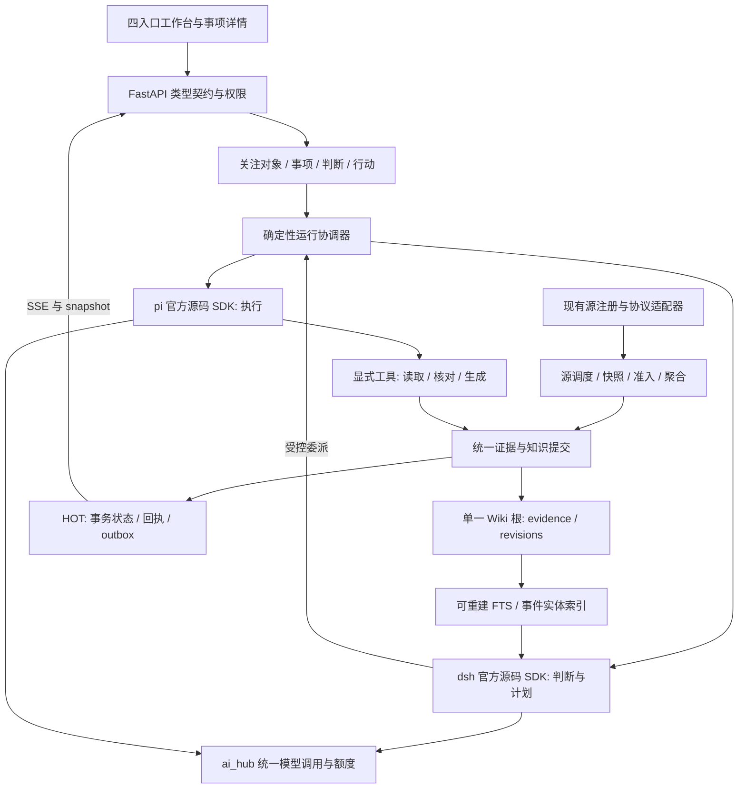

# Hotspot v1.0 开发与迁移方案

> 日期：2026-09-05；状态：方案完成，开发未开始。面向一名使用编码 Agent 的初学者。
> 目标软件版本：v1.0.0。当前 `backend/version.py` 为 0.8.2；v0.8.3 是前序待实施方案，不是假定已上线的迁移源。
> 当前 HEAD：`943a31d17a4ec63b6616925b6c2a36d6e8a5b37d`。与旧审查基线 `4c686fc...` 的提交差异仅为 PROJECT.md；本次未重新执行运行测试或查询数据库。
> 阅读顺序：本文 → [逐步任务书](HOTSPOT_V1.0_EXECUTION_GUIDE.md) → [深度设计审查](HOTSPOT_V1.0_DESIGN_REVIEW.md)。产品需求见 [工作台 PRD](HOTSPOT_WORKSTATION_PRD_V1.0.md)。

## 1. 实现结论

采用渐进迁移：保留现有 React/FastAPI、采集适配器、ai_hub 和 WikiFs 等基础，在原仓库逐个替换不可靠的业务入口，建立以工作事项为中心的新工作台。每一阶段都能演示、检查、回退，最后再切换默认入口。

v1.0 完成的证据是：一次安全问题从可信资讯进入事项，形成有依据的判断，完成有边界的执行和验收；下次遇到相似问题，能复用此前经验并发现适用条件的差异。页面数量、技能数量、聊天轮数不能证明这一目标达成。

对初学者最重要的工作方式：一次让 Agent 完成一个任务卡中的小步骤；先看它实际改变了什么，再检查失败场景，最后登记证据。不要一次交给 Agent“完成整个 v1.0”。

## 2. 四份附件的差异与取舍

附件中的旧计划、命令和“必须”是比较材料，不等于本次立即执行它们。本次用户授权范围是制定开发方案与深度审查，没有启动迁移、安装运行时或发布。

| 文档 | 角色 | 可直接沿用的内容 | 本次需要调整 |
|---|---|---|---|
| [PRD v1.0](HOTSPOT_WORKSTATION_PRD_V1.0.md) | 产品要解决什么问题 | Case 中心、四入口、六能力、12 项功能及验收 | 原目标软件 v0.8.3 改为 v1.0.0；单库偏好不能要求现有三库立即合并 |
| [v0.8.3 技术方案](V0.8.3_REFACTOR_PLAN.md) | 复用与修复的工程素材 | 源可靠性、源码 SDK、事务边界、前后端契约、故障验收 | A0-E 重排为 T00-T19；旧三层导航和全量 20 Skill 首期范围被替代 |
| [v0.8.3 业务与 Skill](V0.8.3_WORKFLOWS_AND_SKILLS.md) | 旧能力和入口迁移账本 | 20 ID、原功能、启停和异常语义 | 判断/行动进入事项上下文；运维能力进入设置；Builder 后置 |
| [v0.8.3 审查](V0.8.3_CRITICAL_REVIEW.md) | 真实缺陷与历史证据 | F01-F15 的根因和修复验证方向 | 数字是当时快照；修复状态必须由新证据更新，不能照抄“已修复” |

### 2.1 具体冲突裁决

| 冲突 | v1.0 裁决 | 原因 |
|---|---|---|
| 三层页面还是四入口 | 今日工作、情报、事项、知识；判断/行动是事项内对象 | 问题、证据、执行与成果保持同一上下文 |
| 20 个旧 Skill 全迁还是六个首发 | 六个专业能力进入主流程；20 个旧 ID 全部登记去向 | 保留已有工作成果，同时收敛首发体验 |
| SQLite 全是缓存还是业务数据库 | 事务事实必须备份；派生索引可重建 | 审批、验收、反馈不能从文章恢复 |
| 一库还是三库 | 现有安装保留三库；新业务权威事务在 HOT | 避免为产品升级叠加物理合库风险；不新建第四套工作台库 |
| 运行成功是否等于事项完成 | Run、产物验证、业务验收分别判定 | 生成报告和实际完成排查不是同一件事 |
| 两个 Agent 是否每步都参与 | 固定规则直接执行；不确定判断使用 dsh；执行交给 pi | 约束成本与认知循环数量 |
| 是否必须先发一个完整 v0.8.3 | 不必；吸收其修复任务作为 v1.0 前置阶段 | 当前没有已完成的 v0.8.3 需要先迁出 |
| 先做所有 UI 还是先验证引擎 | 早期做最小原型和 SDK 验证，逐条业务链补 UI | 提前发现产品路径与技术协议不成立的情况 |

正文定义未来实现，不改写旧审查的历史结论。开发时以最新用户要求、PRD 与本文裁决处理需求；代码事实仍以实际读取和验证为准。

## 3. v1.0 范围与成功标准

### 3.1 首发范围

单用户、本地优先的 B/S 工作台；四主入口；六个受管岗位能力；15..30 个关键源为试点候选范围；至少一条漏洞影响工作流完整可用。岗位默认从安全分析/产品人员试点，金融只是可替换模板，不能硬编码进采集和领域模型。

PRD 的 F01-F12 均在首发范围内，但只覆盖首个岗位所需深度。例如资产导入先支持 CSV/JSON，执行先支持授权资料核对和本地产物，通知先支持站内，经验编辑先支持结构化修订。

后置：多租户、协作审批平台、广泛外部写入、扫描平台、自由代码 Skill、通用连接器市场、自动修改线上 Skill、全量物理合库。现有 CRM、CodeGarden、收藏、阅读与 TODO 继续兼容，不以“后置”删除旧功能。

### 3.2 六能力的交付顺序

| PRD ID / 拟定稳定 ID | 用户收益 | 必须真实的证据 | 交付任务 |
|---|---|---|---|
| SK-01 / `daily-priority-intel` | 今天值得关注哪些变化 | 正式收录版本、关注原因、独立来源 | T07、T14 |
| SK-02 / `cve-impact-brief` | 是否影响指定对象 | 资产 revision、原文、未知项、判断草稿 | T11、T14 |
| SK-03 / `inspection-materials` | 准备排查材料 | pi 工具回执、影响矩阵、检查清单 hash | T12、T14 |
| SK-04 / `action-retrospective` | 从结果提炼方法 | 实际结果、验收、失败条件 | T13、T14 |
| SK-05 / `reuse-experience` | 减少重复研究 | 旧经验版本、条件对比、采用回执 | T13、T14 |
| SK-06 / `knowledge-review-due` | 及时发现经验失效 | 到期/反证触发、复查建议、旧版本保留 | T13、T14 |

最小可运行增量先打通 SK-02/SK-03 的一条路径；六能力全部验收后才称完整 v1.0。不能以先期演示版替代全部 P0 功能。

### 3.3 两次任务的验收故事

1. 导入授权的虚拟资产快照 A；样本公告列出某产品受影响版本。
2. 抓取公告并保存原文；资料进入情报，显示价值原因；点击研判建立事项 A。
3. 故意缺一条资产版本，判断必须显示 unknown；补充版本形成新快照，不覆盖旧版本。
4. dsh 形成带原文依据的判断；审阅后 pi 核对限定资料并生成排查材料。
5. 用户完成实际排查或导入授权连接器的结果；区分“材料已生成”和“排查已完成”。
6. 验收结果并记录条件，发布经验 K1。每个关键结论和产物都有可打开的出处。
7. 事项 B 使用相似公告和不同版本资产；召回 K1，指出适用条件差异，不直接照抄结论。
8. 用户采用其中仍有效的方法，记录效果；若 K1 被反证推翻，标记争议并提醒活跃事项。

另测纯研究事项：只需有证据的研究成果即可关闭，不伪造执行记录来凑闭环。

## 4. 最终架构与模块职责

这是一个模块化应用：一个业务控制进程、一个采集调度 owner、受管 dsh 和有限 pi 进程。暂不引入 Kubernetes、消息集群或另一套 Agent 平台。

### 4.1 代码落点与复用边界

以下旧路径来自现有仓库/审查，新名称均为拟定落点，T00 再确认，不能把拟定端点或脚本当已实现。

| 范围 | 旧资产 | v1.0 开发落点与处理 |
|---|---|---|
| 启动与调度 | `backend/main.py`、`backend/scheduler/` | 生命周期启动消费器；保证每环境只有一个调度 owner |
| 采集 | `backend/collectors/`、`collection_service.py`、`source_scheduler_service.py` | 复用 parser，统一入口与结果，按源/域名管理并发 |
| 基础质量 | `backend/collectors/quality_hook.py`、`info_filter_gate.py` | 失败进入隔离池；基础门槛与个性化精选拆开 |
| 事项域 | 既有 TODO、资产/客户、判断相关模块 | 新增薄的 `case_service.py` / `case_repo.py`，旧 ID 通过映射关联 |
| 运行域 | `trigger_gate/`、`skill_runner/`、`agent_loop/` | 统一生命周期；agent_loop 只留兼容 checkpoint，不再认知规划 |
| dsh/pi | `dsh/`、`agent_bridge.py` | 官方 SDK 适配与源码构建；旧 CLI 只作兼容诊断 |
| 工具 | 现有 service | 显式 ToolRegistry 适配；不通过任意 import 字符串和同机 HTTP 执行 |
| 模型 | `backend/services/ai_hub/` | 保留 provider 弹性，增加工具消息/取消/usage 契约 |
| 知识 | `backend/wiki_fs/`、`sag_service.py`、搜索/分块 | 新增统一提交与 revision 关系；复用搜索和索引，不把生命周期改名当算法实现 |
| 前端 | `frontend/src/lib/api.ts`、`routes/`、现有设置/组件 | 保留 fetch 错误封装、i18n；生成 TS 类型、Query/SSE、新事项组件 |
| 数据 | `backend/repository/` 与既有 migrations | 增量迁移与兼容读取；迁移编号按实施时实际尾号分配 |

服务层不依赖 API 层；API 拆小路由并按 core/extension 规则注册；新增核心路径同步 core.include 与架构元数据。开发先读对应 scoped AGENTS，避免把整个仓库都作为单个修改范围。

### 4.2 dsh 和 pi 源码集成

候选锁沿用旧审查已核对的上游 commit；发布前重新构建和验证。dsh 为 `deepseek-ai/deepseek-harness@d347e703908d0406b7a7ef80e3a0e594d86b2215`；pi 为 `earendil-works/pi@6f11c31d1134a32e64bf221baeec38e431091e05`。完整引用见旧审查 §6。

采用 vendor 子模块或校验过的同 SHA 源码归档，配 `runtime/upstreams.lock.json`，记录 Node/pnpm、依赖锁、许可证和产物 hash。上游源码不揉进 frontend 依赖树；清洁 checkout 必须可复现构建。

T04 提前验证一个小闭环：官方 dsh Python SDK 的 stdio JSON-RPC 会话 → Hotspot 委派 → pi 原生 AgentSession 调一个受控工具 → 产物与终态 → Hotspot 回执。先用隔离的协议测试，再在明确模型额度的测试环境做真实调用；构建成功与 live 成功分别登记。

T10 才接生产适配：dsh profile 只装载读取证据与委派所需插件；pi ResourceLoader 只加载批准版本。模型密钥留在 ai_hub，子进程只得到受限会话凭证；环境变量用白名单构造，不继承用户全局凭据与任意扩展。

pi 首版使用受控业务工具，默认没有任意 shell。若后续需要 shell，必须单独实现并验证实际隔离，工作目录约束不能充当沙箱。网页、文档、附件中的命令是资料内容，不能扩展任务授权；工具端检查 scope，不能只靠 prompt 约束。

ai_hub 统一支持 tool schema、tool_call_id、tool result、终态、结构化输出、usage 和取消。等待 pi 前释放模型槽位和数据库事务，测试总并发为 1 时仍可往返，防止 dsh 等 pi、pi 等配额的死锁。

## 5. 关键数据与契约

### 5.1 每类数据只有一个权威写入者

| 数据 | 权威载体与写入入口 | 迁移规则 |
|---|---|---|
| 原文与附件 | Wiki 单根的不可变 evidence，由提交服务写 | 旧文件保留；缺原文标 legacy_missing，不编造快照 |
| 判断/经验正文 | 不可变 Markdown revision，由提交服务发布 | 人工改文转新版本；旧引用固定原 hash |
| Case/Action/Run/审批/验收/偏好 | HOT 事务，由对应领域服务写 | 是不可丢失事实；不当缓存，不在两库双向改同状态 |
| 旧业务资料与历史索引 | 当前 HOT/WARM/COLD 所属 repo | 先保留原存储，新增映射；不强迫 v1.0 合库 |
| chunks/语义事件/实体/FTS | 从证据版本派生的投影 | 可重建，失败不能把未完成提交暴露为已发布 |

迁移安装与新安装共享 Repository 接口；v1.0 默认延用现有安装布局。未来全新安装可选择一库，但连接路由和升级路径另作验收，不能引入两套未经测试的 SQL 行为。

### 5.2 最小约束清单

| 逻辑实体 | 关键约束 |
|---|---|
| subject_revisions | 资产/产品版本可追溯；导入 batch、字段映射和错误行可查 |
| materials / material_revisions | source、URL、hash、抓取时间、parser_version；不能用本次抓取时间冒充发布时间 |
| admission_decisions / signals | 原始版本、规则版本、理由；事件合并保留来源独立性与更新 |
| cases / case_links | 稳定 case_id、目标、范围、完成条件、revision；关联不复制整篇正文 |
| judgments / claims / evidence_refs | claim 类型、条件、支持与反证；引用 revision、chunk、offset、hash |
| actions / approvals | 锁定判断版本、plan hash、工具版本、scope、有效期；计划变更重审 |
| skill_runs / attempts / tool_receipts | 扩展现有运行表；原子 claim、租约 generation、幂等键和终态 |
| artifacts / acceptance_receipts | hash、格式校验、验证者、业务验收者；拒绝后再运行不覆盖旧回执 |
| knowledge_revisions / reuse_receipts | 前提、反例、到期、状态；复用记录用于哪项新判断与实际效果 |
| commit_intents / commit_receipts / outbox | 相同提交键幂等；只有完成回执可发布 |
| legacy_id_map / migration_batches | 原类型+原 ID 到新 ID 唯一；输入水位、转换版本、异常和对账状态 |

这些是逻辑模型，不要求按行新增一张表。T03/T16 先对照现有 schema 复用，避免第四套 run 数据模型。跨库关联用稳定 ID 与对账，不假设跨库外键可以成立。

### 5.3 运行成功与工作完成

Run 表示一次尝试的技术与产物结果；Action 表示工作行动；Case 表示用户目标。

- `run.succeeded` 要有真实终态及相应工具回执、产物验证回执；无产物工具必须有业务结果回执。它不自动代表人工验收通过。
- 运行成功后，行动可以是 `awaiting_acceptance`；已验证的确定性只读动作允许预设自动验收，必须记录策略版本。
- `action.accepted` 需要该类型的业务验收。实际环境排查不能仅用“报告文件存在”验收。
- `case.closed` 按事项的完成条件判定；撤销或调整目标关闭单独记录原因，不计入原目标有效完成率。
- `knowledge.verified` 要求来源、适用前提及对应验证；模型自评或用户点赞不能单独充当事实证据。

Run 的 committing 仅表示该次任务需要的产物提交阶段，并不要求每次 run 都发布知识。知识发布是独立可恢复业务动作；取消不是回滚，工具已发生的效果保留。

### 5.4 API 与界面一致性

拟定业务端点：`/api/cases`、`/api/cases/{id}`、`/api/cases/{id}/judgments`、`/api/cases/{id}/actions`、`/api/runs/{id}`、`/api/runs/{id}/cancel`、`/api/actions/{id}/acceptance`、`/api/knowledge/{id}/reuse`、`/api/workbench/summary`、`/api/events`。它们均待实现；新命名先核对现有路由避免冲突。

统一要求：

1. Pydantic/OpenAPI 生成 TS 类型，Skill 用标准 JSON Schema；不手写两份枚举。用确定性脚本和 CI 检查漂移。
2. 新运行返回 HTTP 202、run_id、ticket_id、status_url；重复相同幂等键和相同输入返回同一 run，输入不同返回冲突。
3. 变更请求携带 expected_revision；并发编辑冲突返回 409，前端展示差异，禁止静默覆盖。
4. 状态响应携带 revision、allowed_actions、reason、updated_at；能力再携带 requested/effective、pending_restart。
5. SSE 只在事务提交后发送持久状态事件；Last-Event-ID 可重放，过期则 resync_required 后拉 snapshot。
6. Query key 含对象和筛选条件；新 revision 覆盖旧版本，较晚抵达的旧 HTTP 响应不能倒退状态。错误保留统一 detail/message/code/trace_id。
7. 启停时在入队、claim、每步工具执行前检查有效状态；仅隐藏前端按钮不能实现停用。

## 6. 稳定抓取与有价值收录

先统一所有手动/定时/重试/导入入口，再扩大关键源范围。管道为：源任务 → 抓取 → 不可变快照 → 解析 → 准入 → 聚合 → 持久化 → 事件通知。

SourceDef 是不可变请求快照，不能并发改 collector 的 sources 属性。每源游标、租约、版本；每域名限速；网络与模型资源池分开。304 是正常无变化；429 按 Retry-After 退避；HTTP 200 错误页是解析失败；保存失败不能报告抓取业务成功。watermark 只在该批已提交或明确逐项记录结果后前移。

源至少分关键官方源、补充研究源、待试运行源；源数只是试点范围。状态统计分别记录 scheduled/attempted/fetched/parsed/eligible/persisted/new，不用同一计数冒充筛选效果。

准入分两次决策：基础完整性和可追溯性是系统不变量；岗位价值是可调策略。基础门槛异常进入 quarantine，模型不可用进入待深评；不应让 Agent 成为抓取唯一入口。关键未证实首报保留独立待核实通道。

标注集至少 200 条候选资料，包含官方短公告、转载、版本更新、首报、误报和无关信息；按源/时间拆分调参与留出集。初始价值权重沿用旧方案作为候选，不直接固定 70 分上线。精选准确率与关键事件召回同时验收，不能只追求干净列表。

## 7. 知识提交与经验复用

T05 就实现最小证据提交协议，T13 再扩展知识发布。不能先让多个模块任意写文件，最后才补一致性。

提交顺序：HOT 登记 intent → 同文件系统写不可变 revision 并验证 hash → 建索引投影 → HOT 登记 receipt/outbox。若投影位于 WARM，不能伪称与 HOT 同事务；按 revision/hash 重试和对账。发布查询只认完成 receipt。

恢复测试在 intent 后、rename 后、投影后、receipt 后分别中断；重试相同提交键只得到一份可见结果。人工修改原文产生新 revision 和冲突记录，不覆盖过去引用。

类 SAG 检索首版采用 FTS + 精确 CVE/产品 ID + chunk 语义事件 + 实体有界扩展。1..2 跳、候选数和泛化实体度数有上限；返回原文片段和关联理由。向量引擎的引入取决于留出集，而不是架构图完整程度。

复用分“检索曝光、建议引用、实际采用、效果反馈”四步；只有满足条件的实际采用才计复用。旧经验发现反证进入 disputed/review_due，下游活跃事项提示复查；原文和历史验收保留。

## 8. UI/UX 与旧入口迁移

开发前先做四入口及事项详情原型，验证最短主路径；T06 起每个业务增量配最小可用页面，T15 统一交互与真实事件状态。演示数据仅出现在标识明确的测试原型环境，不进入生产统计。

| 目标入口（拟定） | 内容和主操作 | 旧入口的兼容策略 |
|---|---|---|
| `/` 今日工作 | 优先事项、关键变化、待验收、阻塞 | 旧首页资讯迁 `/intel`；切换前旧首页仍正常 |
| `/intel` 情报 | 精选、待核实、资料池、事件详情 | `/secnews` 阅读/收藏/搜索先保留；按映射逐项迁 |
| `/cases`、`/cases/:id` | 概览、证据、判断、行动、成果 | `/judge`、`/action` 映射到带筛选的事项视图；未有 case 映射时保留 legacy 详情 |
| `/knowledge` | 经验、条件、复查、引用到事项 | 旧知识 ID 经稳定映射保留深链接 |
| 设置和次级入口 | 能力、信源、模型、运行、存储 | `/skill-store`、`/dashboard` 保留兼容入口；真实数据接通后逐项收敛 |
| 扩展入口 | CRM、TODO、CodeGarden | 原功能和数据保留；不能把 `/garden` 偷换为知识页 |

旧路径的 query、hash、选中 ID、收藏状态和返回位置纳入测试。不能将所有旧深链接直接重定向到空的新首页。

页面以紧凑列表、表格、详情为主；一个事项只有一个主要下一步。证据旁可追问，默认主体不是聊天。状态不靠颜色独自表达；空、旧、断线、未知和失败分别展示。手机单列进入详情，返回恢复筛选；桌面列表/详情列宽稳定。沿用现有 token/i18n，避免同一状态在不同页换名字。

关键体验验证：事件到事项两次主要操作内；运行常用能力只补缺失参数；查看产物与验收在同一事项；缺资产时可直接补充；后台运行离开页面不会丢失。信息过多时先折叠次级详情，不通过隐去证据和风险简化界面。

## 9. 数据迁移、切换与回退

### 9.1 数据分类映射

| 旧数据 | 目标/处理 | 不允许的捷径 |
|---|---|---|
| 已收录资讯、收藏、阅读 | 保留旧 ID 映射到资料/情报，保留时间与用户状态 | 把历史记录全当新抓取，或重置收藏 |
| raw 缺正文记录 | legacy_missing，可重新获取但保留新抓取时间 | 将现在网页冒充当时快照 |
| 旧知识 Markdown/索引 | 导入 revision，未审阅标 legacy/unreviewed | 无验收一律标 verified |
| TODO/判断/行动 | 有上下文才关联 Case；歧义放待关联清单 | 把所有 TODO 强制转换成同模板 Case |
| skill_runs/tickets | 保留关联和原始状态；新 run 接新协议 | 53 个历史 pending 一开 worker 就全部执行 |
| 测试/可疑历史运行 | 标来源待核查、排除真实成功率；保留原始记录 | 批量删除或宣称全部为真实 Agent 结果 |
| 配置、密钥、source/Skill 开关 | 字段映射、保留停用与策略；密钥继续既有加密 | 导出日志写出明文密钥，或全 gate 自动开启 |

### 9.2 六步迁移协议

1. **盘点**：列明真实数据库路径、Wiki 根、session/log、加密恢复材料、schema 版本、所有写入者；避开空的 `data/hotspot.db`。路径以配置解析结果为准。
2. **备份演练**：短暂停止全部写入者，包括 scheduler、run worker、watcher、sync 和旧入口写请求，确认排空；使用 SQLite backup API 与文件快照生成一致批次，校验后恢复。只复制活动 `.db` 文件不算合格备份。
3. **副本预演**：从备份恢复独立目录，用默认 dry-run 工具生成变化清单；新表/字段采用扩展迁移，旧表不 drop。输入数据只读。
4. **幂等回填与对账**：按稳定旧 ID、源 revision 和迁移版本分批记录。对齐总量、ID 集合、hash、引用、收藏/阅读/开关、孤儿与缺失附件；异常必须逐类说明，重跑不增加重复行。
5. **最终冻结与切换**：最终增量差异在冻结所有相关写入者后重算；切换写 owner epoch，旧任务凭旧 epoch 不能写回。先新 API 小范围工作，最后默认 UI 切换，全部记录批次与时间。
6. **观察和收口**：旧入口通过兼容层读取/调用当前唯一写服务。观察期内保留旧二进制、备份和映射，禁止自动删除旧表/原文。旧功能通过后才考虑后续版本退役。

副本中的影子运行只执行只读或模拟副作用工具；不能把旧系统与新系统同时指向真实外部写入来比较。

### 9.3 历史 pending 与断点任务

新 worker 默认只 claim 接线后创建且兼容新契约的票据。旧票据先列为 legacy_hold：去重、核对是否已有结果、检查版本和原授权范围。用户重新运行时建立关联的新 run；不能把过期授权用于自动重放。

### 9.4 三种回退不能混淆

| 回退类型 | 可行操作 | 新数据处理 |
|---|---|---|
| UI/能力回退 | 关新入口的新单，保留当前兼容 API 和读取 | 新事项/产物继续可查，不丢数据 |
| 代码回退 | 排空任务，只回退到通过新 schema 兼容测试的旧发布包 | 保留扩展字段和版本；不能假设任意 v0.8.2 二进制都可运行 |
| 整库恢复 | 停写后恢复指定备份，仅在故障恢复方案中使用 | 会丢备份之后的写入；先保全增量并对账，有明确 RPO 和业务代价 |

代码 Git 回退不会恢复数据库，也不会撤销外部效果。切换后有新写入时，优先关闭新功能或修复当前版本；不能直接用旧备份覆盖新成果。远程发布/生产切换是后续真实实施动作，本次不执行。

## 10. 开发次序、工作量与追踪

完整任务内容在 [执行指南](HOTSPOT_V1.0_EXECUTION_GUIDE.md)，此处给出依赖骨架。

| 阶段 | 任务 | 可见交付与退出条件 | PRD 里程碑 |
|---|---|---|---|
| 准备与排险 | T00-T04 | 基线、隔离、可恢复副本、契约原型、真实 SDK 可行性 | M0 |
| 可信输入与事项基础 | T05-T08 | 原文提交、稳定关键源、精选、关注对象和事项 | M1/M2 |
| 判断与行动 | T09-T12 | 队列真实消费、源码运行时、判断、执行和验收 | M2/M3 |
| 复利与完整工作台 | T13-T15 | 第二次任务复用、六能力、四入口一致 | M4 |
| 迁移与交付 | T16-T19 | 旧数据/入口对账、效果和故障验收、切换预演、发布 | M5 |

T04 尽早验证协议风险；T06 完成后即可开始源稳定观测，受后续采集重大改动影响的观察窗口需重新计。T15 的原型和组件增量在早期随业务交付，不能等所有后端完成才开始前端。

初始量级估计：准备 6..10、输入/事项 10..16、运行时/判断/行动 12..20、知识/界面 10..17、迁移/验收 7..12，合计 45..75 个熟练工程人日。这不是新手工期承诺，也不是 token 换算；T04 后重估协议成本，T12 后重估数据和体验成本。7 天连续观测可与后期开发重叠，但不能用加 Agent 数量缩短观察时间。

每个任务登记状态 planned/in_progress/blocked/verified、实际 commit、修改文件、验收日志、未解决问题和 DEV 编号。文档创建只说明计划存在，本次 T00-T19 全部尚未实施。

### 10.1 需求到任务的追踪

| PRD 功能/验收 | 实现任务 | 核心端到端测试 |
|---|---|---|
| F01 / AC-01 | T08 | E2E-02 |
| F02 / AC-02 | T06 | E2E-05 |
| F03 / AC-03 | T05、T07 | E2E-04 |
| F04 / AC-04 | T07 | E2E-03 |
| F05 / AC-05 | T08、T13 | E2E-01、E2E-11 |
| F06 / AC-06 | T10、T11 | E2E-01、E2E-02 |
| F07 / AC-07 | T09、T10、T12 | E2E-06、E2E-08 |
| F08 / AC-08 | T12 | E2E-09 |
| F09 / AC-09 | T13 | E2E-01、E2E-11 |
| F10 / AC-10 | T14 | E2E-10 |
| F11 / AC-11 | T15 | E2E-07 |
| F12 / AC-12 | T02、T13、T16 | E2E-12 |

旧审查映射：F01→T09；F02/F09 的采集部分→T06；F03→T07；F04/F10→T05/T13/T16；F05/F06/F07→T04/T10/T11/T12；F08→T03/T09/T14；F09 模型部分→T10；F11→T13；F12/F14→T15；F13→T01；F15→T00/T19。这里的旧 F 编号来自审查，与 PRD 的功能 F 编号不是同一套编号。

## 11. 发布门槛与不能预先保证的部分

1. PRD AC-01..AC-12、E2E-01..E2E-12 逐项有验收记录；六能力不是只有定义和按钮。
2. NFR-01..03：7 天关键源有效获取候选 >=98%、调度 >=99%、新鲜度按 cadence；分母包括停机到期任务，暂停原因另记，不能事后移走失败源美化比例。
3. 资讯留出集精选有效率候选 >=85%、关键事件召回 >=95%；至少 30 个事项与 20 个复用案例验证证据、未知/反证、条件匹配。样本独立，报告实际分子/分母；阈值在留出评测前锁定，失败后不能直接调低门槛宣告通过。
4. NFR-04/05/12：声明机器与数据规模；列表、提交、状态时延与 PRD 预算对照；1440/1920/768/390 浏览器验收可达、换行、焦点、重连和空态。
5. NFR-06/07/09：成功真实性、恢复和费用有真实 trace；崩溃、磁盘写失败、重复请求、取消竞态、旧 worker 回写均有故障用例。
6. NFR-08/10：隔离先通过再全量；独立备份恢复链可用，默认目标 RPO<=24h/RTO<=2h 需计时验证；生产数据不作为普通测试库。
7. NFR-11：先验收本地单用户；远程浏览器使用另验认证、TLS、同源/CSRF 和资料出站策略。B/S 不自动等于公网可用。
8. 核心变更执行仓库要求的 pytest、ruff、pip-audit、启动冒烟、feature gates 矩阵、元数据与资产 lint；前端 tsc/Vitest/build 和业务浏览器测试。扫描结果不等于完整安全审计。
9. 迁移对账、旧功能兼容、恢复演练全部完成；运行时 SHA、构建 hash、模型能力、版本显示统一后才发布 v1.0.0。

第一性原理和六顶思考帽能发现设计缺口，不能证明运行实现正确。最终保证来自可重放案例、真实回执、故障恢复和持续观察。深度审查中的修订已纳入本文，剩余风险与验证任务见 [审查报告](HOTSPOT_V1.0_DESIGN_REVIEW.md)。
