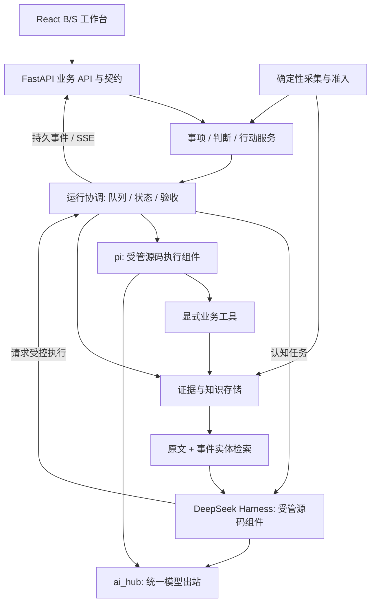

# Hotspot 安全从业者 AI 工作台 PRD

> 文档版本：1.0；日期：2026-09-05；状态：从零设计的产品方案，待实施。
> 产品名称：Hotspot。首期实施目标版本：v1.0.0（2026-09-05 按用户最新要求由 v0.8.3 调整）；PRD 版本与软件版本独立。
> 实施入口：[v1.0 开发迁移方案](HOTSPOT_V1.0_DEVELOPMENT_PLAN.md)、[新手逐步任务书](HOTSPOT_V1.0_EXECUTION_GUIDE.md)、[第一性原理与六顶思考帽审查](HOTSPOT_V1.0_DESIGN_REVIEW.md)。现有安装保留三库物理布局、运行与业务验收分离等实现裁决见开发方案，不表示软件已经完成。
> 用户已确定：看板型 B/S 工作台、稳定抓取与有价值收录、dsh 大脑、pi 执行、llm-wiki-2.0 + SQLite 知识复利。
> 本文是新的产品需求基线，不以现有页面、路由、20 个 Skill 或模块数量限定目标。此前审查继续作为风险证据，重构方案作为实现参考；与本文冲突的旧产品布局以本文为准。

## 0. 产品决策摘要

**Hotspot 帮助安全从业者持续发现值得关注的变化，把变化转化为有证据的判断，执行有边界的行动，再将经过验证的经验用于下一次工作。**

核心产品对象是 **工作事项**：围绕一个明确问题，组织资料、判断、行动、产物和经验。例如“某漏洞是否影响我们的网关”“新规对支付业务有什么变化”“本周哪些客户值得跟进”。

五项设计决策：

1. 首页展示今天需要处理的事项、重要变化和阻塞原因；资讯流是重要入口，对话是上下文辅助。
2. 资讯、判断、执行是同一事项的工作链，详情中共享证据、对象、版本和目标，不要求用户跨系统搬运。
3. 产品同时维护“关注对象”和“可信证据”。前者回答与我有何关系，后者回答凭什么相信。
4. 自动化以可启停的岗位能力交付。Skill 包含输入、流程、工具、产物、验收和使用边界，能够在看板直接运行。
5. 知识复利以实际复用和行动反馈衡量。收藏、生成摘要、保存聊天都不自动算知识成果。

首版验收主线：**一个真实安全问题，两次相似任务**。第一次从资讯完成判断、执行、验收和沉淀；第二次准确引用第一次经验，并检查当前条件是否仍成立。

## 1. 问题与价值

### 1.1 用户真正需要完成的工作

安全工作需要连续回答五个问题：发生了什么；与我有什么关系；应该作何判断；接下来做什么；以后怎样少走弯路。

当前常见成本来自信息噪声、来源中断、上下文散落、重复取证、行动失联和经验难以复用。产品应减少这些成本，而不是要求用户每天管理更多工具或维护大量 Agent 配置。

| 工作痛点 | 产品应提供的结果 | 判断是否有价值 |
|---|---|---|
| 看了很多资讯却不知道该做什么 | 少量重要变化及相关事项建议 | 用户能说明为何关注，并决定跟进或暂缓 |
| 结论听起来合理但无依据 | 事实、推断、反证和适用条件 | 关键判断可以逐项定位原文 |
| 没有完整资产/业务背景 | 明确缺口与补充入口 | 不将“不知道”误判为“不受影响” |
| 每次从头整理资料与提示词 | 岗位能力和可复用证据包 | 同类任务更快完成，质量不降低 |
| Agent 跑完却不知道是否有效 | 产物、工具回执和验收结果 | 任务目标真实达成，失败可解释 |
| 报告归档后无人再用 | 可检索、有条件、会过期的经验 | 后续任务引用并验证其适用性 |

### 1.2 产品定位与边界

面向安全从业者的个人专业工作台，连接外部情报与个人/组织工作上下文，承担研究、研判、材料整理、受控执行与经验复用。

首版不承担完整 SIEM/SOAR、终端实时防护、漏洞扫描平台、企业资产发现平台或通用项目管理系统的全部职责。相关数据通过导入和连接器进入工作台；没有连接器时允许人工上传和记录实际结果。

对话支持追问、解释、补充约束和修改草稿。默认工作入口必须是业务对象、能力和待办，不能依赖用户每次编写完整 prompt。

## 2. 用户与设计假设

### 2.1 首要用户

首版假设用户是需要同时处理情报、客户/业务影响、方案与跟进的安全分析/安全产品从业者，金融场景作为第一套岗位模板。这个假设来自当前任务背景，尚未经过用户访谈验证。

| 用户类型 | 高频目标 | 首期支持 |
|---|---|---|
| 安全分析/安全产品人员 | 重点事件、影响研判、报告、跟进 | 主用户，全链路支持 |
| 安全运营/工程人员 | 漏洞影响、排查清单、执行与复盘 | 通过授权资产快照与受控工具支持 |
| 安全顾问/售前人员 | 客户情报、方案依据、行业变化 | 关注对象与事项模板支持；高级 CRM 后置 |
| 安全负责人 | 重点风险、进展、决策依据 | 简报与事项视图支持；团队审批流后置 |

首版单用户、本地优先，桌面浏览器为主。移动端覆盖查看、补充、批准和跟踪，不强求复杂批量分析与配置编辑。小团队共享是后续阶段，不在首期偷偷引入多租户复杂度。

### 2.2 用户工作上下文

初始化只要求选择岗位和关注方向；资产清单、客户名单、业务系统、研究课题可以后补。

“关注对象”分为资产/产品、业务/客户、技术/课题、法规/标准四类，允许别名、版本、业务重要性、有效期和来源。上下文有 revision；历史判断保留当时使用的快照。

资产表未填写时仍可浏览情报、形成通用研究，但系统不得承诺准确完成“本组织是否受影响”的判断。用户可以随时查看、修订和停用自己的岗位偏好。

## 3. 目标、非目标与指标

### 3.1 产品目标

| ID | 目标 | 首版判断标准 |
|---|---|---|
| G1 | 重要输入稳定且可信 | 关键源状态可解释；正式收录具有原文证据与准入原因 |
| G2 | 让用户更快作出可靠判断 | 每个关键结论有依据，缺失上下文明示，能给出下一步 |
| G3 | 让行动真实完成 | 执行有身份、边界、产物、回执、验收和故障恢复 |
| G4 | 让经验进入后续工作 | 经过验证的经验可召回，引用时检查适用性与时效 |
| G5 | 降低重复操作成本 | 高频工作不需重写 prompt，主要流程在事项内完成 |

### 3.2 北极星与防止刷指标

北极星：**每周完成且通过验收、产生可追溯产物的有效工作事项数**。按业务事项去重，不按 run 数、报告篇数或子任务数量累计。

知识复利配套指标：在后续独立事项中被有效引用且适用性得到确认的已验证经验数，以及同类事项取证/判断耗时的变化。一次引用自己生成的报告不算新复用，模型自评成功不能替代验收。

| 指标 | 定义/分母 | 首期候选目标 |
|---|---|---|
| 精选有效率 | 分层抽样中用户认为对岗位有价值的正式资讯占比 | >=85% |
| 关键变化召回 | 独立人工参考集中的重要事件被捕获并可见的比例 | >=95% |
| 关键证据可追溯率 | 需证据的判断 claim 有有效原文版本引用的比例 | 100% |
| 执行成功真实性 | 标完成的运行中实际产物和验收回执存在的比例 | 100% |
| 闭环率 | 到期且未撤销、符合完成条件的事项中验收完成的比例 | 先建立基线，按工作类型改进 |
| 复用质量 | 抽样复用中引用正确且条件仍适用的比例 | >=90% |
| 重复工作耗时 | 相同难度任务中取证、研判、整理的人工主动耗时 | 相比人工基线降低 >=30% |
| 通知可行动率 | 用户认为需要阅读/处理的通知占比 | >=80% |

这些是待验证目标，不是当前成绩。以 >=200 条分层资讯标注、>=30 个事项案例、>=20 个复用案例形成基线，区分训练/调参集和按时间留出的验收集。小样本报告实际分子/分母，不仅报告百分比。

## 4. 核心领域模型

### 4.1 工作事项是主线

工作事项必须有一个要回答的问题或要达到的结果。它可以由用户手建、从资讯创建、从岗位模板创建，或由系统提出建议后确认。

系统不把每条抓取资讯都自动升级为事项。只有命中明确的关注规则且在自动化预算内，才自动创建；默认将同一对象、同一问题的新增资料追加到已有事项，避免待办爆炸。

| 对象 | 回答的问题 | 核心字段与关系 |
|---|---|---|
| 关注对象 Subject | 我关心谁/什么 | 类型、名称、别名、版本、重要性、context revision |
| 原始资料 Material | 信息来自哪里 | source、URL/文件、原始快照、hash、抓取时间、版本 |
| 情报事件 Signal | 发生了什么变化 | 事件摘要、发生时间、证据集合、关联对象、价值原因、更新 |
| 工作事项 Case | 我要解决什么问题 | 目标、范围、优先级、截止时间、相关对象、状态、完成条件 |
| 判断 Judgment | 现在相信什么、为什么 | claim、事实/推断、证据/反证、适用条件、置信、未知项、revision |
| 行动 Action | 为何要做、要做到什么 | 关联判断、执行范围、能力/流程、预期产物、验收标准、状态 |
| 运行 Run | 这次到底执行了什么 | attempt、Skill/模型/工具版本、步骤、预算、日志、结果、错误 |
| 产物 Artifact | 实际得到什么 | 类型、内容引用、hash、生成 run、验证结果、发布状态 |
| 经验 Knowledge | 下次可以复用什么 | 经验证结论/方法、前提、反例、证据、应用记录、复查时间 |

一个事项可关联多条情报、多版判断和多次行动。行动失败不删除判断；新证据可以推翻旧判断并触发复查。某事项只是研究问题时，完成有依据的判断与知识产物即可，不强迫生成无意义的执行任务。

### 4.2 闭环关系


资料、判断、行动构成知识的三个内容层；Case 连接工作目标，Run 记录操作事实。内容层、工作状态、执行状态、验证状态分别建模，不能合并成一个含糊的“处理中”。

## 5. 首个完整用户旅程

下面为产品验收场景，使用样本公告和授权资产快照，不代表发生了某个真实漏洞事件。

| 步骤 | 用户行为/系统动作 | 界面结果 | 完成条件 |
|---|---|---|---|
| 1 初始化 | 用户选择岗位、关注某网关产品，可上传资产快照 | 今日工作台开始展示相关变化 | 没有资产时也可使用，缺口明确 |
| 2 捕获 | 官方源发布版本安全公告 | 情报流展示新增变化和关注原因 | 原文快照、发布时间、hash 可查 |
| 3 建事项 | 用户点“研判影响” | 新事项继承情报、关注对象和问题 | 不需复制粘贴文章到聊天框 |
| 4 补缺口 | dsh 发现资产版本不完整 | 显示“需要版本信息”，可上传/输入 | 不能据此判不受影响 |
| 5 研判 | dsh 对照原文、资产、既有经验 | 判断草稿显示受影响/不受影响/未知及证据 | 事实与推断分开，有反证位置 |
| 6 行动 | 用户选择“生成排查材料” | 展示范围、步骤、产物和预算 | 默认仅本地资料操作 |
| 7 执行 | pi 核对授权快照并生成影响矩阵/清单 | 步骤、产物与失败原因实时可见 | 工具回执、最终状态真实 |
| 8 实际处理 | 用户或已授权连接器执行实际排查 | 将结果、日志或截图挂到行动 | 没有连接器时不伪造系统已处置 |
| 9 验收沉淀 | 用户确认结果与适用条件 | 事项完成，经验草稿经确认入库 | 总结关联原文、判断、实际结果 |
| 10 下次复用 | 相似版本问题出现 | 新事项召回旧经验并提示条件差异 | 过时条件触发复查，不直接复用结论 |

日常使用应支持“早上看重要变化、白天处理事项、下班前验收与复盘”。用户无需每天巡看所有模块或检查 dsh/pi 进程细节。

## 6. 功能需求

优先级：P0=首个可交付闭环必需；P1=完整岗位工作台扩展；P2=长期演进。这里是产品范围优先级，与旧审查的故障严重等级区分。

### F01 岗位与关注对象 [P0]

- 支持岗位模板、关注主题、产品/资产/业务对象、别名和有效期；模板可修改。
- 支持资产 CSV/JSON 导入、字段映射、预览、错误行反馈和版本更新；首版不自动发现全网资产。
- 支持“与我相关”的原因展示，例如命中产品、客户、课题或监管适用范围。
- 初次使用可以跳过敏感上下文；涉及特定组织的结论明确标未知。
- **验收 AC-01**：变更资产快照后，新判断使用新 revision，旧判断仍能还原当时依据。

### F02 信源中心与稳定采集 [P0]

- 支持官方 API、RSS、公开网页、文件/URL 手动导入。浏览器解析作为有预算的站点适配器。
- 每个源展示来源类型、更新频率、最后尝试/成功/有效新内容、失败类型、解析版本和下次重试。
- 源状态区分试运行、正常、限流、解析异常、访问失败、长期无更新、暂停；用户暂停不计可用性失败。
- 支持启动追抓、断点续抓、条件请求、域名限速、有界重试；单源故障不阻塞其他源。
- 首期集中验证 15..30 个关键源、覆盖多种来源类型；这个数量是试点范围，不以接入更多源作为交付标准。
- **验收 AC-02**：源返回合法 304 记正常无更新；返回 HTTP 200 错误页不能记有效采集；服务重启后不重复收录已提交版本。

### F03 收录门槛与资料池 [P0]

- 分离基础准入与岗位精选。基础准入覆盖可追溯、解析有效、内容完整性与重复；精选覆盖岗位相关、证据质量、新增信息和可行动性。
- 收录产生带 rule_version 的 accepted / pending_review / quarantined / rejected 决策，保留原因。
- 基础门槛失效时继续保存原始资料，停止进入可信流；用户关闭个性化筛选不能绕过基础门槛。
- 官方短公告、结构化漏洞记录按类型判断完整性，不按统一字数阈值误拒。
- 高影响未证实变化进入“待核实”通道，不与确认事实混排；用户可以调整关注但不能用偏好改写事实置信。
- **验收 AC-03**：同一资料在规则升级后可重新评估；原始版本与历史决策可查，未发生静默删除。

### F04 情报聚合与注意力管理 [P0]

- 按事件组织多源资料，区分首次报道、转载、官方确认、补丁更新和撤回；保留独立来源和矛盾证据。
- 展示“为什么值得关注”“相较之前新增什么”，支持收藏、暂缓、忽略主题、加入事项和创建事项。
- 默认精选有每日阅读预算，可配置；超出预算进入资料池，关键待核实预警保留独立通道。
- 重要性按影响/时效/对象相关排序；最新视图按收录时间，两个视图不混淆。
- **验收 AC-04**：十篇同源转载合成一个事件；官方新增受影响版本进入更新，不能去重丢失。

### F05 工作事项 [P0]

- 支持研究、影响研判、行动跟进三种首期模板，目标和完成条件各不相同。
- 事项内含概览、证据、判断、行动、成果与复盘；切换不丢失范围和上下文。
- 支持优先级、截止时间、关注对象、暂停原因、完成条件、关联/合并重复事项。
- 系统创建建议默认待用户确认；自动创建需用户启用明确规则和每日数量上限。
- **验收 AC-05**：新增证据可以追加旧事项；已完成事项发现影响结论的反证时进入待复查，而不是改写完成历史。

### F06 判断与证据审阅 [P0]

- 提供结构化模板：问题、事实、推断、结论、支持、反证、未知、适用条件、建议、复查时间。
- dsh 对资料检索和证据包进行判断；输出字段强校验，引用定位到具体文档 revision 与原文片段。
- 使用高/中/低或待核实的可解释置信等级，不展示未经校准的“93.7% 可信”。
- 支持接受、修订、要求补证据、标记争议；人工修订有独立作者与版本。
- **验收 AC-06**：原文不支持的关键 claim 无法通过验收；没有信息显示未知，不能归为否定结论。

### F07 行动规划与受控执行 [P0]

- 从已审阅判断生成行动建议，展示目的、scope、步骤、所需权限、预算、预期产物和验收规则。
- 初版默认能力为读取授权材料、核对清单、生成本地报告/草稿、建立内部跟进事项。
- 运行支持排队、实时进度、取消、断线重连、超时、受控重试；展示实际运行时与模式。
- 对外发送、写外部系统、实际环境变更通过单独能力及绑定具体计划的批准；缺连接器时显示人工待办。
- **验收 AC-07**：只有文本、进程退出码为 0 或工具中间输出不能标任务完成；必须有最终状态、产物和工具回执。

### F08 验收与复盘 [P0]

- 分开“运行结束”“产物通过规则验证”“人工业务验收”。不同类型任务可采用预设自动验收策略。
- 支持预期/实际差异、成功依据、失败原因、适用条件、后续建议和外部结果附件。
- 失败允许部分成果保留；某步骤完成不代表整个事项完成。
- **验收 AC-08**：产物未保存、引用失效或验收不通过时，事项不能满足原完成条件；用户可以修改目标并记录原因后关闭。

### F09 经验与知识复利 [P0]

- 知识类型包括经过验证的事实结论、操作方法、判断案例、行动复盘和领域简报；保留信息/判断/行动层次。
- 经验需有来源、验证方式、适用前提、已知例外、时效、版本和关联事项。
- 后续判断召回经验时展示“为什么相关”“条件是否相同”“有无过时/反证”。
- 新证据可将知识设为待复查、被替代或撤回，并通知相关活跃事项；不删除历史出处。
- **验收 AC-09**：对相似但资产版本不同的问题，系统召回旧经验，同时提示差异；失效经验不能作为当前高置信依据。

### F10 内置能力与自动化 [P0]

- 能力可发现、查看版本/用途/输入/产物、手动运行、启用/停用自动触发、查看历史和回退版本。
- 停用新任务、停止自动创建、取消在飞任务分别表达；显示依赖未就绪与重启待生效。
- 固定流程使用 Workflow，原子操作使用 Tool，不把所有后端函数包装成用户 Skill。
- 首版仅允许受管能力包；用户自建能力向导为 P1，但版本/契约/验收基础为 P0。
- **验收 AC-10**：一个被停用或依赖不可用的 Skill 不能被后台事件绕过；历史运行和产物仍可读。

### F11 今日工作台与通知 [P0]

- 首页按紧急性展示需要判断、等待补充、等待批准、待验收和知识复查的事项；辅以关键情报变化。
- 健康信息只在影响工作时突出，例如关键源中断、模型不可用、存储失败、任务停滞。
- 首版提供站内通知/摘要；不默认对外发送。相同事件合并通知，支持稍后处理、静默时段和通知预算。
- 对阻塞状态显示具体缺什么及下一步；普通后台运行不反复打断用户。
- **验收 AC-11**：待处理数量与服务端实际计数一致；网络错误显示陈旧/不可用，不以零值或合成健康值代替。

### F12 搜索、资料管理与退出能力 [P0]

- 统一搜索资料、情报、事项、判断、产物、经验，支持关注对象、时间、验证状态和内容层过滤。
- 导出事项证据包和知识 Markdown；导入先预览、去重和来源校验。备份包括事务库、原始快照、知识版本和运行关联。
- 数据保留分原始临时资料、正式收录、产物、日志；自动清理仅作用于已定义的临时层，不能清除已被引用的证据。
- 用户主动删除与产品留存政策分开，删除前展示关联影响；旧 ingested 资料的迁移不包含清理。
- **验收 AC-12**：恢复备份到独立目录后，事项可以打开原文、判断、产物和经验引用，不只是数据库完整性检查通过。

## 7. 首批内置岗位能力

首期六个岗位 Skill 足以验证产品闭环；不预设必须迁入全部旧 Skill。旧功能在实际迁移方案中单独处理，不通过产品重设计静默删除。

| ID | 用户看到的功能 | 输入 | 输出与验收 | 路径 |
|---|---|---|---|---|
| SK-01 | 今日重点情报 | 岗位/关注对象、时间窗、已准入事件 | 重点变化清单，每项有价值原因与原文 | 固定 workflow + 必要模型摘要 |
| SK-02 | 漏洞影响研判 | 公告证据、资产 revision、问题范围 | 影响判断、未知项、建议，引用可核查 | dsh；需要材料核对时委派 pi |
| SK-03 | 排查材料准备 | 已审阅判断、授权资料、模板 | 影响矩阵、检查清单、本地报告 | pi；产物和范围校验 |
| SK-04 | 行动复盘 | 执行回执、实际结果、用户反馈 | 经验草稿、适用条件、失败教训 | dsh + 确定性知识提交 |
| SK-05 | 历史经验复用 | 新事项问题、对象/环境快照 | 相关经验、条件差异、证据包 | 检索 Tool + dsh 适用性判断 |
| SK-06 | 知识到期复查 | 经验有效期、新证据、关联事项 | 需复查清单和修订建议 | 定时 workflow，不自动覆盖人工结论 |

P1 再加入监管条款变化、客户情报、专题研究、周报、解析器样本修复等能力。信源重试、索引更新、数据库备份属于受管系统功能，不向用户伪装成需要 prompt 的岗位 Skill。

Skill 标准：id/version、输入/输出 schema、依赖、工具及 scope、prompt/workflow、预算、触发策略、验收、产物类型、证据规则、权限策略、UI 入口。一次运行锁定全部版本。

P1 的“把常用对话固化”为：选择已成功完成的事项 → 提取变量与步骤 → 绑定产物和验收 → 回放样本 → 发布能力版本。仅对话文本不足以直接形成可自动执行能力。

## 8. 信息架构与 UX

### 8.1 四个主入口

| 主入口 | 用户的问题 | 默认内容 |
|---|---|---|
| 今日工作 | 今天先处理什么 | 待处理事项、关键变化、阻塞、待验收和到期复查 |
| 情报 | 有哪些值得关注的变化 | 精选、关注对象、待核实、资料池、事件详情 |
| 事项 | 当前问题进展如何 | 事项列表/状态看板、目标、证据、判断、行动、成果 |
| 知识 | 以前学到了什么、现在能用什么 | 经过验证的经验、方法、案例、引用关系和复查 |

能力、信源、模型/运行时、存储和岗位配置放在次级导航或设置；全局搜索与快速新建事项始终可达。自动化运行中心从事项与状态条进入，不再独立成为另一个产品首页。

资讯/判断/行动的三层逻辑通过内容类型与事项内阶段保留。用户以“当前在解决的问题”导航，不必理解后台组件的分工。

### 8.2 今日工作台

首屏优先展示具体对象和主动作。无工作时展示本时段重要变化和新建事项入口；没有数据时展示真实接入状态，不用演示任务补齐界面。

```text
Hotspot    今日工作  情报  事项  知识           搜索   新建事项   设置
----------------------------------------------------------------------
岗位 / 关注范围 / 时间                         最近同步与运行状态
----------------------------------------------------------------------
优先处理
事项标题                     原因 / 截止时间             下一步
待补资产版本的影响研判         缺少版本信息                补充资料
已生成的排查材料               等待验收                    查看产物
----------------------------------------------------------------------
重要变化                                      正在跟进
事件 / 相关对象 / 新增信息                      活跃事项 / 当前阶段
----------------------------------------------------------------------
需要复查的经验                                影响工作的异常
```

草图仅说明结构，不是生产数据。首页不提供虚假的总安全分、永久在线图标、未标注来源的趋势或主观“AI 智能指数”。

### 8.3 事项详情

页头固定显示问题、范围、优先级、完成条件和当前阻塞。主体提供概览、证据、判断、行动、成果五个视图，同一 case_id 下保持选择状态。

桌面上左侧为工作内容，右侧为相关证据/详情检查器；对话“讨论”作为可收起 tab。引用点击定位原文版本和高亮片段。未配置时显示补充动作，失败时显示实际错误与可行恢复入口。

用户修订判断采用可审阅差异，保留人工作者；接受 AI 建议后产生新 revision。产生外部效果的操作预览精确范围和参数，不使用含糊的“允许全部”。

### 8.4 控件与视觉约束

- 风格为安静、紧凑、可扫描的专业工具；表格/列表为主，少量图表服务比较，关系图仅在有真实关联时使用。
- 稳定列宽、可调整详情面板、长标题换行；加载、hover、状态标签不改变行和按钮尺寸。
- tabs 切换视图，toggle 表示启停，菜单选择枚举，stepper/input 设置预算；刷新、取消、下载等采用熟悉图标并有可访问名称。
- 颜色辅助状态，必须同时有文字/图标；正常、警示、错误语义统一。正文 14..16px、元信息 12..13px、页面标题 20..24px，文字不随视口比例缩放。
- 支持浅色/深色、键盘导航、焦点保持和 reduced motion；不使用装饰性大屏动画分散工作注意力。
- 1440/1920 桌面适配列表与详情；768 窄屏折叠筛选；390 手机列表/详情逐层进入，返回保留过滤和滚动。
- 标注资料陈旧、未知、不可用、待重启；任何错误都不能用空列表或“0 项”掩盖。

### 8.5 最短交互路径

从事件到事项最多两次主要操作；在事项内运行常用能力不超过“选择能力 → 补必填参数 → 运行”。补齐上下文后不要求再次粘贴证据。执行完成后的产物与验收入口在同一事项可见。

不要求所有流程都在两次点击完成：涉及外部变更时保留必要的范围审阅。用可理解的业务决策减少操作，不靠隐藏风险步骤减少点击。

## 9. 状态、自动化与边界条件

### 9.1 状态分别管理

| 对象 | 状态 | 规则 |
|---|---|---|
| 资料准入 | captured / accepted / pending_review / quarantined / rejected | 每次决策有版本，rejected 不等于已删除 |
| 事项 | proposed / active / waiting / ready_to_close / closed / cancelled | waiting 有原因，closed 有完成依据，可产生 reopen 事件 |
| 判断 | draft / needs_evidence / ready_for_review / accepted / disputed / superseded | 接受不代表永远正确，新证据可以触发复查 |
| 行动 | proposed / authorized / in_progress / awaiting_acceptance / accepted / failed / cancelled | 运行结束后仍可能待业务验收 |
| 运行 | queued / running / waiting_approval / cancel_requested / committing / succeeded / partial / failed / interrupted / cancelled | 以服务端回执为准，不从 UI 动画或文本推断 |
| 知识 | draft / verified / review_due / disputed / superseded / withdrawn | 原始资料可读；高置信检索只采用符合策略的当前知识 |

每个状态变化包含发生时间、原因、来源、对象 revision 和关联 run。已完成任务遇到新事实，新增复查事件和版本，不抹去原历史。

### 9.2 自动化级别

| 级别 | 默认范围 | 用户控制 |
|---|---|---|
| 自动整理 | 采集、解析、去重、索引、准入基础检查 | 信源/系统功能配置，不依赖模型持续在线 |
| 自动建议 | 重点情报、事项建议、判断/行动草稿 | Skill 启停、数量预算、触发频率 |
| 授权执行 | 特定资料范围内的读取、整理、草稿和已定义内部工具 | 每能力 scope、预算、有效期，可撤销 |
| 需要批准 | 对外发送、外部写入、实际环境变更 | 审批绑定计划与参数；变更后重新批准 |

停用 Skill 阻止新请求与尚未开始的排队步骤；在飞步骤按可取消性停下或完成当前原子操作，明确显示结果。停止进程不承诺撤销已经发生的外部效果。

### 9.3 必须覆盖的异常

| 异常 | 产品行为 |
|---|---|
| 源不可用/解析改版 | 旧资料保留，状态提示最后有效时间；独立重试或暂停该源 |
| 模型不可用或额度不足 | 抓取与检索继续；依赖模型的任务显示等待/不可用，不标成功 |
| 缺资产/业务信息 | 形成未知项，提供补充入口；不生成组织级确定结论 |
| 多份证据冲突 | 展示矛盾和时间/来源差异，判断进入待核实 |
| 运行中关闭浏览器 | 服务端继续运行，返回后从持久 snapshot 恢复 |
| sidecar 崩溃/网络断开 | 运行中断，先核对工具回执；不能盲目重放外部效果 |
| 保存产物失败 | 保留可恢复任务，标归档失败；无发布回执不得完成 |
| 判断已经过时 | 经验待复查，相关活跃事项得到提醒；历史引用仍可打开 |
| Skill 版本更新 | 在飞 run 继续锁旧版本；新 run 使用通过验证的新版本 |
| 删除被引用资料 | 先展示引用影响；按保留政策处理，不留下看似有效的空引用 |

## 10. 知识复利机制

### 10.1 三层知识分别沉淀什么

| 内容层 | 保留内容 | 可复用价值 | 不能混淆的内容 |
|---|---|---|---|
| 信息层 | 原始材料、事实片段、事件变化、来源版本 | 下次无需重复取证，能确认事实来自何处 | 转载数量不代表证据独立性 |
| 判断层 | 问题、推理结论、证据/反证、适用条件、修订 | 复用分析框架与当时取舍 | 模型推断不自动变成客观事实 |
| 行动层 | 计划、回执、实际效果、方法、失败复盘 | 复用经过验证的步骤和避坑条件 | 生成操作清单不等于实际完成操作 |

复利过程是“保存 → 结构化 → 建关联 → 验证 → 后续召回 → 适用性检查 → 使用反馈”。其中任何一环缺失，都只能称资料归档或自动生成。

### 10.2 类 SAG 的产品语义

把每个证据片段抽取为有完整语义的事件，并关联产品、CVE、厂商、技术、法规等实体。检索时从问题相关的实体和事件做有界局部扩展，返回支持答案的原文，而不是向用户输出一张不能核对的全局知识图谱。

事件语义必须绑定原文片段与版本，模型抽取错误可修订；人工纠正可改善检索映射，但不能修改原始快照。首版可以 SQLite/FTS+事件实体扩展实现，语义向量召回依效果逐步加入，不承诺复现 SAG 论文成绩。

### 10.3 记忆分层

| 记忆 | 持久化与用途 |
|---|---|
| 事项上下文 | 当前问题、选定资料、约束和版本；供本事项继续工作 |
| 运行上下文 | dsh/pi 原生 session、工具事件；供恢复、追踪和调试 |
| 岗位偏好 | 用户确认的关注/忽略/输出偏好；可查看与修改 |
| 领域知识 | 已验证结论、方法与案例；跨事项检索和引用 |

知识发布前验证来源、产物完整性、适用条件和验收。测试数据、失败自评、讨论草稿不能默认流入 verified 知识。用户点赞主要反映有用程度，不能替代事实正确性。

### 10.4 复用必须有回执

后续事项记录引用了哪个知识 revision、用于哪个判断、条件检查结果、是否实际采用、效果及修正。仅检索曝光不计复用；实际采用但不成立也是有价值反馈，并降低旧知识的适用范围。

对于“一次性结论”只保留案例；对于“可复用方法”提取变量、适用条件和检查步骤。经验足够稳定且通过回放样本后，可升级为 Skill 新版本；不能自动修改线上能力。

## 11. 概念数据与持久化

### 11.1 权威来源

| 数据 | 权威载体 | 说明 |
|---|---|---|
| 原始字节与资料快照 | llm-wiki-2.0 管理的不可变 evidence 文件 | 有 hash 和来源 metadata，引用后按证据策略保留 |
| 判断/经验/复盘正文与语义版本 | llm-wiki-2.0 Markdown + YAML | 用户可读可导出，修订保留历史 |
| 事项、运行、审批、配置、发布回执、反馈 | SQLite 事务数据 | 不是可丢弃缓存，必须备份 |
| chunks、事件实体映射、FTS、查询聚合 | SQLite 派生数据 | 关联来源 revision 和 extractor_version，可重建 |
| dsh/pi 运行过程 | 原生日志 + SQLite 引用 | 为诊断和恢复服务，不代替业务成功状态 |

知识正文可从 Markdown 重建索引，但不能据此声称“删除 SQLite 不丢任何信息”。历史人工修订、外部手工编辑和数据库投影必须通过明确的版本协调协议处理。

### 11.2 关系与一致性

逻辑实体包括 subjects、materials、signals、cases、judgments、actions、runs、artifacts、knowledge_revisions、evidence_refs、skill_versions、automation_rules、run_events 和 commit_receipts。

主键稳定，业务内容有 revision。所有判断引用 `{material_id, revision, chunk_id, offsets, hash}`，动作关联 judgment revision；审批锁定 plan hash、scope 和有效期。

文件和 SQLite 不是一个原子事务。提交必须先记录意图，写不可变版本并验证，再完成投影和回执；进程中断后能够对账补齐。发布查询只展示完成提交的版本，失败不制造不存在的文件链接。

从零的首版优先一个 SQLite 事务库，按逻辑表区分运行与派生数据；大正文和日志放文件。现有 Hotspot 三库架构属于后续迁移约束，不能把其复杂度当作新产品的先决条件，也不在本次 PRD 中执行合库。

## 12. 推荐技术实现

### 12.1 组件结构



Python/FastAPI + React/TypeScript + SQLite/WAL/FTS5 + Markdown 足够支撑首版。Node 承载 dsh/pi，作为 Hotspot 内部受管运行时；不另外引入产品 UI、第二套用户账户或另一个全局任务系统。

### 12.2 三方职责

- Hotspot 管工作对象、触发、状态、scope、预算、审批、验收、知识发布和用户体验。
- dsh 管目标理解、证据整合、计划、委派和判断修订。dsh 是 Harness，不等于某个固定 DeepSeek 模型；模型选择仍由统一模型能力决定。
- pi 管指定目标内的工具选择、步骤执行、观察和执行上下文管理。保留上游真实 AgentSession，不重写一个同名执行器。

固定统计、采集、索引与简单流程直接调用确定性服务；无需所有工作都经过 dsh+pi 两次推理。Hotspot 的业务协调器只处理确定性状态，不成为第三套认知循环。

### 12.3 源码集成与模型契约

固定 DeepSeek-Harness 和 pi 官方源码 commit，保留许可证、依赖锁、构建产物 hash 与适配版本。dsh 使用官方 SDK/profile/plugin，pi 使用源码构建 SDK，进程、工作目录、环境变量和能力加载由 Hotspot 管理。

统一 ai_hub 支持消息、工具 schema、tool call/result、usage、终态、取消和所需结构化输出；先通过真实工具调用往返验收。只接通文本补全不能视为 Agent 集成完成。

所有任务使用同一 run_id 关联 dsh/pi session 与 attempt；只由 Hotspot 在工具回执和产物验收后判业务结果。SDK 生存状态、模型成功和业务成功分开呈现。

### 12.4 运行可靠性

源级任务与 Agent 任务分资源池，互不耗尽对方预算。单源有租约/游标和域名限流；运行有 heartbeat、deadline、版本、重试上限与幂等键。

持久事件通过同事务 outbox 发出，SSE 可断线重放，客户端按 revision 去重。子进程失联后先核对步骤与外部效果，再决定恢复；不声称能确保外部系统 exactly-once。

模型限流包含排队时间，retry 不能无限叠加；工具已产生副作用后禁止透明切模型重做整步。取消先 SDK abort，再受控终止进程组，并保留已经发生的回执。

### 12.5 前后端一致性

Pydantic/OpenAPI 生成 TS 类型；动态 Skill 使用标准 JSON Schema，两端验证。后端返回 effective_enabled、reason、revision、allowed_actions 和 pending_restart，前端按同一契约呈现。

采用共享查询缓存、按对象失效和持久事件同步；后台结果先写事务再通知，刷新不会丢运行身份。统一错误 code/trace_id，缺数据与无结果分开。前端不从按钮状态、启用技能数量或历史静态值推导运行健康。

## 13. 非功能需求

| ID | 需求 | 候选验收门槛与范围 |
|---|---|---|
| NFR-01 | 抓取稳定 | 7 天连续窗口，关键启用源到期尝试有效获取率 >=98%；停机计入，304 合法计成功 |
| NFR-02 | 调度兑现 | >=99% 到期任务在声明容差内开始；延期/限流/暂停原因可追踪 |
| NFR-03 | 新鲜度 | 有可信发布时间的源 p95<=2*cadence+10min；未知时间单列 |
| NFR-04 | 界面响应 | 声明机器、10 万资讯/1 万知识、3 并发运行下，列表 warm p95<300ms、首页聚合<500ms |
| NFR-05 | 异步体验 | 提交任务 p95<300ms；业务状态到屏幕 p95<2s，外部模型/网络时间单列 |
| NFR-06 | 成功真实性 | 100% 成功 run 有终态、产物/无产物任务的业务回执及验收记录 |
| NFR-07 | 恢复 | 重启后队列与提交可恢复；无法确定外部效果时明确待核对，不自动重复执行 |
| NFR-08 | 可恢复数据 | 独立目录恢复后通过原文、事项、知识、引用、run 关联验证；首版默认每日备份，RPO<=24h、RTO<=2h 需演练验证 |
| NFR-09 | 成本 | 按 run/Skill 统计 token、耗时和已知费用；限额含重试，未知价格不计为零 |
| NFR-10 | 隔离 | 普通测试不出网且数据/日志/session 在临时目录；真实 E2E 单独标记并使用授权资料 |
| NFR-11 | 访问与资料 | 本地 loopback 默认；远程需认证/TLS/同源策略；敏感资料不能流向未授权模型/工具 |
| NFR-12 | 可用性 | 桌面/手机关键动作可达，无文本重叠，键盘导航与状态播报可用 |

目标先在试点测基线再定正式发布值。源站长期中断需替代官方源或人工流程，不能通过不抓该源来美化统计分母。

## 14. 埋点、评测与验收案例

### 14.1 产品事件

记录 material_captured、admission_decided、signal_viewed、case_created、judgment_reviewed、action_authorized、run_settled、artifact_accepted、knowledge_verified、knowledge_reused、knowledge_reopened。

事件带 entity_id/revision、时间、来源、run_id、Skill 版本与结果原因。业务事实 append-only，正文和敏感输入不无差别写分析日志。人工耗时使用可关闭的主动计时或抽样研究，不能把浏览器标签页停留时间当真实劳动时长。

### 14.2 验收场景

| 编号 | 场景 | 通过判据 |
|---|---|---|
| E2E-01 | 两次相似漏洞影响任务 | 首次资料→判断→行动→验收→经验；第二次有效引用并核对条件 |
| E2E-02 | 资产版本缺失 | 结论 unknown，显示缺口；补资料后新 revision，不覆盖旧依据 |
| E2E-03 | 转载与关键更新 | 转载合并，官方版本更新仍被发现并触发相关事项复查 |
| E2E-04 | 质量服务异常 | 原始资料保留，可信流无绕过，恢复后可重评 |
| E2E-05 | 200 错误页、304、429 | 分别解析异常、正常无更新、限流退避；统计和 UI 一致 |
| E2E-06 | pi 中间文本后 error | failed/partial 按实际回执表达，不能标成功 |
| E2E-07 | 关闭页面与 SSE 重连 | 运行继续，状态无倒退/重复计数，列表详情一致 |
| E2E-08 | 工具后崩溃与重复请求 | 幂等工具不重复效果；未知外部结果待核对 |
| E2E-09 | 归档写入失败 | 没有虚假知识链接和完成状态，修复后按同 intent 恢复 |
| E2E-10 | 停用 Skill 与在飞任务 | 新任务阻止，当前步骤策略明确，历史和产物保留 |
| E2E-11 | 原结论被反证推翻 | 旧知识标争议/替代，活跃事项提示复查，旧引用可读 |
| E2E-12 | 备份恢复与测试隔离 | 独立环境可恢复完整业务链；普通测试不污染用户数据 |

功能 AC-01..AC-12、上述 E2E 和 NFR 共同构成验收。截图、单元测试数量或上游 SDK 安装成功不能单独替代业务验证。

### 14.3 目标追踪矩阵

| 目标 | 功能与验收 | 重点验证 |
|---|---|---|
| G1 可信输入 | F02-F04 / AC-02..AC-04 | E2E-03..E2E-05；NFR-01..NFR-03；独立参考集的精选有效率和召回 |
| G2 可靠判断 | F01/F05/F06 / AC-01/AC-05/AC-06 | E2E-01/E2E-02/E2E-11；原文引用与上下文缺失样本 |
| G3 真实行动 | F07/F08/F10 / AC-07/AC-08/AC-10 | E2E-06..E2E-10；NFR-06/NFR-07/NFR-09 |
| G4 知识复利 | F09/F12 / AC-09/AC-12 | E2E-01/E2E-11/E2E-12；复用回执和条件差异样本 |
| G5 操作效率 | F05/F10/F11 / AC-05/AC-10/AC-11 | E2E-07/E2E-10；NFR-04/NFR-05/NFR-12；任务走查与人工耗时 |

## 15. 范围与实施路线

### 15.1 从零建设的范围裁决

| 阶段 | 交付范围 | 明确后置 |
|---|---|---|
| 首期 P0 | 岗位上下文、关键源采集/准入、事件流、事项、证据判断、受控执行、验收、知识复用、六个 Skill、四主入口 | 多用户协作、通用连接器市场、任意代码 Skill、大规模扫描、复杂 CRM/项目管理 |
| P1 | 监管变化/客户情报、能力 Builder、更多连接器、专题研究、每周复盘 | 自主外部变更的广泛权限 |
| P2 | 小团队协作、组织知识、按量扩展存储/worker、经评测的高级检索 | 无边界全能 Agent 与无人值守关键决策 |

“最小可行”指把一个有用工作做完整，不能只先做漂亮资讯列表，或只有可聊天但无回执的执行框。

### 15.2 里程碑

| 里程碑 | 交付与依赖 | 退出条件 |
|---|---|---|
| M0 需求验证与原型 | 验证岗位假设、关注对象、事项模型；固定源/资料/案例基线 | 用户能从原型完成首个旅程，AC/指标口径无歧义 |
| M1 可信输入 | 源采集、快照、准入、事件聚合、关注对象 | 源异常不污染精选；启动 7 天观测；正式资料可回原文 |
| M2 事项与判断 | Case/证据/判断版本、dsh 源码 SDK、模型契约、搜索 | 输入一条事件可形成有依据/明确未知的判断 |
| M3 执行与验收 | pi 源码 SDK、受管工具、run 状态、产物、取消、恢复 | 真实工具执行到验收回执，E2E 故障场景通过 |
| M4 知识复利与工作台 | 经验发布、适用性检查、复查、四入口、六个能力 | 第二次任务能正确复用第一次经验 |
| M5 试点发布 | 标注评测、7 天抓取、备份恢复、性能、浏览器与全量测试 | P0 AC + E2E + 已锁 NFR 全通过，才发布 v1.0.0 |

建议先用 M0 与 dsh/pi 小型技术验证减少不确定性，再估正式工期；上游 alpha SDK、模型工具调用、资料解析质量是主要变量。不给尚未验证的范围承诺固定一周完成。

### 15.3 与现有 Hotspot 的关系

从零设计产品不等于删除重建仓库。实现前建立“新需求 → 现有能力 → 可复用/需适配/缺失 → 迁移验收”表。旧模块只有满足新契约和验收才复用，旧路由需要兼容时放在迁移层，不反向决定新导航。

旧资讯/知识/收藏/事项不得丢失；新规则对历史数据标记 legacy/unreviewed，并逐步补证据。旧 Skill 按实际岗位价值评估迁移，不为凑数量进入首屏。CRM、CodeGarden 等可保留兼容入口，但不作为从零核心模型的前提。

此前 [v0.8.3 审查](V0.8.3_CRITICAL_REVIEW.md) 提供实际风险；[技术重构方案](V0.8.3_REFACTOR_PLAN.md) 与 [旧业务/UI 方案](V0.8.3_WORKFLOWS_AND_SKILLS.md) 是可复用实现材料。开始开发前按本文的工作事项中心和首期六能力重排任务，不沿旧页面直接补丁式扩建。

## 16. 第二轮批判性审查

| 质疑 | 风险 | PRD 已吸收的处理 |
|---|---|---|
| 工作事项会不会增加录入负担？ | 每条资讯都建 Case 会制造大量无价值待办 | 只对明确问题建事项；从情报继承上下文，同对象同问题优先追加 |
| 三层是否强迫线性流水线？ | 研究无需执行，行动可反过来改变判断 | 多对多与版本关系；研究型事项有独立完成条件，允许回流 |
| 高质量筛选会不会漏重大首报？ | 新源历史少，规则评分可能过低 | 待核实关键通道、独立 recall 集、阈值校准与资料池重评 |
| dsh+pi 是否重复、浪费 token？ | 固定流程无须两个模型循环 | 固定工作直接 workflow；dsh 管全局认知，pi 管受限执行 |
| 新知识是否只是旧内容重写？ | 摘要数量增加但没有工作收益 | 经验必须含验证/条件，后续复用有回执，成果数按事项去重 |
| AI 验收是否自说自话？ | 模型既生成又判正确可能放大错误 | 确定性验证优先，业务验收独立；模型自评不能作事实证明 |
| 个人数据少，怎么判断相关性？ | 冷启动排名容易偏差 | 模板+少量关注对象即可启动；组织级结论缺上下文则未知 |
| 保存全部原文是否导致膨胀？ | 抓取快照重复、日志无限增长 | hash 去重、临时层容量和期限；已引用证据单独保留 |
| 知识过时是否会越用越错？ | 高复用反而强化旧结论 | 使用前条件检查、版本、反证、复查到期、下游影响提醒 |
| 首版会不会过于庞大？ | 情报、执行、知识都做全会失焦 | 15..30 关键源、一个纵向案例、六能力、单用户；完整闭环优先 |
| 所有安全岗位能共用一套吗？ | 岗位差异造成泛化文案和无用功能 | 先验证金融安全分析/产品角色，数据模型通用，模板逐岗位扩展 |

审查后的核心取舍：持续自动化适合收集、组织和草稿准备；高质量专业判断需要证据与上下文；行动价值由实际回执和验收确定；知识价值由下一次工作的使用效果证明。

## 17. 尚待试点验证的假设

H1：首要岗位以安全分析/安全产品人员为主，金融安全模板能覆盖第一组高频任务。

H2：用户愿意维护最小关注对象与资产快照，以换取更准确的影响判断；无需先接入完整 CMDB。

H3：用户认为每日少量重要变化比海量资讯更有价值，同时需要可搜索资料池保证覆盖。

H4：受控材料准备和本地报告已经有足够日常价值，可在外部系统连接器成熟前完成真实工作闭环。

H5：用户愿意对少量关键成果作验收；简单明确的验收动作不会成为新的负担。

H6：事件实体检索和版本证据足以支撑首批案例，向量召回可按真实评测增量引入。

验证方式：M0 以 3..5 位目标用户的真实工作材料做走查，观察任务完成、重复输入和信任判断；试点后调整模板、门槛和导航。人数是建议研究规模，并不表示已开展访谈。

## 18. 本次交付与下一步边界

本次完成从零 PRD，未修改业务实现、运行时或数据库，未执行生产测试、采集或模型调用。原型、API 规格、schema 迁移与实现任务书在本文基础上展开。

开发启动前首先锁定首个试点岗位与案例验收集，产出四主入口和事项详情可交互原型，同时验证真实 dsh/pi SDK 工具调用链。两者都通过后按 M1-M5 推进，避免先铺满所有页面再寻找可完成的工作。
