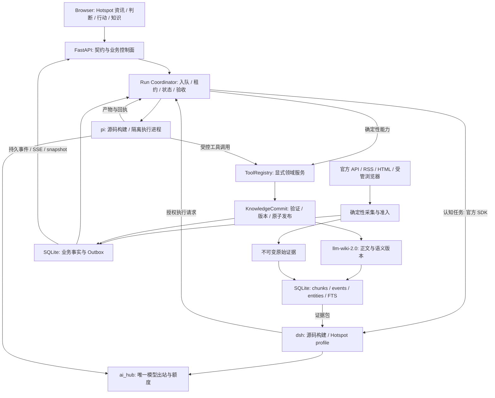
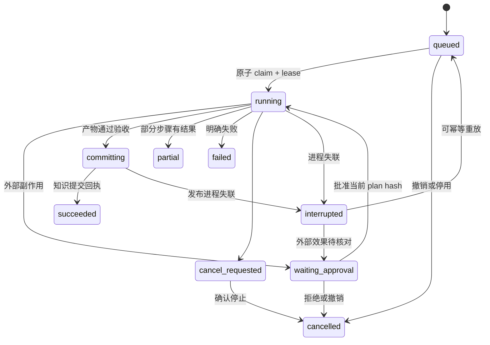

# Hotspot v0.8.3 重构方案

> **实施目标更新（2026-09-05）**：用户要求将重构目标迁至软件 v1.0。当前执行方案为 [v1.0 开发迁移方案](HOTSPOT_V1.0_DEVELOPMENT_PLAN.md) 和 [逐步任务书](HOTSPOT_V1.0_EXECUTION_GUIDE.md)。本文 A0-E 及原发布目标保留为历史技术参考，不要求先完成一个独立 v0.8.3 发布；当前代码仍为 v0.8.2。

> **产品基线更新**：后续用户要求从零重新设计产品，见 [Hotspot 工作台 PRD v1.0](HOTSPOT_WORKSTATION_PRD_V1.0.md)。本文保留为技术与迁移参考；旧页面布局和 20 Skill 首期范围须按新 PRD 重排，不直接作为当前产品要求。

> 日期：2026-09-05。基于 v0.8.2 HEAD `4c686fc33cb1fe79130785f49486398d277a6724`。
> 状态：待实施的设计基线；不是已完成版本。用户指定的产品方向和 dsh/pi 源码复用方向已纳入，不重复请求方向裁决。
> 事实来源：[真实架构审查](V0.8.3_CRITICAL_REVIEW.md)。产品规格：[业务流、Skill 与 UI/UX](V0.8.3_WORKFLOWS_AND_SKILLS.md)。

## 1. 目标与第一性原理

**Hotspot 是安全从业者的看板型 B/S AI 智能体：dsh 负责认知，pi 负责执行，llm-wiki-2.0 + SQLite 承载证据、判断与行动的知识复利。**

价值不是对话次数、资讯条数或 Skill 数量，而是：

1. 关键来源持续可获得，失败能发现、恢复和解释。
2. 收录的信息对岗位有用，能追到原始证据，且不过度漏掉重要变化。
3. 判断区分事实、推断、不确定性，能映射到资产、客户或工作事项。
4. 行动有输入、权限、产物、验收、反馈；可以长期运行、取消和恢复。
5. 下次遇到相似问题时能复用经过验证的知识，减少取证和决策成本。

因此版本顺序是：**真实性与隔离 → 抓取和准入 → 真实 dsh/pi 集成 → 三层闭环与工作台 → 故障演练及效果验收**。不把关键抓取可靠性依赖在 LLM 正常或 pi 常驻之上。

### 1.1 不可变产品约束

- 第一屏是岗位工作看板；主要导航保留资讯、判断、行动，对话在对象详情侧栏。
- 常用 prompt、对话过程、工具和验收标准固化为可版本化 Skill；启用、自动运行、取消是不同操作。
- 现有收藏、搜索、阅读、知识、TODO、CRM、CodeGarden 能力保留，通过路由兼容和能力映射迁移。
- 原始 ingested 资料不删除；不满足新门槛的历史资料标 legacy/unreviewed，不静默清空。
- 单人本地优先，继续使用 React/FastAPI/SQLite；节点数量不能成为拆微服务理由。
- 内部模块仍受现有 url_safety、密钥管理、wiki 路径和 feature gate 约束。
- v0.8.3 交付必须包含可运行的源码 dsh 与 pi 完整路径，不能以 mock 通过冒充最终完成。

### 1.2 对“能力 Skill 化能否支持知识复利”的回答

技术栈支持。Skill 化能统一发现、调用、启停、输入输出、复用与评测，但它本身不产生知识复利。成立条件是每次有效执行写出有证据、有版本、可检索、可修订的产物，并能回到下一次判断中。

业务能力只在能表达“用户要完成什么”时成为 Skill；分页、数据库连接、HTTP 重试、基础准入、加密和缓存是基础设施或 Tool，不包装成需要大模型调度的 Skill。

## 2. 目标技术架构



图中“授权执行请求”走 Hotspot 工具/策略回调，不能在持有 SQLite 写事务、模型并发槽位时等待 pi；避免 brain 等 executor、executor 等 brain 占用的最后一个 LLM 槽位造成死锁。

### 2.1 组件所有权

| 组件 | 唯一职责 | 必须交出的职责 |
|---|---|---|
| Browser | 展示服务端事实、操作业务对象、输入参数与审阅证据 | 不自行决定成功、权限、gate 和额度 |
| Hotspot Run Coordinator | 业务 run/ticket 身份、调度、租约、幂等、审批、终态、产物验收 | 不再自造认知规划循环 |
| dsh | 用户目标理解、证据整理、生成计划、委派 pi、评估结果与建议修订 | 不拥有第二套全局 scheduler，不直接写业务数据库 |
| pi | 在任务范围内选择工具、执行步骤、观察结果、压缩执行上下文 | 不改变全局目标、自动触发源、权限和知识发布规则 |
| ai_hub | 所有模型调用、能力选择、预算、配额、断路器、token 与成本事实 | 不承接任务编排；不强行把 tool calling 降级成纯文本摘要 |
| ToolRegistry | 显式登记业务工具，复用现有 service/repository 方向 | 不按任意模块字符串 import 用户代码 |
| KnowledgeCommit | 知识版本与证据关联的唯一发布入口 | dsh/pi/Skill 不直接自由写 wiki 或 SQLite |

允许 dsh 与 pi 各保留原生 session 日志：前者记录认知交互，后者记录执行事件。**业务成功状态只由 Hotspot 确定**；用 `run_id → dsh_session_id → pi_session_id/attempt_id` 关联，禁止三者双向同步同一个状态字段。

### 2.2 部署与运行边界

- v0.8.3 默认一个 FastAPI 控制进程、一个采集调度 owner、一个受管 dsh runtime、有限 pi 执行进程。仍是本机模块化系统。
- 优先在现有 FastAPI 内管理 run worker，阻塞 SDK/DB 调用进入受控线程；CPU/浏览器/工具执行进入受管子进程。等队列延迟与资源测量证明需要时再拆独立 worker 服务。
- Browser 只访问 Hotspot，同源部署；开发端口沿用 8898 / 8000。dsh 首选 stdio，无需用户配置 3080/3210/8766；预留端口不代表已监听。
- 本地模式绑定 loopback。远程 B/S 使用会话认证、TLS 入口与同源/CSRF 防护，工具/运行权限仍由服务端判断；CORS 不是身份认证。
- 若后续启用多 uvicorn worker，scheduler/claim owner 必须独立或具备租约选主，模型配额集中；不能简单增加 worker 数。

## 3. 直接复用 DeepSeek-Harness 与 pi 源码

### 3.1 源码依赖策略

采用 **锁定上游 commit 的 submodule + Hotspot 自有适配包/profile**。初始候选 SHA 见审查文档上游索引；经构建与协议测试后才能成为发布锁。若项目分发环境不接受 submodule，可改用同 SHA 的校验源码归档，不能引用浮动 main。

拟新增结构：

```text
vendor/deepseek-harness/        上游源码与许可证，锁定 SHA
vendor/pi/                      上游源码与许可证，锁定 SHA
runtime/upstreams.lock.json     repo / commit / toolchain / artifact hash
runtime/dsh-hotspot/            Hotspot profile、tools/model/subagent 插件
runtime/pi-hotspot/             SDK worker、ResourceLoader、受控工具与事件适配
backend/services/dsh/           官方 SDK 适配与生命周期
backend/services/skill_runner/  统一业务调度与结果适配
```

运行层是 Node，业务服务仍为 Python。上游当前共同最低 Node 22.19；dsh 声明 `^22.19.0 || >=24.0.0`、pnpm 11.7.0，pi 声明 `>=22.19.0`。发布构建锁定一个双方验证过的具体 Node 版本；原依赖锁分别保留，禁止把两个 monorepo 的依赖随意合并进 frontend。

“直接应用源码”指 Hotspot 构建和分发已知源码产物，并使用真实 SDK/plugin 能力，不是再写一个叫 dsh 的 mock，也不是把上游全部文件复制到 services。保留 MIT 和第三方 notices，记录本地补丁；必要 core 补丁小范围单独维护，升级时自动检查能否移除。

### 3.2 dsh 接入方案

1. Python 使用本次上游 `HarnessClient/HarnessConfig` 官方 stdio JSON-RPC，设置构建后的 `dsh_bin` 与独立 `dsh_home`。
2. 创建 `hotspot-brain` profile，基于 sdk-minimal 的显式组成验证，装载 session、模型、认知循环、知识读取和委派插件。保留上游 CLI/profile 启动方式。
3. 插件只暴露 `knowledge.search/read_evidence`、业务只读 Tool 和 `hotspot.execute_skill` 委派入口。dsh 的通用 shell/filesystem 等能力按需不装载，保证执行出口可控。
4. 将 dsh subagent provider 扩展为 Hotspot pi 委派适配：通过 Run Coordinator 创建 child attempt、获取执行范围、启动 pi、消费结果。首版只承诺 one-shot；continuable resume 通过协议验收后才上屏。
5. 把当前 `agent_loop` 降为业务阶段/checkpoint 兼容壳，保留历史回放，不再并行生成第二份 plan/reflection。固定 Skill 流程直接执行，不要求 dsh 重新规划。
6. SDK initialize + session create + plan + tool request + result + shutdown 为就绪检查；HTTP 200/进程存活不足以标“脑已就绪”。

### 3.3 pi 接入方案

1. 从锁定源码构建 `@earendil-works/pi-coding-agent`，由 `runtime/pi-hotspot` 使用 `createAgentSession`；保留 SDK 原生工具循环、压缩与事件，不手写替代执行引擎。
2. Hotspot 自有 worker 协议统一 `initialize/start/cancel/get_state` 和 NDJSON 事件；协议字段由本地 schema 定义，不能冒称上游 RPC 已有这些接口。
3. 传入受控 `ResourceLoader`，仅加载批准的 Skill 版本、prompt 与工具；禁用自动发现项目任意 `.pi` 扩展、全局配置和凭据继承。
4. 每个 attempt 使用隔离工作目录和最小环境变量。自有 Tool 通过 Hotspot 调用；需要本地读写/命令时，按 scope 提供文件根和命令能力，并配实际执行隔离。
5. 执行结果包含 `terminal_reason`、结构化 output、artifacts/hash、tool receipts、usage；有文本而无终态、工具失败、stdout 截断均不能算成功。
6. `cancel` 先 SDK abort，超时再终止进程组；测试子孙进程退出。cwd 检查不等于隔离，禁止把字符串路径验证写成 sandbox 验收。
7. CLI 路径保留为旧版兼容/诊断，标记 `legacy_cli`；源码 SDK 路径通过后才切换需要执行的 Skill，不再以 builtin 文本回退假装执行完成。

### 3.4 ai_hub 契约升级是集成前置

当前 gateway 主要走非流式文本调用，不能假设自定义 base_url 一配就支持 dsh/pi。

需要新增受控内部模型协议：messages、system、tool schemas、tool call id、tool result、structured output、stream/cancel、usage、finish_reason、provider capability。dsh 的 llm adapter 和 pi 的 custom provider 都映射到这个协议，再使用现有 provider 选择与弹性层。

- 首版完成非流式多步 tool round-trip，再加增量流；不支持的模型能力明确报 unavailable。
- provider fallback 在请求未产生可观察副作用且契约等价时进行；输出一半工具参数或工具已经执行后，不能透明换模型重放。
- 重试分层：模型网络重试只管模型，采集重试只管源，run retry 只重做可幂等步骤；总预算含各层 attempts。
- ai_hub 在一个持有预算的事件循环接收所有 dsh/pi 模型请求。dsh/pi 只持短期本地 token，不持 provider key；supervisor 清理环境继承，不能仅通过 SDK env 合并实现“白名单”。
- 每 run/skill/provider 有 deadline、最大步骤数、token/费用上限；等待额度也消耗 deadline，避免无限 pending。
- 配额按任务类型保留采集判断等基础份额；禁用 runtime 不影响无 LLM 的抓取/收藏/查询。

## 4. 抓取稳定性与资讯收录门槛

### 4.1 统一源级管道

所有定时、手动、分类刷新、追抓、导入入口必须进入同一个源级任务，不再各写一条落库路径：

```text
SourceDef + cursor + lease
  -> FetchResult (HTTP/304/timeout/rate_limited + 原始字节/响应元数据)
  -> EvidenceSnapshot (hash、URL、抓取时间、parser_version)
  -> ParseResult (结构化条目、正文、解析错误)
  -> AdmissionDecision (accepted / quarantined / rejected + 原因版本)
  -> PersistResult (实际写入数、证据引用、watermark)
  -> Outbox (accepted_item / source_health_changed)
```

复用 crawler_sources 的 cadence、priority、etag、last_modified、cooldown、parser_id；补 `source_revision`、`last_attempt_at`、游标和租约，而不是新建平行信源中心。collector 只负责协议/解析，SourceDef 快照不可变，移除运行时覆盖共享 `self.sources` 的调度方式。

稳定性策略：官方 API/RSS 优先，静态 HTML 次之，受管浏览器仅适配需要 JS 的站点。支持 ETag/Last-Modified/304、Retry-After、指数退避+jitter、域名限并发和熔断、源级 deadline、分页游标与有界重叠追抓。源站正常但无新内容是 `unchanged`，不能等同 dead；连续 200 但正文突然归零是解析漂移，需要与传输失败分开。

抓取与内容解析分别记录成功。来源可访问不代表文章有效，源站停更不代表故障；信源生命周期管理需要 update cadence 和人工停用原因。新源先试运行，使用保存样本验证 parser，不直接扩大正式资讯流。

### 4.2 基础准入与岗位价值分离

| 层 | 判断 | 异常行为 |
|---|---|---|
| G0 基础可追溯 | 来源身份、URL/抓取时间、内容 hash、类型、合法解析 | 进入 quarantine，不进可信流 |
| G1 内容质量 | 乱码/空正文/列表页/诱导页/重复；正文要求按文章、官方短公告、结构化 feed 分类型 | 保留原始资料与原因，支持重评 |
| G2 证据可信度 | 官方原文优先，转载回溯，证据是否支持关键事实，版本是否撤回 | 降置信/待核实，不编造事实补全 |
| G3 岗位价值 | 与资产/客户/行业/当前课题相关性，新增信息、影响与可行动性 | 缺少价值则不进入精选；原始资料仍可检索 |
| G4 多样性和去重 | 同事件聚合，保留多源佐证与矛盾；每类源/主题有曝光上限 | 不能把关键更新误判为旧闻删除 |

G0/G1 最低门槛是 ingestion invariant，不能由用户关掉个性化 Skill 一并绕过。G3/G4 可配置启停或使用严格/平衡模式，但保留基础门槛。LLM 不可用时运行确定性规则，未完成深评的条目标 pending_review，不能默认高价值。

首版可解释打分作为待校准策略：`value=0.30*岗位相关+0.25*证据可信+0.20*增量信息+0.15*影响+0.10*可行动性`，各项 0..100。候选分界 accepted>=70、50..69 待评，低于 50 归资料池；**这不是已验证阈值**，上线前必须用标注集校准。

硬拒绝/证据缺失不允许由高总分抵消。高影响关键预警走“待核实预警”通道，不因新源缺历史评分而被静默压制；展示未证实状态，保持敏感性。多家转载同一新闻不能被算成多份独立证据。

### 4.3 先定义指标再扩大源数量

| 指标 | 分母与窗口 | v0.8.3 候选发布门槛 |
|---|---|---|
| 调度兑现率 | 到期且启用的预期 fetch attempts；7 天，停机时间也计入 | >=99%，失败可追踪 |
| 关键源可获取率 | S0/S1 到期 attempts；有效 2xx 与合法 304 为成功 | >=98%，连续不可用按源单独报警 |
| 解析回归 | 各 parser 的正常、空更新、改版、异常响应固定样本 | 100% 通过；200 错页不能成功 |
| 新鲜度 | 原站可验证发布时间至正式可见；按源承诺 cadence 分组 | p95 <= 2*cadence+10min；不可验证时间单列 |
| 价值 precision | 分层抽样且人工标记的精选资讯 | >=85%，按岗位/主题分别统计 |
| 关键事件 recall | 独立整理的关键公告/事件参考集 | >=95%，不得用 accepted 集自己作分母 |
| 证据完整性 | 正式资讯/判断/行动产物 | 100% 有有效 evidence refs 或明确人工输入来源 |
| 重复曝光 | 精选流人工可见的重复事件条目 | <=5%；证据合并不算丢资料 |

这些是拟定 SLO，先用至少 7 天稳定采集和 >=200 条分层标注（按时间/源拆训练与留出集）检验可行性，再锁正式门槛。不能用此次历史 crawler_runs 的 success/fetched=accepted 数据直接宣告通过。

## 5. Skill、Tool、Workflow 与启停

### 5.1 四个不同概念

- **Tool**：受控原子操作，如 fetch_source、search_evidence、read_document、create_todo。
- **Skill**：可重复岗位任务，封装输入、prompt/流程、工具范围、产物和验收标准。
- **Workflow/Playbook**：Skill/Tool 的固定编排，用于简报、判断到行动、定时巡检。
- **Agent**：由 dsh 在不确定任务中选择 Skill/Tool 并委派 pi；不是每个按钮都要重新思考一遍。

固定查询和维护走 deterministic 快路径。判断/研判走 dsh，涉及文件/工具的复杂执行交给 pi；纯简报生成可以复用固定 workflow + 模型，无需为每篇资讯创建两个 agent。

### 5.2 标准能力包

一个目录承载 `skill.yaml`（唯一机器契约）、`SKILL.md`（人读操作规范）、版本化 prompts、fixtures。运行引用 immutable version/hash；前端获取后端解析出的 JSON Schema，不能解析 SKILL.md 当权限配置。

必需字段：id/version/category、input_schema/output_schema、runner、tools、side_effect、scope、trigger、default_enabled、timeout/step/token/cost budget、retry/idempotency、artifact_type、evidence_policy、acceptance、ui placement。

现有 20 个 builtin 逐一映射，详见配套文档。开发 Agent 的 `.agents/skills` 与产品内置 Skill 分命名空间、存储目录和加载器；用户上传文档中的“skill 指令”不能成为执行授权。

### 5.3 启停一致性

`effective_enabled = extension_gate AND installed AND validated AND user_enabled AND dependencies_ready AND policy_allowed`。

返回 requested_enabled/effective_enabled、unavailable_reason、config_revision、pending_restart。禁用 Skill 阻止新 run 和尚未开始的队列项；在飞 run 默认完成当前原子步骤后停止新步骤，产生 partial/cancelled。用户另行点击取消才发送 cancel 请求，已发生的外部效果不承诺撤销。

已禁用的业务能力仍可读历史；运行时版本升级或启动型 gate 更改需要 restart_pending。parent gate 为 false 不应向 UI 返回 enabled=true；自动触发开关与手动执行开关分别呈现。

## 6. Run 生命周期与可靠执行



复用 trigger_tickets、skill_runs、loop_checkpoints，分迁移增加 `attempt_id`、`parent_run_id`、`lease_owner/expires_at/heartbeat_at`、`revision`、`idempotency_key`、`runtime_versions` 和错误分类。不要新增平行的第四套任务表。

新增持久 `run_events`、`outbox_events`；两者均在 HOT 与业务事务一起提交。大 payload 写不可变 artifact，只在事件中保存引用与 hash，避免 token 流占满热库。token delta 可临时流式展示，状态与工具回执必须持久。

租约过期不直接判“任务没执行”：先核对 attempt、进程和工具回执。旧 worker 的完成回写须带 lease generation/CAS revision，防止恢复后的旧执行覆盖新状态。独立工具 idempotency key 为 `run_id/step_id/effect_version`，外部服务不支持幂等时进入人工核对；不承诺 exactly-once 外部效果。

审批绑定 plan hash、Skill/tool 版本、参数摘要、scope、有效期；计划变更使旧审批失效。只读检索、生成本地草稿在已授权 scope 内执行；发送、修改外部系统、发布等操作按具体能力策略。看板显示等候原因和下一步。

## 7. llm-wiki-2.0 + SQLite：类 SAG 的知识复利存储

### 7.1 单一真相按数据类型划分

| 数据 | 权威来源 | 可重建性与策略 |
|---|---|---|
| 原始资料 | wiki 管理范围内不可变 evidence/blob，含 metadata/hash | 索引可重建，原始快照必须备份 |
| 资讯、判断、行动总结正文 | llm-wiki-2.0 版本化 Markdown + YAML 语义元数据 | 可重建知识索引；人工修订必须保留版本 |
| tickets/runs/approvals/settings/feedback | SQLite HOT 事务数据 | 不是缓存，必须备份；不能从 Markdown 凭空恢复 |
| chunks/语义事件/实体关系/FTS | SQLite 派生索引，关联文档 revision/extractor version | 从知识和证据重建，不同版本不能串引用 |
| dsh/pi sessions | 各自原生日志，Hotspot 存 hash/ref 与关联身份 | 运行追踪材料；不能作为精选知识直接回灌 |

根路径仍经 `wiki_fs/paths.py` 与 resolve_wiki_root；先盘点现有 items/inbox/concepts/raw 约定，再在单根内扩展 evidence/revisions，不新建第二知识根。顶层语义 `layer=information|judgment|action` 与 KL 的加工状态是两个维度，不能把三层塞进一个五阶段枚举。

### 7.2 数据模型

优先扩展已有 knowledge_items、knowledge_chunks、item_entities、knowledge_links；具体 SQL 编号由实现时最新 migration 尾号确定，禁止预占错误编号。

新增或扩展的逻辑实体：

| 实体 | 最小字段/约束 |
|---|---|
| evidence_snapshot | id、source_id、canonical_url、published_at、fetched_at、content_hash、blob_ref、parser_version、document_revision；hash 去重 |
| admission_decision | evidence_id、verdict、reason_codes、各维分数、rule_version、reviewer、decided_at；追加版本 |
| knowledge_revision | item_id、revision、layer、body_hash、evidence_refs、supersedes、review_status；语义内容以 md 为准，DB 为投影 |
| semantic_event | id、chunk_id、document_revision、event_text、occurred_at、extractor_version；不同于系统 outbox event |
| entity/event_entity | canonical entity、aliases、entity_type、事件关联与提取置信；复用现有实体做兼容映射 |
| knowledge_link | from_revision、to_revision、supports/contradicts/derived_from/acted_on/validated_by；每条推断关系带证据 |
| judgment | 问题、claim、事实/推断、置信、证据、反证、适用资产、建议行动、复查时间；正文在 wiki，状态投影在 DB |
| action | judgment_ref、run_ref、scope、预期结果、验收、实际结果、复盘；事务执行归 run，最终总结归 wiki |

三层共享 evidence ref：`{evidence_id, document_revision, chunk_id, char_start, char_end, content_hash}`。Markdown 更新后旧引用仍指向旧版本，不用当前同名文件假装原证据。

### 7.3 首版有界检索

1. 解析查询对象（CVE、厂商、资产、标准、日期、岗位场景），按权限和 review 状态过滤。
2. FTS5 的中文/英文索引寻找 chunks 与 semantic events 种子；精确 CVE/产品 ID 给独立高权重。
3. 从种子事件经 entity 关联做 1..2 跳有界 SQL 扩展，限制实体度数与总候选数，降低高频泛化实体影响。
4. 查询时形成局部候选事件集合，排序、去重后返回原始 chunk，携带扩展原因、文档版本、支持/矛盾关系。
5. 只有证据包经过校验后 dsh 才生成判断；无证据明确输出 insufficient_evidence，不生成看似完整的建议。

向量检索作为可插拔 RetrievalPort 后续加入。只有留出集表明 FTS+实体扩展召回不足，才选 SQLite 向量扩展或外部引擎；本版不以图谱可视化、SAG 名称或未复现 SOTA 替代效果测量。

### 7.4 跨文件与数据库提交

不能声称 SQLite 事务包含文件系统原子写；WAL 模式跨 ATTACH 数据库也不能当作掉电时全局原子事务。

发布协议：

1. HOT 事务记录 commit intent，绑定 run/step、目标 revision、expected previous hash 和 artifact hash。
2. 在 wiki 同文件系统写唯一临时文件，flush/fsync，原子 rename 为不可变 revision，再校验 hash；目录持久化策略按目标 OS 验证。
3. 更新知识索引/FTS 投影，HOT 事务登记 commit receipt 与 outbox；若索引在 WARM，使用 revision/hash 对账重试，不假装跨库原子。
4. 发布查询只读取有完成回执的版本；进程在 2/3 之间崩溃时，恢复器按 intent+文件 hash 完成投影，重复调用返回同一 receipt。
5. 外部手工改 Markdown 由 watcher 转新 revision，冲突时保留双方供合并；不能用最后写覆盖用户修订。

### 7.5 复利评估与防止自我强化

原始观察、模型推断、人工确认、行动实测分不同来源类型。生成内容引用自己不计新证据；点击赞不等于事实正确，反馈只能调整偏好权重或进入审阅流程，不能自动提高事实置信。

衡量复利：证据引用有效率、经验证结论复用率、同类判断耗时、重复调研减少量、行动验收率、被撤回结论的下游更新时延。保存反证、失败复盘和过时条件；新证据使旧判断进入 needs_review，不能一味累计“成功经验”。

## 8. 前后端一致性与效率

### 8.1 契约单一来源

- FastAPI/Pydantic 定义 DTO 与 OpenAPI；增加生成 TS 类型/client 的固定脚本，CI 检查生成结果无漂移。
- 动态 Skill input/output 使用 JSON Schema，服务端强校验；前端表单用同一 schema 的 required/enum/range/default。
- API 返回统一错误 `{detail:{message,code,hint,trace_id,retryable}}`，保留现有格式兼容；不能把失败显示成空列表。
- 新增能力快照接口（拟定）`GET /api/capabilities`；现有 skill-registry 路由继续兼容，新 run/query/event 路由通过小文件分域接入。
- `POST /api/skill-registry/{id}/run` 演进到 202 + ticket_id/run_id/status_url；旧客户兼容期记录 contract_version。
- 拟定 `/api/runs/{id}`、`/api/runs/{id}/cancel`、`/api/runs/{id}/approvals`、`/api/events` 和 `/api/workbench/summary`。这些是待实现接口，不是当前可访问端点。

### 8.2 缓存与实时状态

TanStack Query 在工作台、资讯、判断、行动按域渐进接入，沿用 apiFetch 的错误解析和 AbortSignal。query key 包含过滤条件、用户、能力/config revision；mutation 成功按对象失效，不刷新全站。

服务端业务事件与事务通过 outbox 保证对应。SSE 每事件有 event_id、run_id、aggregate_revision、type、payload_version；客户端按 revision 去重，支持 Last-Event-ID 重放。游标过期返回 resync_required，重新取 snapshot；断网/页面隐藏时暂停无意义轮询，重连后校正状态。

长任务从同步请求改为入队，UI 立即获得身份而非等待子进程结束。需要审批/失败/不可用保留清晰状态，乐观更新只用于可逆偏好，运行成功必须等最终回执。

### 8.3 性能改进范围

后端：源级不可变请求、连接池、短 SQLite 写事务、批量 upsert、keyset 分页、增量索引、带 watermark 的预聚合看板；禁 N+1 明细查询和循环扫描全部 wiki。共享并发与 provider 预算必须覆盖子进程请求。

前端：保留路由懒加载与 manualChunks；长列表按实际数量虚拟化，避免载入全部日志；图谱按查询加载局部邻域。SSE token delta 批量渲染，使用固定高度滚动容器防跳动。

候选预算：10万条资讯/1万知识条目、声明机器配置、3 个并发受管任务下，热点列表 warm p95<300ms，看板 summary p95<500ms，提交队列 p95<300ms，业务状态变化到屏幕 p95<2s；首屏 LCP<2.5s，互动 INP<200ms。真实模型/外网时延单列，不计入数据库查询延迟。先测现状再锁指标，不宣称本次已经达成。

## 9. 分批实施与验收

| 批次 | 工作内容与责任边界 | 退出条件 | 对应审查 |
|---|---|---|---|
| A0 可信基线 | 测试进程级隔离；生产 mock 指标移除；建立现网统计口径、配置/数据清单 | 模拟 runner 不触碰真实数据；unknown 如实显示；形成可复跑基线 | F12/F13/F15 |
| A1 抓取与准入 | 统一单源持久化、采集计数、源租约、门禁异常 quarantine、证据快照 | 强制 upsert 失败不能成功；重试不重复收录；关键源样本通过 | F02/F03/F09/F10 |
| A2 任务与模型契约 | worker 生命周期、handler、真实票据关联、run 状态、idempotency、tool-capable ai_hub | HTTP submit 到产物闭环；模型 tool result 可往返；断连可恢复 | F01/F07/F08/F09 |
| B 源码运行时 | dsh/pi 锁版本构建、官方 SDK、profile、pi worker、受控 tools、取消与预算 | 真 dsh 规划 → 真 pi 调工具 → 真产物回执；禁 mock | F05/F06/F07 |
| C 知识与岗位 Skill | 知识提交协议、证据版本、事件实体检索、20 skill 迁移、首批岗位流程 | 资讯→判断→行动→复盘→下次检索可追溯闭环 | F04/F10/F11 |
| D 工作台 | typed API、Query/SSE、能力启停、三层对象视图、旧路由兼容 | 双端同状态；重连/停用/审批/失败真实可操作 | F12/F14 |
| E 发布收口 | 7 天 soak、价值标注、故障注入、恢复备份、性能与全量回归 | 下述 release gates 全部满足，才发布 v0.8.3 | 全部 |

A1 可先以 v0.8.3 内部 alpha 交付并开始 7 天观测；后续批次不能延后抓取修复。粗估 A0-A2 8..13 人日、B 8..15、C 7..12、D 5..8、E 4..6，总计 32..54 人日，加不压缩的 7 天观察窗口。估算不是承诺；A2/B 协议原型完成后按实际差距重估，避免用旧“桥已写好”的印象报一周交付。

### 9.1 发布门禁

- 测试隔离后再跑 core 全量 pytest、ruff、pip-audit、启动冒烟、feature gate 全开/全闭和 `generate_meta.py --check`；agent assets lint 同 CI。
- 前端 tsc、Vitest、Vite build、业务 E2E；Playwright 在 1440/1920 桌面与 390/768 窄屏检查重叠、可达、取消/审批/详情与空态。
- 真实运行测试与 fake fixture 分目录/marker，日志写 `runtime_kind=test|mock|live`、源码 SHA、模型和协议版本；发布 gate 要求 live trace + artifact hash，不能用测试 seed 计数。
- 关键故障：429/503/DNS/timeout、304/空页/改版、SQLite busy/disk-full、进程在认领后/工具后/rename 后退出、重复 webhook、取消竞态、SSE 断连与事件重放。
- 7 天关键源覆盖与价值/召回评估达到已锁门槛；恢复备份到独立目录后验证证据、run、知识引用和检索可用。
- 所有成功任务必须有 acceptance receipt；审批、失败、未知、取消互不伪装。远程部署须单独验收访问控制。

### 9.2 迁移与回滚

扩展 schema、读兼容、按 Skill/源分流、观察、最后切写；仅允许一个权威写入者。新增功能的运行 gate 初始关闭，由能力依赖就绪后开启；不恢复 v0.8.2 已删除的无消费者 gate 键。

停用新运行时只阻止新单，旧 run 进入可解释状态。回滚到 v0.8.2 保留新表、新证据和版本文件，禁 drop 数据；旧版看不到新状态时用兼容 API 投影，不能把 interrupted 映射 succeeded。重放只对幂等工具启用。先完成加密/备份恢复演练，再迁移生产写入点。

每批更新 DEV_LOG、PROGRESS；变更注册点运行元数据生成。发布时才修改 APP_VERSION，不能因为方案命名 v0.8.3 就把当前软件版本提前抬高。

## 10. 第二轮批判性审查与方案修订

| 反向质疑 | 推导 | 本方案已吸收的修订 |
|---|---|---|
| 两个 Agent 是否多余、成本翻倍？ | 固定任务不需要两个模型循环；认知与执行的不确定性不同 | deterministic/固定 workflow 快路径；dsh 管全局计划，pi 只处理受限执行 |
| 再增加 coordinator 是否第三个大脑？ | 排队/幂等/审批不是认知推理 | coordinator 只做确定性控制，退役自制 PLAN/REFLECT |
| 自有 pi worker 是否又在手写引擎？ | 跨语言需要传输层，但不需要重写执行循环 | worker 仅封装上游 AgentSession 与生命周期，循环/压缩复用源码 |
| 直接复用 dsh Web 会更快？ | 容易带入第二工作台和会话中心，破坏岗位对象流 | 使用 SDK/profile；Hotspot 保持唯一产品 UI |
| SQLite 是否真够用？ | 单人、短事务、有界并发适合；跨库/文件不天然原子 | 单 HOT 控制事务、版本 journal、明确重建边界；量化阈值触发后再评估 PostgreSQL |
| wiki-first 会不会丢事务状态？ | 文档不是队列/审批数据库 | 按数据类型划真相；不再声称所有 SQLite 都是缓存 |
| 高门槛会不会漏掉新威胁？ | 低信誉新源也可能首次报道重大事件 | 待核实高影响通道、独立 recall 集、可重放 quarantine |
| 只用关键词是否配叫 SAG？ | FTS 缺语义召回，图标签也不是动态事件检索 | 明确称类 SAG 首版；有界事件实体扩展，可插拔向量并经留出集验证 |
| 运行记录能否直接成为记忆？ | 测试、错误结论、自生成报告会污染下一次推理 | provenance 分层，verified 才算高置信记忆，保留反证与失效条件 |
| 启停是否能彻底阻止在飞操作？ | 外部副作用发生后无法撤销 | stop-new/drain/cancel 独立语义，工具回执及审批绑定具体版本 |
| ai_hub 集中会不会成为瓶颈？ | 是治理入口，也是潜在等待热点 | 单 loop 公平预算，deadline 含排队，模型网络不持数据库事务；按实测扩展 |
| 计划范围是否过大？ | 抓取、运行时、知识、UI 同时重写有高回归风险 | 分 A0-E 可验收阶段，先实用抓取修复再迁移，保持旧功能与数据 |

复核后保留的不确定性：上游 alpha 的 API 稳定性、pi 与当前 provider 的工具调用兼容、源站长期可用性、不同岗位的筛选阈值、三库备份恢复时点一致性。它们分别有构建协议门、live trace、7 天观测、标注集和恢复演练，不用更多概念组件掩盖。

本版完成的判据是一个真实岗位案例跨越三层并在下一次任务中复用，而不是目录里同时出现 dsh、pi、skills 和 wiki。
