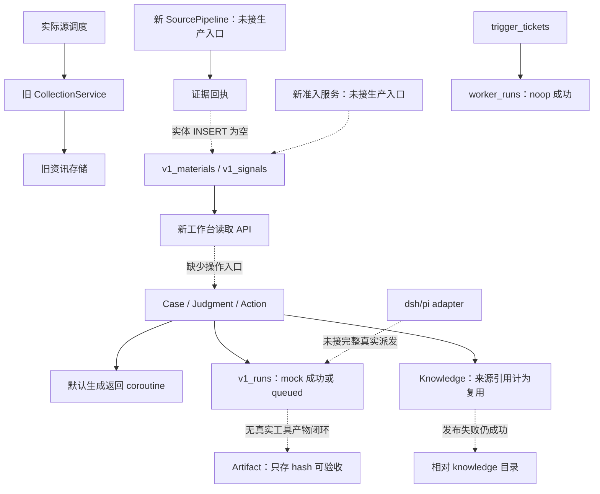

# Hotspot v1.0.0 实现审查：发布阻断、业务闭环与整改验收

- 审查时间：2026-09-07 09:46，Asia/Shanghai。
- 审查基线：`943a31d..bdac95f`，160 个文件，新增 26,852 行、删除 124 行，包含设计文档与测试。
- 关联记录：CHECK-0003、DEV-0154。
- 结论：**当前实现不能按原 PRD 判定为 v1.0.0 完成或可发布。已有领域模型、数据库、API、部分状态守卫和看板基础，但可信输入、真实执行、业务验收、知识复用、迁移恢复均存在闭环阻断。**

## 1. 主要发现

以下 P1/P2 是代码缺陷严重级别，不等同 PRD 的功能范围 P0。静态证据指已核对实际调用关系；隔离复现指只在临时目录或内存数据库运行。没有证明真实生产事故发生，不将风险写成已发生的数据损失。

### R01 [P1] 证据提交成功不代表资料落库

位置：[v1_evidence_service.py:290](/path/to/hotspot/backend/services/v1_evidence_service.py:290)，提交状态更新在同文件 226 行附近。

`_insert_subject`、`_insert_material`、`_insert_signal` 均为 `pass`，但 `commit_intent` 仍将回执标为 committed。注释要求调用方提前插入，实际 `SourcePipeline` 没有执行该插入；intent 只保留 body hash，不能从中恢复原文。

- 触发：正常采集结果交给新管道提交。
- 结果：隔离复现 `items_committed=1`、`committed_receipts=1`，而 `v1_materials` 为 0 行，游标已推进。
- 影响：资料池没有证据，后续引用校验失败；“成功收录数”失真。T05 的统一提交承诺未成立。
- 修复与验收：一个提交 owner 负责实体、证据版本、回执和待投影记录的事务；持久化可恢复 payload。验收必须查询正文及实体，再杀进程恢复，不能只断言回执状态。

### R02 [P1] 新采集与准入服务没有接入线上调度

位置：[source_pipeline.py:15](/path/to/hotspot/backend/services/source_pipeline.py:15)、[source_scheduler_service.py:80](/path/to/hotspot/backend/services/source_scheduler_service.py:80)、[collection_service.py:529](/path/to/hotspot/backend/services/collection_service.py:529)。

真实启动仍创建 `CollectionService`，源调度调用旧 `run_one_source`。生产代码中未发现实例化 `SourcePipeline` 或 `V1AdmissionService` 的业务入口，新信号 API 却读取 `v1_signals`。旧路径将 fetched 当 accepted，upsert 异常被捕获后仍可能返回 success；quality hook 异常时放行原始条目。这些旧文件在本次 diff 中未被修复。

- 影响：T06/T07 新单测即使通过，用户最重视的稳定抓取、价值准入依然走旧行为；看板与真实收录分属不同数据链。
- 补充：`v1_admission_service.py:121` 明示 rules=None 不查库，默认 neutral；当前规则主要处理来源 allow/deny，不能证明基础证据门槛与岗位精选已实现。
- 修复与验收：先选一个关键源，让真实 scheduler 经过原始快照、基础门槛、岗位精选、证据提交进入看板。失败保留原始输入并进入待核实或隔离，不得记 accepted；验证 304、200 错误页、429、解析失败、落库失败和重启追抓。

### R03 [P1] 写入失败后推进采集游标，会跳过未保存资料

位置：[source_pipeline.py:309](/path/to/hotspot/backend/services/source_pipeline.py:309)。

逐项解析或证据提交失败只增加 `items_failed`；只要有 next_cursor，仍执行 watermark.advance，outcome 保留 success。

- 隔离复现：`committed=0, failed=1, outcome=success, cursor=page=2`。
- 影响：接入真实采集后，下次从后一页继续，未保存项可能永久漏收。
- 修复与验收：仅推进到已持久化的连续位置，或先持久化整页及重放清单；幂等键由来源对象及版本确定，重试 attempt 不应改变同一内容身份。注入中间条目失败，重启后验证无漏收、无重复版本。

### R04 [P1] 生产 worker 消费票据但没有执行 Skill

位置：[worker_pump.py:75](/path/to/hotspot/backend/scheduler/jobs/worker_pump.py:75)、[worker_coordinator.py:207](/path/to/hotspot/backend/services/worker_coordinator.py:207)。

pump 调用 `coordinator.consume(req)` 不传 task_fn，默认 `_noop_task_fn` 只记日志并返回空 items，随后 worker_runs 标 succeeded、trigger_tickets 标 done。构造请求也没有传递 Skill 身份供实际执行路由使用。ai_hub/case_service 队列被直接 continue。

- 影响：pending 下降并不代表任务得到处理，F01“无人消费”被替换成“消费后空成功”。
- 修复与验收：必填真实 dispatcher，绑定 Skill ID/版本、输入、授权、Run ID，执行前复核启停与依赖；未知类型失败而非 noop。用生产 scheduler 入口触发一次真实受控本地工具，检查输出文件和 Run/票据关联；仅注入成功 task_fn 的协调器单测不算接线验收。

### R05 [P1] 行动默认 mock 成功，真实协议只排队不派发

位置：[action_api.py:64](/path/to/hotspot/backend/api/action_api.py:64)、[run_service.py:147](/path/to/hotspot/backend/services/run_service.py:147)、[action_service.py:265](/path/to/hotspot/backend/services/action_service.py:265)。

API 和 service 均默认 `protocol=mock`；Run 创建时直接 succeeded，steps/artifact_ids 为空，并尝试将 Action 标成功。选择 pi/dsh/direct 时只创建 queued 记录，未发现生产消费者推进这些 `v1_runs`。worker_runs、skill_runs、v1_runs 没有完整的一次执行关联。

- 影响：默认路径虚报完成；显式真实模式不能完成任务，违反 AC-07。
- 事务补充：Action 先 CAS 为 running 并独立 commit，随后才创建 Run；后者校验或落库失败会留下无 Run 的 running Action，重试 start 又被状态检查拦截。
- 修复与验收：生产配置拒绝隐式 mock，未就绪显示 blocked。事务性创建 Run/派发意图；Run 执行成功、产物验证和业务验收分开。测试默认 HTTP 请求、重复请求、Run 插入失败、真实执行、取消、超时、重启，而非只验证数据库状态变换。

### R06 [P1] “live trace”验证的是模拟程序，且适配协议与上游不符

位置：[t10_live_trace.py:267](/path/to/hotspot/scripts/t10_live_trace.py:267)、[pi/live_session.py:54](/path/to/hotspot/backend/services/pi/live_session.py:54)、[dsh/live_bridge.py:56](/path/to/hotspot/backend/services/dsh/live_bridge.py:56)。

`--live` 仅检验 vendor SHA，实际启动 `python -c _DSH_MOCK` 和 `_PI_MOCK`；即使捕获 error frame，最后也固定返回 `live_trace=ok`。因此 lock 中 live_trace_recorded 不能作为真实源码运行证据。

本地未跟踪 upstream 源码提供了进一步反证：pi RPC 命令采用 `type: prompt/abort/new_session`，本地 adapter 却发送 `event: init/prompt/cancel`；默认命令既无 `--mode rpc`，也没有指定 vendor 工作目录。dsh checkout 是 Node/TypeScript monorepo，默认 adapter 却尝试 `python -m deepseek_harness`，没有对应构建/启动桥接证据。

- 上游核对位置：`runtime/upstreams/pi/packages/coding-agent/src/modes/rpc/rpc-types.ts:22`、`runtime/upstreams/dsh/package.json`。这些是本地 checkout 静态核对，本次未重新构建或联网运行。
- 修复与验收：锁定源码、工具链、构建产物及 cwd，按上游真实 SDK/API 编写桥接；使用受控临时工具验证模型请求、工具请求、执行、结果回注和最终产物完整往返。trace 任一必需环节失败，验收必须失败；mock trace 必须独立命名。

### R07 [P1] 默认模型调用未 await，判断、行动、经验生成无法解析

位置：[judgment_service.py:267](/path/to/hotspot/backend/services/judgment_service.py:267)、[knowledge_service.py:218](/path/to/hotspot/backend/services/knowledge_service.py:218)；同类问题在 action_service.py:184、sk01_daily_priority.py:161。

`ai_service.generate_text` 在 service.py:341 定义为 async，四个同步 `_call_dsh` 却直接返回它。解析器收到 coroutine，不是文本。

- 隔离复现：调用真实默认 KnowledgeService 路径，不等待或执行模型网络请求，返回 `is_coroutine=true`；实际解析器报 `AttributeError: 'coroutine' object has no attribute 'strip'`。
- dsh 分支还有 `LiveDSHClient(timeout=30.0)` 与真实参数 `timeout_s` 不符的问题；失败后降级到同一个错误路径。
- 修复与验收：明确端到端异步边界，避免嵌套启动 event loop；测试真实默认调用路径，用异步 fake provider 截断外部网络，不能用同步 dsh_caller 绕开待验证部分。

### R08 [P1] 产物正文没有保存，仍能验收通过

位置：[artifact_service.py:97](/path/to/hotspot/backend/services/artifact_service.py:97)、[artifact_repo.py:22](/path/to/hotspot/backend/repository/artifact_repo.py:22)。

create 只用 content 计算 hash/size，数据库没有正文，`content_ref` 又允许为空；verify 只接受调用方传入的 pass，未验证存储内容，accept 不要求文件可读。

- 隔离复现：真实 ArtifactService/Repository 与迁移 schema，`status=accepted, content_ref=null, body_saved=false`。探针使用内存库、未启用外键，不用于证明孤儿 Run 可通过生产约束；正文缺失与验收缺失是独立问题。
- 修复与验收：先可靠保存产物，再提交可读取的内容引用、hash、版本、Run ID；验证从存储重新读取并匹配 hash，失效引用和缺文件不能通过验收。人工确认必须能打开具体产物。

### R09 [P1] 名为 CAS 的产物状态更新没有比较旧状态或版本

位置：[artifact_repo.py:114](/path/to/hotspot/backend/repository/artifact_repo.py:114)。

`update_status_cas` 实际 WHERE 只有 id，没有 expected_revision 或旧状态。Service 的先读后写无法阻止两个并发请求同时通过检查。

- 隔离探针：已 accepted 后调用旧更新，仍返回 rowcount=1 并变成 rejected。该探针验证缺少数据库原子条件；实际竞争触发是 verify/accept/reject 请求在写前交错读取。
- 修复与验收：状态更新包含 revision 与允许前态比较，失败返回明确冲突；用两个独立连接的交错请求验证只成功一个，已验收历史不能被旧请求覆盖。

### R10 [P1] Wiki 写入失败仍发布，写入根与记录路径也不一致

位置：[knowledge_service.py:283](/path/to/hotspot/backend/services/knowledge_service.py:283)、[judgment_service.py:398](/path/to/hotspot/backend/services/judgment_service.py:398)、[wiki_fs/store.py:21](/path/to/hotspot/backend/wiki_fs/store.py:21)。

发布使用 `WikiFs("knowledge")`，该类将参数作为相对 cwd 的根目录，不使用 HOTSPOT_WIKI_ROOT。记录的 `knowledge/{id}.md` 与实际 `knowledge/items/knowledge_{id}.md` 不同。两个发布服务在文件失败后仍允许 published。Knowledge、Judgment 调用证据服务时还传入不支持的 entity_type，并吞掉错误。

- 影响：已发布内容不可通过记录路径还原；配置的数据根、备份与实际写入分离；仅设置测试环境变量不能覆盖这个相对路径写入。
- 修复与验收：统一文件根与 canonical path，采用可恢复的提交协议。若文件是权威正文，写失败不得 published；若仅是可重建投影，必须有可靠权威正文、待修复状态及恢复任务。只读磁盘、rename 前后崩溃、配置根切换及备份恢复均需读回验证。

### R11 [P1] 迁移丢失正文和记录身份，并将不完整知识直接发布

位置：[legacy_items_migrate_service.py:114](/path/to/hotspot/backend/services/legacy_items_migrate_service.py:114)、[legacy_migrate_service.py:31](/path/to/hotspot/backend/services/legacy_migrate_service.py:31)。

真实旧表迁移 SELECT 不读取 body，使用类型、标签、链接拼接替代正文；hash 不包含旧 ID、标题或原正文。不同记录元数据相同就被“幂等”合并。每条生成随机新 ID，未建立稳定迁移映射；仅写 v1_knowledge，未迁移引用、修订及 Wiki。`kl:publish` 直接映射 published。

- 隔离复现：两条不同标题、不同正文的旧记录，`candidates=2, applied=1, skipped=1`，迁移后为一条 `body="", status=published`，无错误。
- 边界：旧行没有被物理删除；问题是新工作台的数据表示缺失和混淆。`LIMIT 4000` 无分页、SQL 对 NULL lifecycle 的排除，还会漏掉部分候选。
- 另一条所谓旧知识迁移从 `dev_data/seed.json` 读取开发样本，不能当生产历史迁移；旧 Skill deprecated 只修改进程内 frozen dataclass 的 `__dict__`，重启不持久。
- 修复与验收：稳定 `legacy_source + legacy_id -> new_id` 映射，分批水位，正文、引用与状态逐条对账；无法恢复正文的项进入明确 incomplete/pending_review，不进入已验证经验。开发样本导入和真实迁移命令分离；测试同元数据不同正文、NULL、超过 4000 条、重跑、迁移中断及切换后的新增写入。

### R12 [P1] WARM/COLD 直接复制 db 文件会丢失已提交 WAL 数据

位置：[t02_backup_drill.py:94](/path/to/hotspot/scripts/t02_backup_drill.py:94)。

HOT 使用 SQLite backup API，WARM/COLD 使用 `shutil.copy2`。没有并发写入并不等于没有尚未 checkpoint 的 WAL；脚本也未建立三库与 Wiki 的业务一致性水位。

- 隔离复现：保持 WAL 数据库连接打开，建表并 checkpoint，再插入一行并 commit；调用真实备份 helper 复制 `.db`。原库 1 行、副本 0 行，副本 `integrity_check=ok`。
- 修复与验收：三库都使用 SQLite backup 或经验证的静止快照；文件与数据库通过备份清单/统一逻辑水位关联。恢复后抽查跨层证据及正文、产物，而非只比 hash 和 integrity。备份耗时不能替代 RPO。

### R13 [P1] 四个前端列表 API 拼出双问号，关联列表实际请求错误

位置：[frontend/src/api/v1.ts:160](/path/to/hotspot/frontend/src/api/v1.ts:160)，另见 365、392、403 行附近。

listJudgments/listActions/listRuns/listArtifacts 已包含 `?case_id=...` 或父 ID 参数，又追加返回前导 `?` 的 buildQuery。事项详情固定传 limit，因此正常使用即可触发。

- Node 探针提取仓库真实 buildQuery 和四处模板，均生成类似 `?case_id=ID?limit=50`；解析后 ID 包含 `?limit=50`，limit=null。
- 影响：26 字符 ID 超过服务端 max_length 后 422，或短 ID 查询空集；UI catch 将其变成空数据，破坏整个事项关联视图。
- 修复与验收：一次用 URLSearchParams 构建全部参数；客户端契约测试验证 URL，再从事项页面验证真实 judgment/action/run/artifact 均可见。

### R14 [P1] 新工作台只有读取流程，不能完成岗位任务

位置：[V1Prototype.tsx:22](/path/to/hotspot/frontend/src/components/v1/V1Prototype.tsx:22)、同文件 330、393 行附近。

四个新入口复用原型。组件只导入 list/get API，按钮用于导航，没有创建事项、选择证据生成判断、审阅发布、批准行动、启动取消、产物验收和经验采用等 mutation。API client 中存在函数不能代替用户可以操作的流程。

- 还保留按 CASE001 等样本 ID 匹配的 mock fallback。不是每个真实事项都会显示 mock，但空结果/失败也不能触发模拟业务状态。列表加载异常转 []，违反“不可用不能显示零”的 AC-11。
- `hasMissingAssets` 根据“有 Action 无 Artifact”推断资产缺失，混淆执行前的资产上下文与执行后的产物。
- 修复与验收：以一个真实 Case 为中心实现任务动作及失败恢复，依据 allowed_actions 展示命令；删除生产 mock fallback，区分 loading/empty/stale/error。新用户仅通过浏览器完成闭环，不能借黄金脚本提前写完结果。

### R15 [P1] 六个 Skill 的注册没有形成可执行契约

位置：[v1_skills.py:120](/path/to/hotspot/backend/services/skill_registry/v1_skills.py:120)、[skill_runner/dispatch.py:139](/path/to/hotspot/backend/services/skill_runner/dispatch.py:139)、[sk01_daily_priority.py:35](/path/to/hotspot/backend/services/skill_registry/sk01_daily_priority.py:35)。

- SK-05 target `/api/v1/knowledge/{id}/reuse` 的路径没有插值；输入叫 knowledge_id，dispatcher 只作为 query 发送。
- SK-06 把模块函数放入 class_name、method=None，解析时把函数当构造器调用后执行 getattr(..., None)；隔离替换 job 避免实际扫描后复现 TypeError。
- SK-03/04 的 schema 允许提交缺少 service 必填参数的输入，例如 SK-04 未定义 subject_name/cve_id/evidence_materials，实际签名却要求这些值。
- SK-01 查询 admission_log.action/subject_id，而 migration 097 没有这两列，异常被当作缺数据返回 []。

修复与验收：每个 Skill 使用明确的 adapter 组装运行上下文，schema 与实际调用一致；注册检查应解析 target、校验签名、验证输出结构。逐个从 Skill API 的真实 runner 跑到产物，覆盖最小合法输入、停用、缺依赖、取消与版本回放。注册数量=6 不等于六项能力可用。

### R16 [P1] “知识复用”统计把知识来源当成新任务采用

位置：[knowledge_service.py:249](/path/to/hotspot/backend/services/knowledge_service.py:249)、同文件 445 行，[test_knowledge_reuse.py:63](/path/to/hotspot/backend/tests/test_knowledge_reuse.py:63)。

新知识建立时，来源 judgment/action 都以 role=used 写入 refs；get_reuse_receipt 只是计数。测试断言刚生成的知识 total=2，尚未发生第二次任务使用。SK-05 也只读取这份计数，没有完成检索、适用条件比较、采用及效果反馈。

- 经验生成仅凭传入 source IDs 和证据 hash，不验证来源 Action 是否已完成、产物是否 accepted。
- 影响：来源追溯被误报为复用成效，无法证明“资讯到判断到行动再改善下一次工作”的知识复利。
- 修复与验收：区分 derived_from 与 adopted_by；每次采用绑定新 Case/Judgment/Action、知识 revision、条件差异、采用决定与结果。新知识复用数从 0 开始；第二个不同资产版本的案例应提示不适用或需调整，撤回知识影响相关活跃事项。

### R17 [P1] 有行动关联的事项永远不能关闭

位置：[case_service.py:406](/path/to/hotspot/backend/services/case_service.py:406)。

close_case 只查询 `v1_case_actions` 是否有任意行，存在就判定 active；Action 创建写入的历史关联不会随完成消失。即使 Action、Run、Artifact 全部完成，该 Case 仍被拦截。没有 Action 的事项又缺少按模板完成条件的验收。

修复与验收：检查真实活跃 Run、所需产物与业务验收；保留历史关系，不以删除关联作为“完成”。测试成功完成、取消后明确关闭、仍在运行、无产物、研究型无行动事项五条路径。

### R18 [P2] SSE 通知被静默丢弃，前端也没有真正刷新详情

位置：[action_api.py:221](/path/to/hotspot/backend/api/action_api.py:221)、[action_service.py:311](/path/to/hotspot/backend/services/action_service.py:311)、[V1Prototype.tsx:723](/path/to/hotspot/frontend/src/components/v1/V1Prototype.tsx:723)。

路由通过 asyncio.to_thread 执行 service，线程中 get_running_loop 失败，事件直接 skip。这不是罕见降级，而是正常 API 路径。前端 hook 主要 setTab，未传 case refetch 回调；相同 tab/Case ID 下 effect 不会重新加载。事件总线只有进程内队列，无事件 ID/持久化补发。

修复与验收：业务事务写 outbox，再由事件循环广播；前端按对象 ID/revision 失效缓存，不因后台事件强制跳转用户页面。用真实 HTTP mutation + SSE 连接验证，覆盖同页面、断线重连、错序和重复事件。

### R19 [P2] 前后端契约和性能仍存在多套真相

位置：[knowledge_api.py:184](/path/to/hotspot/backend/api/knowledge_api.py:184)、[V1Prototype.tsx:350](/path/to/hotspot/frontend/src/components/v1/V1Prototype.tsx:350)。

有领域 Pydantic 模型和生成 TS 的基础，但多处业务 API 使用 response_model=None、手写 dict，前端又手写部分接口。类型生成没有约束实际 HTTP 响应，无法防住 R13/R15。事项详情逐个 Action 请求 Run，再逐个 Run 请求 Artifact；知识也串行拉每条复用计数，且固定前 10 个 Run/Artifact 未补全分页。

修复与验收：以运行中的 HTTP 契约为单一边界，生成客户端并校验响应；建立 Case 聚合查询或有界并行/分页。测实际事项规模下的请求数、截断提示与延迟，不能仅以 tsc 通过认定前后端一致。

### R20 [P2] 发布台账与可复现质量门不一致

位置：[task-status.md:13](/path/to/hotspot/docs/v1.0/task-status.md:13)、同文件 28-41 行。

T04 标 verified 同时注明待真 vendor；T18 切换回退被迁移工具替代；T17 全故障验收被启停/SSE 检查替代；T19 已标发布完成。但本次 Ruff 实测 148 errors，全部位于变更文件，其中 4 个 F821 是 gateway.py 的未定义 Any；APP_VERSION 仍 0.8.2，frontend package.version 为 0.7.0。版本号本身不证明功能失败，却进一步说明发布收口没有可复现对齐。

原 PRD 的 7 天关键源 SLO、200 条分层资讯、30 个事项、20 个复用案例、恢复后完整业务引用与浏览器闭环，未找到足以通过验收的证据。台账中降低样本量/替换运行时的决策仍写“待用户裁决”；不能据此断言用户已经批准降低门槛。

修复与验收：历史记录保留，新增按 AC/E2E/G1-G5 对照的证据账本，将存在文件、单测通过、生产接线、实测验收分栏。补全缺失范围或记录明确的用户范围裁决，再做版本与发布材料同步。

## 2. 实际架构与数据流

现有主体是 FastAPI + SQLite 分层存储 + Wiki 文件、React/Vite、进程内调度与受管运行时。这一技术栈足够实现首版单用户安全工作站，当前问题主要是模块之间的连接和状态语义，并非必须换框架或引入更多服务。



主要断点：旧资讯到新证据池、票据到 Skill、Action 到实际运行时、产物内容到验收、经验到第二个任务。增加表、service、router 或版本字段不能自动接上这些箭头。

## 3. PRD 功能完成矩阵

“未达标”表示不满足原验收；不意味着相关代码一无所有，也不虚构一个无权重的完成百分比。

| PRD 功能 | 已有可保留基础 | 未完成的用户结果 | 裁定 |
|---|---|---|---|
| F01 岗位/关注对象 | Subject 模型、关系表、Case subject 引用 | 可操作的关注对象维护、资产导入、历史快照研判证据 | 部分基础，AC-01 未证实 |
| F02 稳定采集 | 旧 collectors、新 FetchOutcome/lease/watermark | 真实源接入、持久化成功语义、7 天 SLO | 未达标，R01-R03 |
| F03 价值准入 | 来源规则、标签/标注表、quarantine 方法 | 基础门槛必经、规则版本重评、精选效果验证 | 未达标，R02/R15 |
| F04 情报聚合 | Signal schema/list、今日情报服务 | 多源事件演化、确认/撤回、变化解释与进入事项 | 未达标 |
| F05 工作事项 | CRUD、revision、若干状态守卫 | 浏览器创建处理、模板完成条件、完成后复查 | 部分可用服务，R14/R17 |
| F06 有证据判断 | Prompt、结构校验、hash 检查、发布唯一约束 | 默认生成、原文定位审阅、反证修订完整链 | 未达标，R07/R10/R14 |
| F07 受控行动 | Plan hash、批准记录、Run schema | 真实 dsh/pi 工具执行、恢复取消、授权执行闭环 | 未达标，R04-R07 |
| F08 验收/复盘 | Artifact 状态及拒绝重复 hash 检查 | 持久化产物、真实验证、并发安全、事项完成 | 未达标，R08/R09/R17 |
| F09 知识复利 | 知识状态、条件/反例、revision 表、复查 job | 第二事项采用与效果、条件差异、失效传播 | 未达标，R10/R16 |
| F10 六内置能力 | 6 注册定义、版本字段、Skill 商店 | 全部真实可运行、参数一致、执行前启停守卫 | 未达标，R04/R15 |
| F11 今日看板/通知 | 四入口、导航、Toast、读 API | 真实待办动作、错误状态、可靠状态刷新 | 未达标，R13/R14/R18 |
| F12 搜索/管理/退出 | 旧搜索/Wiki、导入和备份脚本 | v1 全域搜索、完整迁移、恢复可打开证据包 | 未达标，R10-R12 |

| 任务 | 独立复核结论 |
|---|---|
| T00 | 有基线/清单；记录本身可用，完成断言需与本报告对照 |
| T01 | 测试隔离明显改善；相对 Wiki 根仍有逃逸风险，不能认定所有路径封闭 |
| T02 | 有演练工具；WAL 与跨层恢复不达标 |
| T03 | 模型、TS 生成、原型存在；HTTP 契约及可操作流程未收口 |
| T04 | 仅有 mock/锁版本基础，真实 SDK 往返未完成 |
| T05 | 提交协议缺少真实实体写入及恢复 payload |
| T06 | 管道存在但未上线接线，游标失败语义错误 |
| T07 | 来源规则/标注工具存在，可信准入及效果验收不足 |
| T08 | Case CRUD 基础成立；关注对象和关闭条件不足 |
| T09 | 票据被消费，但生产执行为 noop |
| T10 | subprocess wrapper 存在；真实上游协议适配未通过 |
| T11 | 判断服务骨架存在，默认生成失败，浏览器审阅不足 |
| T12 | 状态表和 API 存在，执行/产物/验收闭环不成立 |
| T13 | 经验记录/计数存在，实际复用不成立 |
| T14 | 6 个注册项存在，不能据此认定可执行能力包完成 |
| T15 | 读看板存在，查询及 mutation 流程未完成 |
| T16 | 旧 Skill 标记不持久；开发样本导入不能替代历史迁移 |
| T17 | 个别专项测试存在，完整故障/E2E/SLO 证据缺失 |
| T18 | 真实旧表迁移存在但有保真缺陷；切换后新增数据回退预演未完成 |
| T19 | 不满足发布门槛，应重新进入整改验收 |

## 4. 第一性原理与批判性分析

目标不是“显示 AI 生成结果”，而是让安全从业者用可信依据做更好的决定，受控完成工作，再降低下一次工作的成本。以下不变量必须先于页面数量和测试数量成立。

| 不变量 | 当前反例 | 达标证据 |
|---|---|---|
| 收录成功必须有可读取的证据 | R01/R03 回执成功但资料缺失 | 原文、来源、hash、版本、收录决定可以读回 |
| 判断必须对应当时的证据和资产条件 | R07 生成失败、R10 发布不可靠 | 审阅者可逐条定位引用并比较资产版本 |
| 完成必须对应真实外部或本地产物 | R04/R05/R08 空执行也成功 | 实际工具回执、产物内容、运行终态完整 |
| 系统状态不能由失败兜底编造 | R02/R14/R18 吞错、空列表、漏事件 | unavailable/stale/blocked 与实际失败一致 |
| 经验必须经过验证并改善新任务 | R16 把来源计为复用 | 第二个 Case 的采用决定、条件差异与结果 |
| 迁移恢复必须保留语义和关联 | R11/R12 记录合并、WAL 缺失 | 逐条对账，恢复后能打开完整工作证据包 |

**是否有“偷懒”？** 不能从代码推断开发者动机，但可以确认存在会降低交付质量的实现捷径：以 pass 代替提交、以 noop/mock 代替执行、以同步注入掩盖真实 async 边界、以 hash 元数据代替正文、以来源计数代替复用、以导航/列表代替业务操作、以局部测试代替原验收。它们不是单纯的代码风格问题，而是改变了产品结果。

也有应保留的工程成果：隔离环境、SourceOutcome 枚举、Case/Action 部分 CAS、判断发布唯一约束、Plan hash、知识版本表、旧能力清单、typed client 基础。建议修复这些基础的连接与不变量，不因审查不通过而再次整仓推倒。

从架构质量看，最需收敛的是 ownership：一个采集入口、一套证据提交、一份 Run 业务身份、一套知识版本与引用、一份可验证 API 契约。旧系统兼容可保留，但每个旧入口必须明确委托给哪个新 owner，不能让旧新两条写链长期各自形成事实。

## 5. 六顶思考帽复核

| 视角 | 深度检查结论 | 设计/交付约束 |
|---|---|---|
| 白帽：事实 | 46 后端专项、8 前端专项及 tsc 通过，同时多项真实函数探针失败；台账数字不是业务证据 | 每项 verified 链接到可重放的结果与适用范围，mock 单列 |
| 红帽：用户感受 | 安全人员最难接受的是“成功但没有产物”“零待办其实是请求失败” | 首页优先待判断、待补证、待批准、待验收、待复查；错误可见且可恢复 |
| 黑帽：失败后果 | 漏收、误判、虚假验收、不完整知识发布会污染后续决定 | 阻断可信流中的静默失败；不完整资料可以保存，但不能冒充已验证知识 |
| 黄帽：现有价值 | 现有 B/S 栈和部分领域基础能承载目标，六能力范围适合首期 | 保留模块与旧 collectors，通过一条纵向闭环逐步迁移 |
| 绿帽：替代方案 | 不必再堆通用 agent 抽象；需要稳定的证据包、Case 聚合与运行回执 | dsh 负责证据研判，pi 执行明确授权工具，确定性流程负责提交/验收 |
| 蓝帽：过程控制 | T 编号齐全掩盖依赖未完成，后续任务在 mock 基础上连续宣告收口 | 按业务门槛串行验收；上游不成立时下游只能标 implemented/blocked |

发布裁定保持不变：G1 可信输入、G2 可靠判断、G3 真实行动、G4 知识复利、G5 操作效率均有阻断或缺证，不能用平均分补偿某个关键门槛失败。

## 6. 整改顺序与每批验收

以下是本次 review 的整改建议，尚未执行修复，也未改变用户批准的产品范围。每批先补能复现缺陷的反例测试，再修改实现；不要给编码 agent “把所有 TODO 清零”这种无法判断业务结果的任务。

| 批次 | 开发内容及边界 | 必须交付的验收结果 |
|---|---|---|
| B0 恢复保护与事实校正 | 修 WARM/COLD 备份、Wiki 根隔离；停止将 mock/noop 标生产完成；把验收状态独立记录 | WAL 反例通过，测试不会写真实根；默认模式未就绪明确 blocked |
| B1 可信输入纵向贯通 | 完成证据提交；单源接入真实 scheduler；基础准入与精选分层；失败游标修复 | 真实来源到 Material/Signal/看板可追溯；5 类失败不漏收、不虚报；开始 7 天观测 |
| B2 真运行时与统一任务 | 按真实 dsh/pi 源码 API 构建适配；修 await；Skill dispatcher 接入；统一 Run 身份及派发事务 | 用实际上游和受控工具形成完整 trace；正常/取消/超时/重启均有真实回执，任一关键失败不能成功 |
| B3 业务验收与证据发布 | 持久化产物；真 CAS；提交/投影恢复；修 Case 关闭条件 | 产物可打开、hash 一致；缺文件阻断验收；完成 Case 可关闭；过期请求无法改写终态 |
| B4 浏览器可操作闭环 | 修 URL 和错误状态；实现 Case 内全部必要 mutation；可靠事件刷新；聚合查询 | 新用户只用浏览器完成“资料→判断→批准→执行→验收”，不依赖手写 SQL/黄金脚本 |
| B5 知识复利与六能力 | 区分来源/采用；条件比较、版本、失效复查；修六 Skill 输入/target/output | 新经验复用数为 0；第二任务真实采用计 1；不同资产版本和撤回经验给正确提醒；六能力逐个真实 runner 验收 |
| B6 保真迁移与回退 | 旧 ID 映射、正文补全、引用迁移、分页水位、旧入口兼容；明确单 writer | 全量对账；样本数据不混生产；迁移中断可重跑；切换后新增数据回退不丢失 |
| B7 原标准发布验收 | PRD AC/E2E/NFR 全矩阵、性能、源质量标注、浏览器验证、完整质量门、版本材料 | G1-G5 全部通过；所有偏离有明确范围裁决；不以“已有代码”代替真实验收 |

实现技术建议：首期继续单应用控制面；SQLite 保存事务状态、版本/身份和 outbox，不可变正文/快照与 Wiki 通过同一提交 owner 管理。三库不是天然原子事务，应定义提交边界和跨库逻辑水位。dsh/pi 保持受管组件，版本/权限/工作目录/预算由 Hotspot 控制面决定；业务代码不分散直接启动运行时。按真实职责做 adapter，避免继续增加一套孤立的“v2”服务。

对新手的任务完成判据：先演示旧代码反例，再看修复后的用户结果，最后跑回归。检查三个对象是否一致：数据库状态、实际文件或工具结果、浏览器显示。缺一个，都不能把该任务标 verified。

## 7. 验证记录与边界

本次为代码与架构审查，没有修复业务代码，没有执行生产迁移、真实模型调用、真实采集或对外发布。历史文件中的命令作为审查资料，未视为本次自动执行授权。

| 检查 | 本次结果 | 能证明什么 |
|---|---|---|
| git diff `943a31d..bdac95f` | 160 文件，26,852+/124- | v1.0 提交范围；并非 160 文件每行都完成形式化证明 |
| pytest isolation/source_pipeline/admission/legacy_items | 46 passed，1 条 Starlette 弃用提示 | 所选现有专项测试通过；不能覆盖生产接线 |
| frontend `tsc --noEmit` | exit 0 | 静态类型通过；不能证明 HTTP URL 和响应正确 |
| Vitest AppNav/useSSE | 2 files、8 passed；React act/Router/Node 环境警告 | 导航和通用 SSE hook 局部行为；不是 v1 业务 E2E |
| `generate_meta.py --check` | exit 0；55 jobs/14 collectors/84 routers/122 services | 架构注册数量与文档一致，不代表功能完成 |
| `ruff check backend/` | exit 1，148 errors；全部在 diff 涉及文件 | 当前全仓“ruff 全绿”不可复现；未执行 --fix |
| SourcePipeline + Evidence 隔离探针 | committed=1、material=0；写失败仍 cursor=page2 | R01/R03 的业务反例 |
| 默认生成路径 + 实际解析器 | coroutine / AttributeError | R07，无模型请求发生 |
| 实际备份 helper + 临时 WAL 库 | 原库 1、副本 0、integrity=ok | R12，无生产库访问 |
| 实际旧知识迁移 + 内存 schema | 2 候选→1 空正文 published，1 skip | R11；audit 被替换，专门检验迁移映射 |
| Skill06 实际 target 解析 | TypeError，job 用 stub 避免真实扫描 | R15；不声称跑通上游 Skill 执行 |
| 真实客户端模板 + URLSearchParams | 4 处父 ID 带 ?limit，limit=null | R13，无真实 HTTP 请求 |
| Artifact 实际 service/repo + 迁移 schema | 无正文仍 accepted；无版本比较的旧更新成功 | R08/R09；内存探针未覆盖生产外键 |

可重复的现有检查命令：

```bash
env HOTSPOT_TEST_UNGUARDED=0 .venv/bin/python -m pytest backend/tests/test_isolation_guard.py backend/tests/test_source_pipeline.py backend/tests/test_v1_admission_service.py backend/tests/test_legacy_items_migrate_service.py --tb=short -q
.venv/bin/python scripts/generate_meta.py --check
.venv/bin/ruff check backend/
# 以下在 frontend/ 执行
./node_modules/.bin/tsc --noEmit
./node_modules/.bin/vitest run src/components/AppNav.test.tsx src/hooks/useSSE.test.ts
```

隔离探针通过导入 conftest 建立会话临时根，并额外切换 cwd，避免 `WikiFs("knowledge")` 写到仓库。迁移探针只构造两条元数据相同但 ID/标题/正文不同的记录；备份探针按 R12 的 checkpoint→commit→copy 顺序即可复现。初次探针曾因 WARM attach、脚本导入路径及 schema 前置缺失未完成，修正隔离 harness 后才取得上表结果；没有将这些 harness 失败当产品缺陷。

未完成的证据范围：全量 backend 回归、完整前端构建、Playwright 浏览器任务走查、真实 dsh/pi 构建与工具往返、7 天采集 SLO、大样本精选/复用效果、真实生产数据对账、跨机器恢复、完整安全专项。R10 暴露相对 Wiki 写路径后，本次没有贸然扩大全量业务测试。以上缺证不能写“已通过”。

工作区另有非本次产生的 `backend/tests/test_api_observability.py` 修改：将午夜可能越界的 `replace(hour=hour-1)` 改为 `timedelta(hours=1)`，本次只读审查未发现该两行修改的问题，也未回退；未单独运行该文件。`runtime/upstreams/` 是原有未跟踪目录，仅用于静态核对，没有安装、修改或纳入提交。

报告落盘时另出现 `frontend/src/components/skills/SkillStore.tsx` 的非本次修改：Skill 分组改从已筛选的 visible 派生，使搜索/类型过滤生效。已只读核对 diff，未发现该修改的新问题；此变更发生在前述类型/前端专项检查之后，没有把早先结果当作此改动的测试证据。

## 8. 审查裁决

当前最准确的状态是：**v1.0 领域服务和看板原型已大量落地，关键生产链路与原验收尚未完成。**

本次不建议继续扩新能力或再次重写 PRD。先按 B0-B3 修正可信输入与真实结果，再用 B4-B5 证明安全从业者能在浏览器完成任务并在第二次任务获益，最后完成 B6-B7 的迁移和发布。任何进一步收窄标准都应明确标成产品范围变更，不能用代码中的“本批简化/后续接入”替代。
