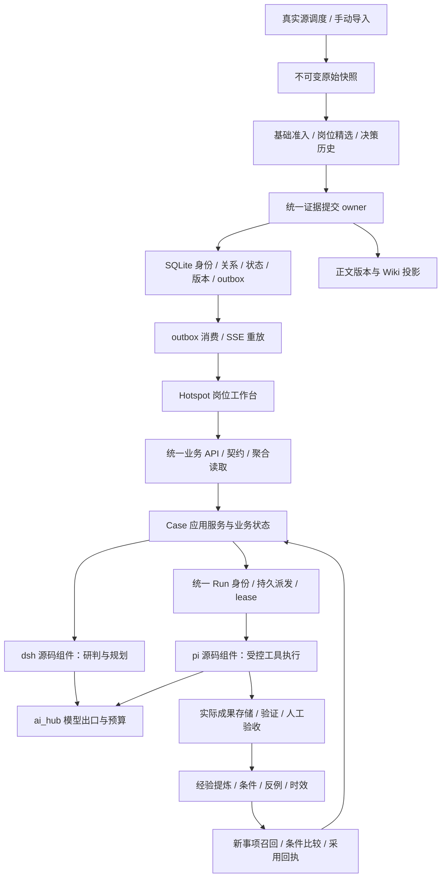

# Hotspot v1.0.0 重构收尾总方案

- 日期：2026-09-07。
- 状态：**待实施的开发与恢复方案；本文件不代表服务已恢复或 v1.0.0 已验收。**
- 基线：`bdac95f` 及当前工作区；依据 [深度审查](REVIEW_2026-09-07.md) R01-R20。
- 配套：[开发任务书](V1.0.0_CLOSEOUT_TASKS.md)、[UI/UX 与业务交互规范](V1.0.0_UI_UX_SPEC.md)。
- 目标：恢复现有数据的可靠访问，完成可信采集、证据判断、受控执行、成果验收、经验采用的 B/S 闭环，再满足原 PRD 发布标准。

## 1. 当前故障：已确认与待确认

### 1.1 本次只读实测

2026-09-07 约 10:00，本机检查结果如下。数据统计为该时点快照，实施前应重新采样，不硬编码为永久验收值。

| 层面 | 证据 | 结论 |
|---|---|---|
| 前端 | 8898 有 Vite 监听，GET `/` 返回 200 | 静态页面服务存在，不代表业务正常 |
| 后端 | 8000 无监听，GET `/api/health` 连接失败，HTTP code=000 | 后端服务不可达 |
| 前端代理 | GET `8898/api/health` 返回 500；vite.config.ts 指向 8000 | 浏览器 API 请求无法取得后端数据 |
| 启动日志 | 09:48:02，migration `099_v10_worker_f01_legacy_hold` 失败 | 具体错误为 `error in view unified_search: no such table: main.knowledge_items` |
| HOT 库 | `backend/hotspot.db`：hotspots=7,223；schema_version 最新 098 | 历史资讯仍在，数据库尚未完成 v1 迁移 |
| WARM 库 | `backend/hotspot-warm.db`：knowledge_items=3,800 | 历史知识仍在 WARM；不是所有数据都消失 |
| 新业务表 | v1_subjects/materials/signals/cases 均 0 行；查询目录中尚无后续 judgment/action/run/artifact/knowledge 表 | 新链空数据与后续 schema 未完成同时存在，不能仅修前端请求 |
| 历史任务 | skill_runs=58，trigger_tickets=53 | 这是总行数，不等于全为 pending，更不等于可以自动重放 |
| 开发副本 | dev_data/db/hotspot.db：hotspots=0、knowledge_items=0 | 误用开发库也会出现真空数据，不能用 seed 掩盖连接错误 |

已核对持久 `unified_search` 视图 SQL：它 UNION 了 `hotspots` 与未限定 schema 的 `knowledge_items`；后者实际在 WARM。migration 099 的 `ALTER TABLE trigger_tickets RENAME ...` 触发 SQLite schema 解析，撞上悬空视图。后端在 lifespan 的 init_db 阶段退出，尚未启动 API/调度。

因此本次明确的故障链为：

```text
旧分库后遗留的无效搜索视图
  → migration 099 执行失败
  → 后端启动中断
  → Vite 代理 API 返回 500
  → 页面取数失败，又被部分组件显示为空列表
```

即使修好启动，新 v1 表仍为空，且审查中的采集/执行断点仍存在，所以“重启一下”不能完成收尾。

### 1.2 补充问题编号

| 新编号 | 问题 | 优先处理 |
|---|---|---|
| R21 | 真实旧库的悬空视图导致 migration 099 阻断启动，空库测试未覆盖分库历史 | C01/C02 |
| R22 | dev_environment.sh 前端启动使用不存在的 `.venv/bin/../npm`；声称代理 8766，但 Vite 实际固定 8000 | C03 |
| R23 | `/workbench`、`/intel`、`/cases`、`/knowledge` 都挂同一原型，内部 tab 默认 workbench；`/knowledge` 重复声明 | C09 |
| R24 | 默认 `/` 仍为旧 Sentinel 独立壳；新导航、旧壳、原型 tabs 与旧知识路由并存 | C09/C10 |

待确认：其他最近启动是否也有不同异常；其余历史视图/触发器是否悬空；WARM/COLD 的实际迁移归属；资料正文在 Wiki/旧数据库中的覆盖；53 条历史票据按状态/目标/授权的具体分类。本次未读取业务正文、凭据或执行真实写入。

不要把 `_check_skill_run_version_compatibility` 的 strict 模式当成本次已证实原因。日志显示失败发生在更早的 init_db；跳过版本检查不能修好 R21。

## 2. 收尾的两个交付层级

### L1 服务恢复

用户能打开现有资讯、知识与旧工作入口；前后端数据环境一致；故障有明确状态；重启不再次迁移失败。尚未接好的 AI 功能显示依赖未就绪或暂停执行，不冒充成功。

恢复门槛：后端与代理业务读取成功；历史数据与启动前清单对账；随机抽样原文可读；错误状态可见；无隐式 mock/noop；历史票据不自动重放。**L1 通过仍不是 v1.0 发布。**

### L2 v1.0 业务闭环与发布

一个真实来源产生可追溯资料，进入价值准入与事项；dsh 依据资料/关注对象生成可审阅判断；pi 在批准的 scope 内运行工具并保存成果；用户验收后提炼经验；第二个事项通过条件比较采用该经验，记录效果与失效反馈。

发布门槛：原 PRD AC-01..12、E2E-01..12、已约定 NFR 与 G1-G5 全部有证据。7 天采集观测、200 条资讯标注、30 个事项、20 个复用案例沿用原标准；任何调整都另行记录范围裁决，不能静默降低。

## 3. 服务恢复路线：先保数据，再修启动

### 步骤 1：建立只读事实清单

记录进程/端口、代码 revision、Python/Node、脱敏配置、HOT/WARM/COLD/Wiki 的绝对路径、schema_version、表/视图/触发器定义、关键表行数及文件清单。记录配置来自默认值、环境变量还是 settings，不能输出 API key。

新增 `check_workstation_runtime.py` 的目标行为是只检查、不建表、不修复、不启动 scheduler。后端即使起不来，也能导出可诊断状态。首次实现以前，本次 lsof/curl/SQLite 只读查询可作为人工基线。

### 步骤 2：生成可验证的备份和开发恢复副本

修复 R12 后再使用备份工具：每个 SQLite 都通过 backup API 获取包含已提交 WAL 的一致快照；正式切换时暂停所有已登记 writer，记录共同逻辑水位，再归档正文/产物/Wiki 版本及清单。单库 backup 不自动保证三库与文件的共同一致性。

验证库文件 integrity/FK、表数、关键业务行数、原文 hash、产物引用、知识版本，再恢复到独立目录读回。禁止把普通 `.db` 文件复制或旧的 integrity=ok 作为充分备份证据。

### 步骤 3：在真实旧库的脱敏结构副本修复迁移入口

修复点位于 migration 099 之前。**只新增编号 106 的 SQL 不够，因为迁移会先在 099 中断。**

推荐在迁移 runner 外建立有限的 preflight/repair 注册表，并提供独立维护命令：

1. 保存无效视图原定义、实际依赖与调用者；检查所有持久视图的可解析性。
2. 为 `search_service` 改为显式 `main.hotspots` 与 `warm.knowledge_items` 查询及统一返回格式，保持旧搜索语义。跨库读取由服务管理；不在持久视图里直接写跨 ATTACH 引用。
3. 仅在旧搜索兼容替代通过后，在维护事务中移除/替换已识别的悬空视图。TEMP 跨库视图可作为连接内兼容工具，但必须在每个连接 ATTACH 后建立，不能当全局持久 schema。
4. 检查 trigger_tickets 与 trigger_tickets_old 的真实状态。当前只读目录未见 `_old`，仍须针对其他部署验证四种组合：旧表未改、仅旧副本、两表共存、迁移完成。
5. 对 099 的 rename/create/copy/drop 各阶段提供幂等与回执；按 ticket_id 对账，任何未知表状态停止修复，不能猜测删除。
6. 审核后续 100..105 的表归属及前置依赖，明确哪些在 HOT、哪些在 WARM。特别审查 105 的 knowledge_items ADD COLUMN，不依赖未限定表名的偶然解析。
7. 改迁移 runner 的“duplicate column 就把整个文件视为完成”逻辑，逐个验证后置条件。它不能保证文件剩余 SQL 已执行。

SQLite 支持事务性 DDL，但 Python executescript 与事务前置提交、PRAGMA foreign_keys 有特定语义。选择一种显式事务控制方式并用当前 SQLite/Python 验证；不能在 connection 上先 BEGIN，再假定 executescript 不改变边界。失败必须留下可识别状态，成功版本记录和实际 schema 对齐。

禁止采用：新建空 main.knowledge_items 骗过视图、修改 schema_version 假装 099 成功、删除整库、关闭所有约束、设置 writable_schema 掩盖错误、重复运行未经修复的迁移碰运气。

### 步骤 4：先恢复读取，限制不可靠后台写入

增加明确 maintenance/read_only/normal 运行模式，分别控制 API 写入、scheduler、票据消费、模型和外部工具。该能力目前不是已有配置，必须实现并做矩阵测试；`CATCHUP_ON_STARTUP=0` 只控制追抓，不是全局禁止后台任务。

未修复的 v1 worker 不得在恢复启动后自动把 53 条历史票据“消化成功”。历史任务逐类展示为需要确认的遗留任务，保留原身份、输入、版本和日志；新执行 gate 与读取历史记录分开。

对非关键 dsh/pi 未就绪，只阻断相关新任务，不应让全部历史读取不可用。schema 错误时只允许独立诊断/维护入口，不伪造业务 readiness。

### 步骤 5：修复前后端统一启动与代理

以现有 `scripts/service/service.sh` 为主入口，修复和复用已有脚本，不再添加第三套启动器。

- 本地运行：默认后端 8000、前端 8898；开发副本可用 8766/8899。端口可以配置，但 frontend proxy 必须读取同一 backend origin。
- Vite 使用明确 `VITE_API_PROXY_TARGET` 或等价 server 配置；当前 HOTSPOT_PORT 不会自动改变写死的 Vite target。
- 修正 dev 前端 npm 路径，验证 cwd/依赖后启动；记录所属 PID、启动时间、项目根，stop 不只凭端口杀未知进程。
- 进程存在和 HTTP 200 之外，还要验证环境 ID、schema、读取就绪与核心数据链。前端根页面 200 不能作为全系统 ready。
- 重启顺序：暂停新任务、有限 drain、停止 owned worker/API、应用已验证迁移、启动 API、验证读取、启动 frontend、恢复经过验证的任务类型。
- 使用单 writer/单 scheduler 的初始部署拓扑，避免多个 worker 各启动一套 scheduler。

### 步骤 6：恢复旧数据的可见性

在完整保真迁移前，提供显式 legacy read adapter：历史资讯进入情报页的“历史资料”，旧知识进入知识页的“待校验历史资料”。保持实际来源、时间、状态和原文链接，不能统一升级为可信精选/已验证经验。

新 v1 中没有 Case 是合法业务空状态，应提供创建事项动作；历史资讯多不意味着必须自动制造数千个 Case。数据诊断页同时展示 legacy/v1 数量、迁移水位、待校验数和失败原因，帮助用户区分“未迁移”“未生成”和“接口故障”。

## 4. 目标技术架构与职责



| Owner | 负责 | 不应承担 |
|---|---|---|
| Hotspot 控制面 | 业务身份、状态、权限、预算、审计、任务调度和页面 | 根据自由文本猜测成功 |
| dsh | 结合证据包与关注对象研判、补证计划和行动建议 | 越过业务批准直接执行生产动作 |
| pi | 按已批准计划执行允许工具，回传步骤、错误、成果 | 自行宣告业务验收通过 |
| ai_hub | 模型路由、弹性、费用/配额、工具消息协议 | 再创建一套业务 Run 状态 |
| Evidence owner | 原文/版本/hash/身份/回执/投影恢复 | 仅写回执、不保存正文 |
| Knowledge owner | 来源、采用、条件、失效与历史版本 | 将来源边数冒充实际复用 |
| API 契约 | 参数、响应、允许动作、错误、环境身份 | 返回 200+空数组掩盖数据库故障 |

保存现有 React/FastAPI/SQLite/Wiki 栈。暂不引入微服务、Redis、专用向量库作为收尾前提；先用现有 SQLite FTS/索引和受控检索建立可解释复用。在确有吞吐/召回瓶颈后再有证据地扩展。

### 4.1 事实与存储边界

用 ADR 明确：SQLite 是业务身份、关系、运行状态、版本元数据的事实源；原始材料与产物正文不可变保存，DB 引用实际路径和 hash。知识的权威正文版本在既有 Wiki/正文存储中按版本保存，DB 保存对应 revision 和验证记录；派生索引、摘要、图谱可重建，不能代替原文。

每次写入必须具有 submission_id、内容版本、来源和回执。正文先写临时文件并校验，在确定性提交协议中记录状态；DB 与文件不是单一事务，使用持久 intent/outbox 与恢复器闭合崩溃窗口。未完成权威正文写入的内容不能 published/accepted。原子 rename 只解决单文件替换，不自动解决跨库/文件一致性。

对现有三库按实体 ownership 固定位置。不要为了方便在 HOT 再建同名旧表；历史迁移采用显式 schema 和稳定映射。

### 4.2 一份 Run 业务身份

保留旧表作兼容历史，但统一 `Run ID` 贯穿 ticket、Skill、Action、runtime session、tool receipt、Artifact、audit。worker_runs 可成为调度事件/attempt 记录，skill_runs 可作为兼容读投影；不能各自写互不相认的 succeeded。

状态最少区分 queued/running/succeeded/failed/cancelled/timed_out/blocked，另记录 lease/attempt；生产成功必须校验该任务要求的完成凭据。业务验收独立于运行完成。Action.start 的状态转移、Run 创建和派发意图在同一业务事务中完成。

## 5. 收录稳定与价值门槛

### 5.1 采集流水线

`source due → 原子 lease → 条件抓取 → 原始快照 → 解析 → 基础准入 → 去重/版本识别 → 岗位精选 → 正式证据提交 → 事件聚合 → 原子游标/重放水位 → outbox`。

基础门槛检查可追溯、成功解析、类型化完整性、重复、版本和证据来源。岗位精选检查与关注对象关系、证据强弱、新增信息、时效与可行动性。短官方公告不按长文章字数规则过滤。

抓取失败、解析失败、零更新、准入拒绝、已提交分别统计；合法 304 计健康无更新；200 错误页不能计有效获取。过滤故障仍保存原始快照，但不进入可信流。对高影响未证实事项开独立待核实通道。

### 5.2 稳定性机制

域级限速、429 Retry-After、有界指数退避、单源熔断/恢复、解析版本、连续提交水位、确定性幂等键、失败重放清单、重启追抓和过期 lease 恢复一起验证。游标不前移到未持久化内容之后；禁止用 attempt 改变内容身份。

关键源首期按原 PRD 15..30 个代表性来源验证，7 天窗口覆盖停机和异常。成功率分母是窗口内应尝试的到期任务，不能把没有实际尝试的失败源悄悄排除；用户暂停单独列出。

### 5.3 精选效果与知识门槛

版本化规则和人工标注集，保留历史决策与重新评估能力。按时间切分调参与验收集，报告误收、漏收及各类型分母；采集成功率和精选有效率分开。

经验发布还需已验证来源成果、适用条件、例外、复查时间及证据 revision。新知识复用次数从 0 开始；来源链 derived_from 和采用链 adopted_by 独立统计。

## 6. 业务流与 UI/UX 联动

详见 [UI/UX 规范](V1.0.0_UI_UX_SPEC.md)。所有页面围绕业务对象，不把 dsh/pi 进程或 SK 编号作为主导航。

主导航只保留“今日工作、情报、事项、知识”；辅助导航是“关注对象、信源、能力、运行、系统”。Case 是跨层上下文锚点，详情包含证据、判断、行动、成果、复盘；允许任务内补充说明，但首页不是通用 Chatbox。

| 业务环节 | 用户要完成什么 | 页面操作 | 后端必须真实完成 |
|---|---|---|---|
| 配置岗位 | 导入资产/产品或设置研究关注 | 关注对象导入预览、错误行处理、版本确认 | Subject 身份、别名、snapshot revision |
| 获取资料 | 看重要变化、查看原文可信度 | 情报精选/待核实/历史资料；加入事项 | Material 版本、准入决定、Signal 合并 |
| 组织工作 | 确定问题、范围与完成条件 | 创建 Case 或追加旧 Case | 保存模板、对象快照、目标与 revision |
| 判断 | 审阅事实、推断与引用 | 生成研判、定位原文、补证、修订、接受 | dsh 真实调用、引用验证、作者版本 |
| 行动 | 明确计划和授权 | 查看 plan diff、批准、运行/取消 | plan_hash/scope/工具/预算绑定；pi 执行 |
| 验收 | 打开成果并确认是否满足目标 | 文件预览、验证报告、接受/退回 | 持久化与 hash 读回、真 CAS、验收依据 |
| 复利 | 将已验证方法用于新事项 | 提炼经验、条件对比、采用/不采用 | 新 Case adoption receipt、效果及失效传播 |

原型 tabs 改为真实路由页面，不只修改默认 tab。统一壳和 URL，处理 `/knowledge` 重复路由；深链接、刷新、返回及筛选共享必须一致。旧路径通过兼容映射保留可读能力，未迁完不能直接重定向丢失对象 ID。

## 7. 前后端一致性契约

以下是拟新增或扩展的接口能力，实施时复用现有同职责端点，不创建平行同名 API。具体路径在任务开始时由现有路由盘点确定并冻结 OpenAPI。

| 契约 | 必需信息 |
|---|---|
| readiness / system snapshot | app build、schema 版本/迁移状态、environment_id、read/write/execution 能力、组件依赖、数据新鲜度 |
| 列表响应 | items、total 或 cursor、as_of、data_status、必要的 legacy/v1 来源信息；数据库异常返回错误而非 [] |
| 业务对象 | id、revision、status、allowed_actions、blockers、相关对象版本；状态显示来自后端 |
| mutation | 需要并发保护时 expected_revision；可重试创建使用 idempotency_key；输入 hash 与批准版本绑定 |
| 统一错误 | code、用户可读 message、retryable、trace_id、必要的 current_revision；不回传凭据或堆栈 |
| Case 聚合 | 一次读回概览、待办、关联摘要/分页游标、成果状态；避免串行 N+1 |
| 事件 | event_id、entity_type/id、revision、occurred_at、trace_id、kind；从事务 outbox 产生 |

TypeScript 客户端从实际 HTTP schema 生成；运行中的响应必须经 Pydantic/等价结构校验。保留 mock 只在测试注入，真实页面不回退 mock。

SSE 断线通过 Last-Event-ID/重放水位续订；事件保留期外要求一次受控全量刷新。按对象 revision 丢弃旧事件，同一 tab 不跳页，mutation 成功后立即更新/失效对应缓存，即使 SSE 暂断也能看见自己的变更。

单用户部署同样要处理两个浏览器窗口及多线程并发。授权/验收/发布不采用未经服务确认的乐观终态，409 显示差异并保留用户输入。

## 8. 迁移、兼容与回退

### 8.1 两种迁移分开

schema 修复解决“服务能启动”；业务数据迁移解决“新工作台有正确数据”。不能将 schema_version 到最新等同于旧知识/能力已迁移。

旧资料保留身份、正文和来源；新资料规则通过后才能进入正式可信池。旧 knowledge_items 缺正文时查找既有 Wiki/正文归档，找不到进入 incomplete 并可读元数据，不允许拼标签后发布。

维护 `legacy_source + legacy_id + legacy_revision -> new_id + new_revision` 映射，逐批游标与事务，保留来源 hash、迁移批次、映射决策、错误重试。记录总候选=成功+已映射+明确隔离+失败，NULL lifecycle 与 >4000 行都覆盖；禁止按仅标签 hash 合并不同条目。

### 8.2 兼容退出条件

旧路径/Skill 每项都有 successor、读写状态、历史回放入口和替代验收。新的六个 Skill 通过实际 runner 运行后才允许撤销旧自动触发；未映射的能力标保留，不以统一 deprecated 掩盖功能丢失。

### 8.3 回退边界

部署回退优先回退应用/路由切换，并保留数据库增量和新产生正文。新增数据不兼容旧应用时进入维护只读，导出增量并向前修复；恢复旧备份会抹除切换后的新工作，不是普通回退路径。

灾难恢复仅在已保存当前故障现场/新增数据、明确恢复点及丢失窗口后进行。演练必须先产生 v1 新 Case/Artifact/Knowledge，再模拟应用回退，确认它们仍可读取。

## 9. 收尾批次与依赖

任务定义见 [开发任务书](V1.0.0_CLOSEOUT_TASKS.md)。R21 启动阻断优先于原 B1-B7；批次通过后才更新对应 verified。

| 顺序 | 任务 | 对应审查 | 结束条件 |
|---|---|---|---|
| 1 | C01 诊断、备份与隔离 | R10/R12/R21 | 数据清单、含 WAL 备份、可读恢复副本 |
| 2 | C02 迁移修复与旧搜索兼容 | R11/R21 | 分库旧库升级成功，连续重启不变形，搜索可用 |
| 3 | C03 统一启动与健康分级 | R04/R20/R22 | API/代理/环境一致；未就绪任务不能执行 |
| 4 | C04 前端取数纠错与历史读取 | R13/R14/R19 | 旧数据可见，空/错分开；达到 L1 |
| 5 | C05 证据、真实采集与准入 | R01-R03/R15 | 一个真实源到看板，启动 7 天观测 |
| 6 | C06 dsh/pi 源码与模型边界 | R06/R07 | 实际 SDK 工具往返 trace |
| 7 | C07 统一 Run 与受控执行 | R04/R05/R15 | Skill API 到工具与成果闭环，启停/恢复正确 |
| 8 | C08 成果验收与可靠发布 | R08-R10/R17 | 可读成果、真 CAS、正常完成事项 |
| 9 | C09 路由与工作台壳 | R14/R23/R24 | 一个壳、唯一页面、深链/返回可用 |
| 10 | C10 岗位操作流与六能力 UI | R14/R15 | 浏览器完成首次真实事项，不靠脚本 |
| 11 | C11 SSE/契约/效率 | R18/R19 | 同页刷新、重连、冲突恢复、聚合性能通过 |
| 12 | C12 知识采用与失效复查 | R16 | 第二个真实事项复用、差异与失效处理 |
| 13 | C13 全量业务迁移与兼容回退 | R11/R20 | 逐条对账、无样本污染、切换新增数据保全 |
| 14 | C14 全量验收与交接 | R20及全部 | L2/G1-G5 全通过，版本及维护材料对齐 |

可提前做 C09 的组件拆分/路由测试，但不能在后端契约未确定时制作大量展示态页面。C11 的契约/outbox 设计在 C05/C07 开始时就冻结，最后一批做跨层验收，避免末尾才发现不兼容。

排期按实测依赖而非许诺天数：L1 优先单独交付；L2 在真实上游协议、正文迁移和历史 schema 完成 spike 后再估算。7 天来源观测有实际时间下限，不能一天跑脚本替代。

## 10. 完整验收矩阵

| 编号 | 场景 | 通过标准 |
|---|---|---|
| A01 | 当前真实分库 schema 升级 | 099..后续迁移成功，旧搜索/资料可读，行数和映射对账 |
| A02 | 每阶段迁移中断后重启 | 不重复复制、不丢表、不假记版本；错误有可执行诊断 |
| A03 | 8000 停止、代理错误、接错开发库 | 页面显示不可用/环境不符，不显示“0 条”；保留旧缓存时间 |
| A04 | 空库首次使用 | 明确初始空状态，可导入真实来源/创建关注对象，不装填 demo 数据 |
| A05 | 304/429/200错误页/解析异常/写失败 | 健康与准入计数正确，不前移未提交水位，不污染可信流 |
| A06 | 十篇转载及官方补丁更新 | 合成事件保留独立来源，新受影响版本不被去重丢失 |
| A07 | dsh/pi 真实工具往返 | 引用、工具请求、批准scope、结果回注、真实产物与终态均可追踪 |
| A08 | 未配置模型、停用 Skill、失效批准 | 新任务 blocked/拒绝，有原因；历史读取可用，无 mock 成功 |
| A09 | 超时、取消、进程崩溃、重试、双提交 | 一份 Run 身份，副作用有幂等/人工确认策略，lease 可恢复 |
| A10 | 缺产物、hash错、并发验收/退回 | 不能误验收；旧 revision 无法覆盖新状态；成果可下载 |
| A11 | Case 真实完成 | 条件满足可关闭；仍在运行或必要成果未验收不可误关 |
| A12 | Wiki 写失败、rename 前后崩溃 | 状态可恢复，权威正文未保存不发布，引用路径读回一致 |
| A13 | 第二事项复用不同资产版本 | 召回条件差异可见；来源不算采用；采纳记录含知识版本 |
| A14 | 知识撤回/过期/反证 | 活跃关联事项收到复查，不改写历史判断；高置信使用被阻断 |
| A15 | 迁移同元数据不同正文、NULL、>4000条 | 身份不合并，正文保留，分页覆盖，对账总量闭合 |
| A16 | WAL 数据与切换后新增数据恢复 | 恢复副本有已提交行，旧应用回退不丢 v1 新资料 |
| A17 | 刷新四入口/深链/返回/多窗口 | URL、选中对象、筛选和数据一致；无重复壳和错误落页 |
| A18 | SSE重复/错序/断连、同tab更新 | 按 revision 收敛，不强制跳页，无消息丢失后的永久陈旧 |
| A19 | 1440/1280/768/390 宽度 | 无溢出遮挡，操作可达，键盘焦点/表单校验/错误恢复可用 |
| A20 | 原 NFR 负载和长期窗口 | 达到 PRD 定义的机器/规模/并发/时延、源 SLO 与效果样本要求 |

所有核心变更执行仓库要求：generate_meta --check、完整 backend pytest、Ruff、依赖审计、启动 smoke、feature gates 矩阵；前端执行 tsc、Vitest、Vite build、Playwright。先修测试 Wiki/cwd 隔离，所有业务测试使用独立数据根，禁止测试代码放开生产写入防护。

验收证据必须写运行 revision、命令、环境/数据范围、实际结果、日志/trace/截图、未覆盖项。Mock 合约测试与真实 runtime/浏览器测试分别报告；“测试存在”不算“测试通过”。

## 11. 第一性原理与二次审查

| 设计问题 | 裁决 |
|---|---|
| 为什么先恢复旧读取？ | 已有知识是用户资产，重构必须连续提供价值；新库空不能成为隐藏历史数据的理由 |
| 为什么不先改配色？ | 当前无法完成操作的主因是服务、契约和数据状态，视觉升级必须绑定真实业务动作 |
| 为什么不把所有数据直接搬成 knowledge？ | 资讯、判断、已验证经验的可信门槛不同，直接升级会污染后续判断 |
| 为什么不靠更多 agent 修一切？ | 当前失败来自 ownership 和接口没有闭合；增加执行者不修契约会增加不一致 |
| 为什么保留 dsh/pi？ | 用户目标明确；需要真实源码适配证据，不能默默改为 mock 或纯 ai_hub 文本生成 |
| 为什么恢复服务不等于发布？ | 读取成功没有证明真实行动和第二次工作复用，需要独立 L1/L2 门槛 |

六帽复核：白帽用端口、日志、数据库快照确认故障；红帽优先消除“数据没了”的不确定体验；黑帽防止假成功与迁移伤害；黄帽保留成熟 collectors/存储/模型出口；绿帽用 Case 证据包和采用回执连接现有模块；蓝帽按 C01-C14 逐项验收，只有结果满足原目标才关任务。

本方案不承诺未经执行的“确保正常”。它将正常运行定义为可测量的 L1/L2 状态，并规定失败时如何保留数据、显示真实状态和恢复工作。当前服务恢复状态仍待 C01-C04 实施与验证。
